# PhenomateDrivers: C++ driver architecture

| | |
|---|---|
| Scope | C++ acquisition side of PhenomateDrivers: `main.cpp`, the build (`CMakeLists.txt`, `cmake/`), `common/` (targets `phenomate_common`, `phenomate_ebus`), `asterx_driver/`, `ebus_driver/`, `gox_driver/`, `fx10_driver/`, `lms4xxx_driver/` with their device tools (`jai_snapshot`, `fx10_snapshot`, `fx10_reference`, `ebus_discover`, `ebus_set_ip`), `config/` and the driver YAML templates. `.devcontainer/` and `start.bash` appear as deployment context only. The web GUI (`app/`) is an external actor here; its internals are described in [architecture-gui.md](architecture-gui.md). |
| Date | 2026-11-26 |
| Status | Derived from the source tree by static reading; not verified on hardware or by a build. |
| Notation | C4 model (levels 1 to 3) and UML views (class, sequence, state), drawn with Mermaid. Each diagram is followed by an element catalogue. `Source` entries are `path` or `path:line` relative to the repository root and refer to the files as read on the date above. Shapes carry meaning only where a diagram says so. |
| Related | [README](../README.md) · [eBUS runtime and RAW format](../ebus_driver/README.md) · device documents for [AsteRx](../asterx_driver/docs/DEVICE_CONFIG.md), [Go-X](../gox_driver/docs/DEVICE_CONFIG.md), [FX10](../fx10_driver/docs/DEVICE_CONFIG.md), [LMS4xxx](../lms4xxx_driver/docs/DEVICE_CONFIG.md) |

## Contents

1. [Introduction and quality goals](#1-introduction-and-quality-goals)
2. [Constraints](#2-constraints)
3. [System context (C4 level 1)](#3-system-context-c4-level-1)
4. [Containers (C4 level 2)](#4-containers-c4-level-2)
5. [Components (C4 level 3)](#5-components-c4-level-3)
6. [Runtime views](#6-runtime-views)
7. [Concurrency view](#7-concurrency-view)
8. [State machines](#8-state-machines)
9. [Data view](#9-data-view)
10. [Failure handling](#10-failure-handling)
11. [Deployment view](#11-deployment-view)
12. [Crosscutting concepts](#12-crosscutting-concepts)
13. [Decisions, risks and glossary](#13-decisions-risks-and-glossary)

## 1. Introduction and quality goals

PhenomateDrivers is one Linux process, `PhenomateDrivers` (`main.cpp`), that records the output of
a Septentrio AsteRx GNSS/INS receiver, JAI Go-X cameras, a Specim FX10e line-scan camera and SICK
LMS4xxx LiDARs in one session. A session coordinator (`common::RunSession`) initializes the enabled
drivers in sequence, runs them concurrently, stops all of them on the first termination and writes
a run manifest, `raw/drivers.json`. Device tools for discovery, re-addressing, snapshots, focus
assist and FX10 references reuse the same libraries. Decoding and export belong to the separate
project PhenomateDecoders.

This document describes the structure of that code. Device protocols and configuration sequences
are specified in the device documents, the `ebus-raw` format in
[`ebus_driver/README.md`](../ebus_driver/README.md), and the operator workflow in the
[README](../README.md); they are linked, not repeated.

### 1.1 Quality goals

The goals below are those the code enforces; the right-hand columns name the mechanism.

| ID | Goal | Mechanism | Source |
|---|---|---|---|
| Q1 | Record native device output unchanged, at a stated level | AsteRx: every SBF block the SDK delivers is enqueued unchanged. Cameras: the `GetAcquiredSize()` bytes of each SDK buffer are copied before requeue. LMS4xxx: complete CoLa B telegrams, checksum byte included, are written to BIN files. | `asterx_driver/src/session.cpp:426-447`, `ebus_driver/src/camera_driver.cpp:661-665`, `lms4xxx_driver/src/raw_recorder.cpp:141-167` |
| Q2 | The first data loss fails the run | Bounded queues refuse instead of blocking or dropping silently; each refusal latches a driver failure; one terminated driver stops the rig. | `asterx_driver/src/sbf_write_queue.cpp:51-69`, `ebus_driver/src/camera_driver.cpp:652-675`, `lms4xxx_driver/include/recording_status.h:13-21`, `common/src/session_runner.cpp:241-251` |
| Q3 | An explicit, persisted result for every run | `drivers.json` is replaced atomically on each lifecycle transition and finalized with a status and exit code on every path after it exists. | `common/src/drivers_json.cpp:29-72`, `common/src/session_runner.cpp:345-371` |
| Q4 | Device time recorded; host time diagnostic only | Device timestamps are stored raw (`device_timestamp_raw`, LMS `device_time_unix_us`, SBF blocks); host clocks are labelled reception or operational times; the manifest declares that no cross-sensor association is established. | `ebus_driver/src/camera_driver.cpp:611-622`, `lms4xxx_driver/src/driver_stream.cpp:441-446`, `common/src/drivers_json.cpp:97-104` |
| Q5 | Acquisition threads never wait for disk or for a log reader | Socket and SDK readers only enqueue; a separate thread writes; a non-TTY console sink drops lines instead of blocking. | `asterx_driver/include/sbf_write_queue.h:18-30`, `ebus_driver/src/camera_driver.cpp:524-526`, `common/include/nonblocking_stderr_sink.h:25-57` |
| Q6 | Ordered, draining shutdown | All terminate flags are set, all Run threads are joined, then every driver shuts down in reverse order, including partially initialized ones; accepted data is drained before files close. | `common/src/session_runner.cpp:29-68` |
| Q7 | Traceable configuration | Every configuration in use is copied into `raw/config/`; cameras write `device.json` with readbacks; the build revision is recorded. | `main.cpp:113-125`, `ebus_driver/src/camera_driver.cpp:350-392`, `CMakeLists.txt:36-39` |

Not goals, as evidenced by the code: no reconnect after the recording has started (AsteRx reconnects
only during warm-up, `asterx_driver/src/session.cpp:519-527`); no online conversion, debayering or
point-cloud generation; no establishment of cross-sensor time association
(`common/src/drivers_json.cpp:97-104`).

## 2. Constraints

| Constraint | Value | Source |
|---|---|---|
| Language | C++20, `CMAKE_CXX_EXTENSIONS OFF` | `CMakeLists.txt:11-13` |
| Build system | CMake ≥ 3.18; policies CMP0167 and CMP0169 set to OLD; default build type Release | `CMakeLists.txt:1`, `:16-30` |
| Build identity | `PROJECT_VERSION` 0.1.0 and `PHENOMATE_BUILD_REVISION` (default `unknown`, restricted character set); configure does not query Git | `CMakeLists.txt:2-3`, `:36-39`, `:79-82` |
| Container OS and toolchain | Ubuntu 22.04 image, APT `build-essential`, `cmake`, `ninja-build`; non-root user `dev`. The README states GCC 11.4 and CMake 3.22 (not verified here) | `.devcontainer/Dockerfile:1`, `:12-17`, `:96-113`; [README](../README.md#build-and-test) |
| eBUS SDK | Pleora 6.5.1-6797 `.deb` from `resource/`, SHA-256 checked, installed under `/opt/pleora/ebus_sdk/Ubuntu-22.04-x86_64`; required libraries `PvBase PvDevice PvStream PvBuffer PvGenICam PvSystem PvPersistence`; RPATH set on consumers | `.devcontainer/Dockerfile:63-72`, `cmake/FindeBUS.cmake:6-10`, `:99`, `:134-139` |
| Qt | Qt5 ≥ 5.12 `Core Network SerialPort`, for the vendored SsnRx SDK (AUTOMOC) | `asterx_driver/CMakeLists.txt:9-32` |
| Boost | System Boost, header-only Asio | `lms4xxx_driver/CMakeLists.txt:9`, `:47-51` |
| OpenSSL | `libcrypto`, SHA-256 of FX10 `.pvcfg` files | `fx10_driver/CMakeLists.txt:3-7` |
| spdlog | v1.17.0, FetchContent into `3rd_party/FetchContent/spdlog` | `cmake/Dependencies.cmake:26-33` |
| yaml-cpp | 0.9.0, FetchContent | `cmake/Dependencies.cmake:39-46` |
| nlohmann/json | v3.12.0, FetchContent | `cmake/Dependencies.cmake:51-58` |
| SensorSync host client | `qiweishen/sensor_trigger`, branch `main`, unpinned; only `session_client.cpp` is compiled, by inclusion into `sensor_sync_log.cpp` | `cmake/Dependencies.cmake:14-21`, `common/CMakeLists.txt:28-33`, `common/src/sensor_sync_log.cpp:9` |
| doctest | Vendored under `3rd_party/doctest` | `common/tests/CMakeLists.txt:24` |
| Threads, Python | `Threads::Threads` required; Python 3 optional (registers `contract_check`) | `CMakeLists.txt:43`, `:57-60` |
| Binary location | All executables in `build/bin`; the repository root is resolved as `<exe dir>/../..` | `CMakeLists.txt:90-92`, `main.cpp:266`, `ebus_driver/src/fx10_config.cpp:91` |
| Host kernel | `net.core.rmem_max` must cover `socket_rx_buffer_mb`; set by `start.bash` on the edge computer | `start.bash:28`, `ebus_driver/src/camera_driver.cpp:202-252` |
| Privileges | `SCHED_FIFO` for LMS receive threads needs `CAP_SYS_NICE`; failure is a warning | `lms4xxx_driver/src/driver_stream.cpp:158-166` |

## 3. System context (C4 level 1)

Notation: stadium = person; double-bordered box = software in scope; cylinder = storage; dashed
edge = optional link, disabled in the shipped profiles.

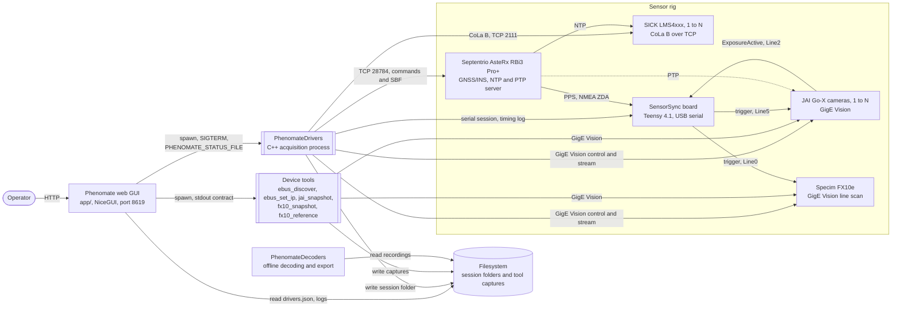

| Element | Responsibility | Source |
|---|---|---|
| Operator | Starts and stops recordings, edits configuration, runs camera tools through the GUI | [README](../README.md#web-gui) |
| Phenomate web GUI | External actor: launches `PhenomateDrivers` with `PHENOMATE_STATUS_FILE`, stops it with SIGTERM, reads `raw/drivers.json`, the session log and `[Statistics]` lines; launches the device tools | `app/services/runtime.py:53`; [architecture-gui.md](architecture-gui.md) |
| PhenomateDrivers | Multi-sensor recorder, one session per process run | `main.cpp:260-277` |
| Device tools | Single-purpose executables built from the same libraries | `common/CMakeLists.txt:87-98`, `gox_driver/CMakeLists.txt:19-22`, `fx10_driver/CMakeLists.txt:16-22` |
| Filesystem | Session folders under the configured `Output Directory`; tool captures in directories chosen by the GUI | `main.cpp:41-57` |
| PhenomateDecoders | External project that reads recordings offline | [README](../README.md) |
| AsteRx RBi3 Pro+ | GNSS/INS receiver; one TCP connection carries commands and SBF; configured as NTP and PTP server, PPS and NMEA ZDA output | `asterx_driver/include/app_config.h:14`, `asterx_driver/config/config-asterx.yaml:74-117` |
| Go-X cameras | GigE Vision cameras, triggered on `Line5`, `ExposureActive` on `Line2`; optional PTP slave (`ptp.enabled: false` shipped) | `gox_driver/config/config-gox.yaml:24-32`, `:64-67`; [Go-X](../gox_driver/docs/DEVICE_CONFIG.md#triggering-sensorsync) |
| FX10e | GigE Vision pushbroom camera, triggered on `Line0` | [FX10](../fx10_driver/docs/DEVICE_CONFIG.md#triggering-and-timing) |
| LMS4xxx | 2D LiDARs, CoLa B on TCP port 2111, NTP client | `lms4xxx_driver/include/app_config.h:18`, `lms4xxx_driver/config/config-lms4xxx.yaml:46-52` |
| SensorSync board | Trigger generator and timing logger; one session per run shared by all cameras | `common/include/sensor_sync_hub.h:34-125` |

| Interface | Peer | Transport and protocol | Code |
|---|---|---|---|
| AsteRx control and data | Receiver | TCP, ASCII commands and SBF on one connection, SsnRx SDK | `asterx_driver/src/session.cpp:184-205` |
| Camera control | Go-X, FX10 | GigE Vision control via `PvDeviceGEV::Connect` | `ebus_driver/src/camera_driver.cpp:416-417` |
| Camera stream | Go-X, FX10 | GVSP via `PvStreamGEV::Open` and `SetStreamDestination` | `ebus_driver/src/camera_driver.cpp:202-270` |
| LiDAR | LMS4xxx | CoLa B over TCP (Boost.Asio), one connection per device | `lms4xxx_driver/src/tcp_client.cpp:68-119` |
| Timing board | SensorSync | USB CDC serial, 115200 8N1 per the header comment | `common/include/sensor_sync_log.h:27-31` |
| Process control | GUI | Process spawn, SIGINT, SIGTERM or SIGHUP, exit code, `drivers.json` and its copy at `PHENOMATE_STATUS_FILE` | `main.cpp:263`, `common/src/drivers_json.cpp:77-79`, `:164-176` |

## 4. Containers (C4 level 2)

### 4.1 Runtime containers

Notation: double-bordered box = executable; plain box = library or file.

```mermaid
flowchart TB
    gui["Web GUI process<br/>python3 -m app.main"]
    subgraph exe ["Executables, build/bin"]
        pd[["PhenomateDrivers"]]
        disc[["ebus_discover"]]
        setip[["ebus_set_ip"]]
        jsnap[["jai_snapshot"]]
        fsnap[["fx10_snapshot"]]
        fref[["fx10_reference"]]
    end
    subgraph libs ["Static libraries"]
        commonlib["phenomate_common"]
        ebuslib["phenomate_ebus"]
        asterxlib["asterx_lib and ssnrx"]
        camlib["ebus_camera, ebus_raw,<br/>gox and fx10 device config"]
        lmslib["lms4xxx_lib"]
    end
    subgraph cfg ["Configuration"]
        maincfg["config/config-main.yaml"]
        drvcfg["Driver YAML templates<br/>asterx, gox, fx10, lms4xxx"]
        snapcfg["Snapshot profiles<br/>config-gox-snapshot, config-fx10-snapshot"]
        pvcfg["FX10 .pvcfg and checksums.txt<br/>fx10_driver/resource/ebus_config"]
    end
    subgraph sess ["Session folder, Output Directory/TS/raw"]
        logf["log_TS.log"]
        manifest["drivers.json"]
        copies["config/ copies"]
        trig["sensor_trigger.log"]
        data["asterx/, gox/, fx10/, lms4xxx/"]
    end
    status["PHENOMATE_STATUS_FILE<br/>acquisition.json"]
    toolout["Tool output directories"]
    gui -->|"spawn"| pd
    gui -->|"spawn"| disc
    gui -->|"spawn"| setip
    gui -->|"spawn"| jsnap
    gui -->|"spawn"| fsnap
    gui -->|"spawn"| fref
    pd -->|"links"| commonlib
    pd -->|"links"| asterxlib
    pd -->|"links"| camlib
    pd -->|"links"| lmslib
    camlib -->|"links"| ebuslib
    disc -->|"links"| ebuslib
    setip -->|"links"| ebuslib
    jsnap -->|"links"| camlib
    fsnap -->|"links"| camlib
    fref -->|"links"| camlib
    pd -->|"reads"| maincfg
    pd -->|"reads, copies"| drvcfg
    pd -->|"FX10 restore"| pvcfg
    jsnap -->|"reads"| snapcfg
    fsnap -->|"reads"| snapcfg
    fref -->|"reads"| snapcfg
    pd -->|"writes"| logf
    pd -->|"writes"| manifest
    pd -->|"writes"| copies
    pd -->|"writes"| trig
    pd -->|"writes"| data
    pd -->|"mirrors manifest"| status
    jsnap -->|"writes"| toolout
    fsnap -->|"writes"| toolout
    fref -->|"writes"| toolout
    gui -->|"reads"| status
    gui -->|"reads"| manifest
    gui -->|"tails"| logf
```

| Element | Responsibility | Source |
|---|---|---|
| Web GUI process | External; spawns executables and observes files | `app/services/runtime.py:53` |
| `PhenomateDrivers` | Unified recorder | `main.cpp`, `CMakeLists.txt:78-92` |
| `ebus_discover` | GigE Vision enumeration, table or `--json`; spdlog redirected to stderr | `common/src/ebus/discover_main.cpp:48-68` |
| `ebus_set_ip` | FORCEIP plus persistent IP write by MAC; one JSON document with `--json` | `common/src/ebus/set_ip_main.cpp:79-105` |
| `jai_snapshot` | Go-X single frame, or focus-assist stream with `--stream-s`; forces SensorSync off | `gox_driver/tools/snapshot_main.cpp:26-105`, `:72` |
| `fx10_snapshot` | FX10 preview lines, or stream with `--stream-s` | `fx10_driver/tools/snapshot_main.cpp:29-96` |
| `fx10_reference` | FX10 white and dark reference capture, one `EbusCameraDriver` per phase | `fx10_driver/tools/reference_main.cpp:116-117`, `:169-214` |
| `phenomate_common` | SDK-free infrastructure: coordinator, logging, configuration, guards, queues, SensorSync client, manifest | `common/CMakeLists.txt:6-40` |
| `phenomate_ebus` | eBUS-dependent shared layer: GenICam environment, error mapping, discovery, IP configuration | `common/CMakeLists.txt:59-85` |
| `asterx_lib`, `ssnrx` | AsteRx adapter and vendored Septentrio SDK | `asterx_driver/CMakeLists.txt:16-68` |
| `ebus_camera` and profiles | Shared camera engine, SDK-free RAW recorder, Go-X and FX10 profiles | `ebus_driver/CMakeLists.txt:3-12`, `gox_driver/CMakeLists.txt:3-17`, `fx10_driver/CMakeLists.txt:4-14` |
| `lms4xxx_lib` | LMS4xxx adapter | `lms4xxx_driver/CMakeLists.txt:14-51` |
| `config/config-main.yaml` | Operator, field, output directory, enable switches, driver configuration paths, SensorSync port, guards | `common/src/main_config.cpp:7-64` |
| Driver YAML templates | Per-driver schema-checked configuration | `*/config/*.yaml` |
| Snapshot profiles | Tool configurations, edited by the GUI | `gox_driver/config/config-gox-snapshot.yaml`, `fx10_driver/config/config-fx10-snapshot.yaml` |
| FX10 `.pvcfg` | Specim camera configuration, checked against `checksums.txt` | `fx10_driver/config/config-fx10.yaml:15`, `ebus_driver/src/fx10_config.cpp:88-94` |
| Session folder | All recorded data of one run (section 9) | `main.cpp:41-57` |
| `PHENOMATE_STATUS_FILE` | Optional second atomic copy of `drivers.json` for the controller | `common/src/drivers_json.cpp:77-79`, `:170` |
| Tool output directories | Captures written by the snapshot and reference tools | `ebus_driver/include/ebus_driver/tool_support.h:54-58` |

### 4.2 CMake target dependencies

Notation: solid edge = PUBLIC link; dashed edge = PRIVATE link (all executable links are PRIVATE).
Test executables are listed in section 12.5.

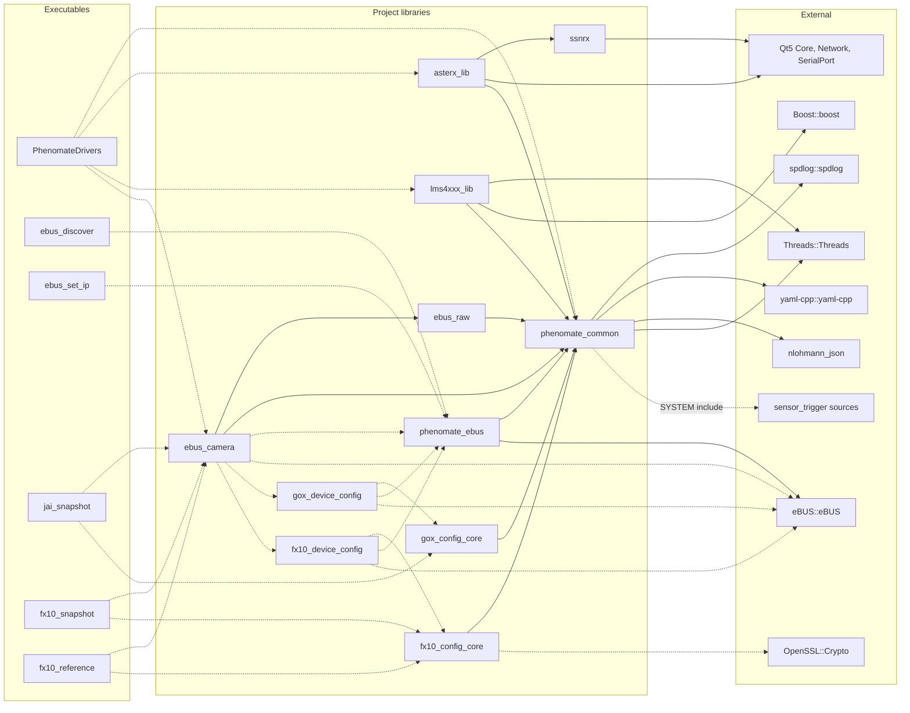

| Element | Responsibility | Source |
|---|---|---|
| `PhenomateDrivers` | Executable from `main.cpp`; version macros | `CMakeLists.txt:78-92` |
| `phenomate_common` | Sources `drivers_json`, `ebus/ipv4` (SDK-free), `logger`, `main_config`, `run_guards`, `sensor_sync_hub`, `sensor_sync_log`, `session_runner`, `signal_handler`, `utility` | `common/CMakeLists.txt:6-40` |
| `phenomate_ebus` | `discovery`, `env_bootstrap`, `ip_config`, `sdk_error`; GenICam variable name and root baked in at configure time | `common/CMakeLists.txt:59-85` |
| `ebus_discover`, `ebus_set_ip` | Tools on `phenomate_ebus` | `common/CMakeLists.txt:90-98` |
| `ssnrx` | Vendored Septentrio SDK, warnings suppressed | `asterx_driver/CMakeLists.txt:14-34` |
| `asterx_lib` | AsteRx adapter; `session.h` listed for AUTOMOC | `asterx_driver/CMakeLists.txt:39-68` |
| `lms4xxx_lib` | LMS4xxx adapter | `lms4xxx_driver/CMakeLists.txt:14-51` |
| `ebus_raw` | SDK-free RAW format and recorder | `ebus_driver/CMakeLists.txt:3-6` |
| `ebus_camera` | `EbusCameraDriver`; links the profiles privately | `ebus_driver/CMakeLists.txt:8-12` |
| `gox_config_core`, `gox_device_config` | Go-X configuration (SDK-free) and SDK-side control; the device target also compiles `ebus_driver/src/gox_config.cpp` and keeps its include paths private | `gox_driver/CMakeLists.txt:3-17` |
| `fx10_config_core`, `fx10_device_config` | FX10 counterparts; the device target compiles `ebus_driver/src/fx10_config.cpp` | `fx10_driver/CMakeLists.txt:4-14` |
| `jai_snapshot`, `fx10_snapshot`, `fx10_reference` | Tools on `ebus_camera` plus the profile core | `gox_driver/CMakeLists.txt:19-22`, `fx10_driver/CMakeLists.txt:16-22` |
| External packages | See section 2 | `cmake/Dependencies.cmake`, `cmake/FindeBUS.cmake` |

## 5. Components (C4 level 3)

### 5.1 Common runtime

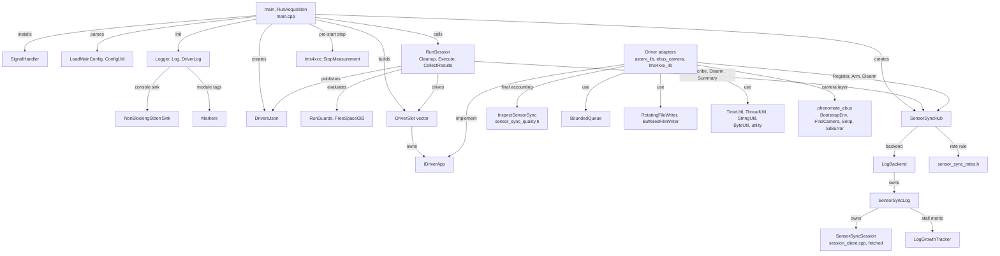

| Element | Responsibility | Source |
|---|---|---|
| `main`, `RunAcquisition` | Signals, root and configuration path resolution, session folder, log, hub, manifest, configuration copies, LMS pre-start stop, driver composition | `main.cpp:71-277` |
| `SignalHandler` | SIGINT, SIGTERM, SIGHUP set the terminate flag and record the signal number; the handler only stores atomics | `common/src/signal_handler.cpp:10-38`, `main.cpp:263` |
| `LoadMainConfig`, `ConfigUtil` | Strict YAML schema; relative paths against the repository root | `common/src/main_config.cpp:7-75`, `common/include/config_util.h:21-24` |
| `Logger`, `Log`, `DriverLog` | One process-wide spdlog logger; module-tagged lines; `LogAndThrow` as the only throwing log call | `common/src/logger.cpp:24-98`, `common/include/logger.h:28-109` |
| `NonBlockingStderrSink` | Console sink on a non-TTY stderr: `O_NONBLOCK`, drops and counts lines | `common/include/nonblocking_stderr_sink.h:25-63` |
| `Markers` | Module tokens and human-readable lifecycle strings | `common/include/driver_markers.h:6-52` |
| `DriversJson` | Run manifest, atomic replace, optional mirror file | `common/src/drivers_json.cpp:76-176` |
| `RunSession` | Session coordinator: `Execute` (bring-up, poll loop, classification), `Cleanup` (stop, join, reverse shutdown), `CollectResults` | `common/src/session_runner.cpp:21-410` |
| `RunGuards`, `FreeSpaceGiB` | Pure decision layer for the disk floor and the no-data watchdog | `common/include/run_guards.h:20-110`, `common/src/run_guards.cpp:7-84` |
| `DriverSlot` | App, display name, marker strings, Run thread, stable key | `common/include/session_runner.h:13-20` |
| `IDriverApp` | Driver contract (section 5.2) | `common/include/driver_app.h:11-74` |
| `SensorSyncHub` | One board session per run: registration, rate checks, start when all armed, end on first disarm | `common/src/sensor_sync_hub.cpp:49-335` |
| `LogBackend`, `SensorSyncLog` | Real-board backend; open with STOP handshake, start, stop, stall metric | `common/src/sensor_sync_hub.cpp:18-45`, `common/src/sensor_sync_log.cpp:48-144` |
| `SensorSyncSession` | Upstream host client (serial I/O, reader thread, log file), included as source | `common/src/sensor_sync_log.cpp:9`, `3rd_party/External/sensor_trigger/session_client.cpp:33-228` (fetched, unpinned) |
| `LogGrowthTracker` | Time since the timing log last grew | `common/include/log_growth_tracker.h:17` |
| `sensor_sync_rates.h`, `sensor_sync_quality.h` | Host copies of the firmware pair-rate rule and log-format-3 checks; `InspectSensorSync` | `common/include/sensor_sync_rates.h:41-75`, `common/include/sensor_sync_quality.h:168-245` |
| `BoundedQueue` | Mutex and condition-variable queue with non-blocking and blocking push, close-and-drain | `common/include/bounded_queue.h:12-123` |
| `RotatingFileWriter`, `BufferedFileWriter` | `std::ofstream` writers with size and time rotation | `common/include/file_writer.h:12-211` |
| Utilities | Clocks, scheduling, strings, byte order, paths | `common/include/time_util.h`, `thread_util.h`, `string_util.h`, `byte_util.h`, `utility.h` |
| `phenomate_ebus` | `BootstrapEnv`, discovery (`kDiscoveryTimeoutMs` 4000), IP configuration, `SdkError` | `common/src/ebus/env_bootstrap.cpp:24-46`, `common/include/ebus/discovery.h:49-55` |
| `lms4xxx::StopMeasurement` | Bounded connect, login, `LMCstopmeas`; connection always released | `lms4xxx_driver/src/driver.cpp:20-36` |

### 5.2 Driver class model

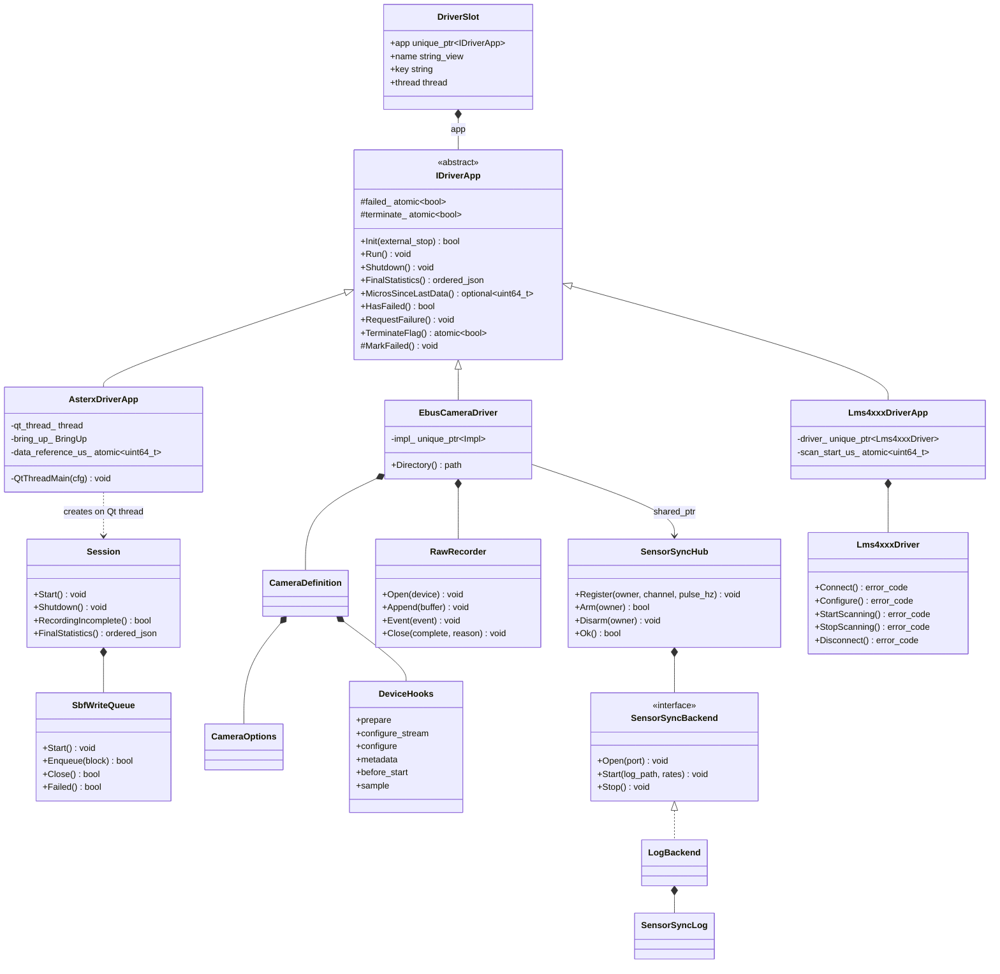

| Element | Responsibility | Source |
|---|---|---|
| `common::IDriverApp` | Single-use driver contract: `Init` on the coordinator thread (false or exception still requires `Shutdown`), `Run` once on its own thread, idempotent `Shutdown`, sticky `HasFailed`, `MicrosSinceLastData` (nullopt = silence expected), `TerminateFlag`; non-copyable and non-movable | `common/include/driver_app.h:11-74` |
| `common::DriverSlot` | Owning slot with display name (`AsteRx`, `FX10`, `GoX`, `LMS4xxx`) and key (`asterx`, `fx10`, `gox:<id>`, `lms:<id>`) | `common/include/session_runner.h:13-20`, `main.cpp:165-238` |
| `AsterxDriverApp` | Wraps the Qt-based session in one dedicated thread; `Init` blocks until the warm-up gate opens or bring-up fails | `asterx_driver/include/asterx_driver_app.h:20-55`, `asterx_driver/src/asterx_driver_app.cpp:50-188` |
| `asterx::Session` | AsteRx state machine on the Qt event loop (section 8.3) | `asterx_driver/include/session.h:31-163` |
| `asterx::SbfWriteQueue` | Byte-budgeted queue plus writer thread for SBF | `asterx_driver/include/sbf_write_queue.h:31-98` |
| `ebus_driver::EbusCameraDriver` | Camera engine for Go-X and FX10; state in `Impl` | `ebus_driver/include/ebus_driver/camera_driver.h:82-103`, `ebus_driver/src/camera_driver.cpp:83-1190` |
| `CameraDefinition`, `CameraOptions`, `DeviceHooks` | Profile output: engine options and device-specific callbacks | `ebus_driver/include/ebus_driver/camera_driver.h:40-80` |
| `ebus_driver::RawRecorder` | `ebus-raw` segments, `device.json`, `events.jsonl` | `ebus_driver/include/ebus_driver/raw_recorder.h:26-72` |
| `common::SensorSyncHub`, `SensorSyncBackend`, `LogBackend`, `SensorSyncLog` | Shared board session with an injectable backend (tests use a fake) | `common/include/sensor_sync_hub.h:18-125`, `common/src/sensor_sync_hub.cpp:18-45` |
| `Lms4xxxDriverApp` | One instance per enabled `lidar[]` entry; owns `Lms4xxxDriver` and `lms4xxx::RawRecorder` (not drawn, to avoid a name clash with the camera recorder) | `lms4xxx_driver/include/lms4xxx_driver_app.h:17-53` |
| `lms4xxx::Lms4xxxDriver` | Connection, configuration, streaming and stop measurement | `lms4xxx_driver/include/driver.h:33-102` |

### 5.3 AsteRx adapter

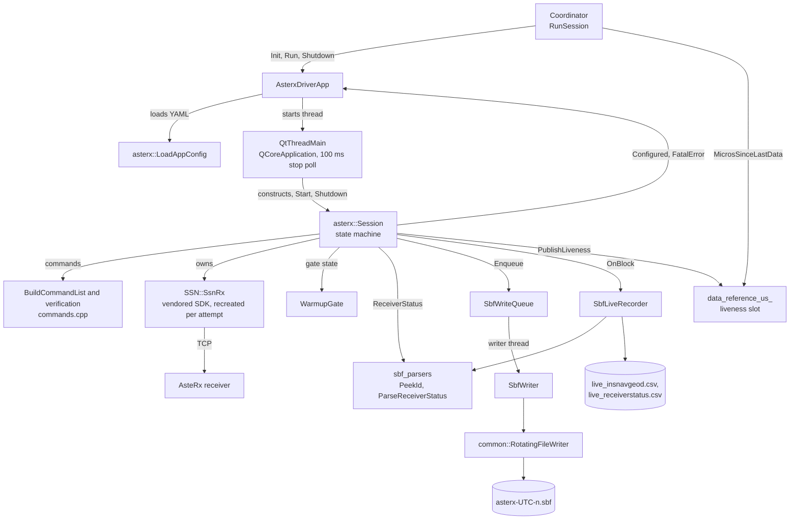

| Element | Responsibility | Source |
|---|---|---|
| `AsterxDriverApp` | Loads the YAML, overrides the output directory to `raw/asterx`, starts the Qt thread, waits for `Recording` or `Failed`; `Run` only waits for the terminate flag | `asterx_driver/src/asterx_driver_app.cpp:106-158` |
| `QtThreadMain` | Owns the process's only `QCoreApplication`, the `Session` and a 100 ms timer that forwards the terminate flag to `Session::Shutdown` | `asterx_driver/src/asterx_driver_app.cpp:50-103`, `:77-84` |
| `asterx::LoadAppConfig` | Strict YAML schema; `device.ip/user/password` and `receiver.sbf_streams` required | `asterx_driver/include/app_config.h:29-31`, `asterx_driver/src/app_config.cpp` |
| `asterx::Session` | Connect (5 s), command sequence (15 s per reply), warm-up, recording, fail-fast; timeouts in `session.cpp:18-23` | `asterx_driver/src/session.cpp:35-656` |
| `BuildCommandList` | Login, `exeCopyConfigFile, Boot, Current`, set/get pairs, `lstConfigFile` proof, SBF stream setup | `asterx_driver/src/commands.cpp:436-600`; [AsteRx](../asterx_driver/docs/DEVICE_CONFIG.md#configuration-sequence) |
| `SSN::SsnRx` | Vendored SDK: TCP, SBF framing and CRC, ASCII replies; a fresh instance per connection attempt | `asterx_driver/src/session.cpp:194-205`, `asterx_driver/3rd_party/RxTools/ssnrx/` |
| `WarmupGate` | Readiness: minimum recorded duration and optional FINETIME (section 8.4) | `asterx_driver/include/warmup_gate.h:24-96` |
| `sbf_parsers` | Minimal SBF decoding for `ReceiverStatus` (4014) and `INSNavGeod` (4226, 4230) | `asterx_driver/include/sbf_types.h:14-16`, `asterx_driver/src/sbf_parsers.cpp` |
| `SbfWriteQueue` | Byte budget `write_queue_bytes` (default 256 MiB), refusal on overflow, writer thread | `asterx_driver/include/app_config.h:21`, `asterx_driver/src/sbf_write_queue.cpp:22-181` |
| `SbfWriter`, `RotatingFileWriter` | Files `<prefix>-<UTC>-<n>.sbf`; hard size cap checked before each write (`precheck_size_cap`), time rotation; flush and close without `fsync` | `asterx_driver/src/sbf_writer.cpp:16-30`, `common/include/file_writer.h:70-210` |
| `SbfLiveRecorder` | GUI telemetry CSV, flushed at most every 250 ms; failures disable only the CSV | `asterx_driver/src/sbf_live_recorder.cpp:17`, `:110-196` |
| Liveness slot | Steady-clock µs of the last recorded block, 0 = watchdog off (before readiness, during backoff and after stop) | `asterx_driver/include/session.h:51-82`, `asterx_driver/src/asterx_driver_app.cpp:161-168` |

### 5.4 eBUS camera runtime with Go-X and FX10 profiles

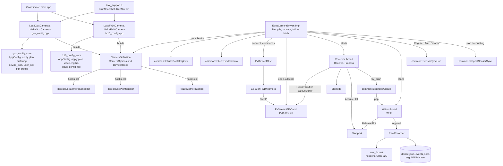

| Element | Responsibility | Source |
|---|---|---|
| `MakeGoxCameras`, `LoadGoxCameras` | One definition per enabled `cameras[]` entry; requires the configured pixel format; maps YAML to `CameraOptions` (module `GoX`, telemetry 5 s) and installs the hooks | `ebus_driver/src/gox_config.cpp:59-402`, `:79-106` |
| `MakeFx10Camera`, `LoadFx10Camera` | One definition (`id` and `kind` `fx10`, module `FX10`, telemetry 60 s); optional dark-reference mode; resolves `device.ebus_config` against the repository root | `ebus_driver/src/fx10_config.cpp:38-238`, `:47-78`, `:88-94` |
| `gox_config_core`, `fx10_config_core` | SDK-free configuration, apply plans and metadata helpers; FX10 `.pvcfg` SHA-256 via OpenSSL | `gox_driver/CMakeLists.txt:3-8`, `fx10_driver/CMakeLists.txt:4-8`, `fx10_driver/src/ebus_config_file.cpp:42-46` |
| `CameraController`, `PtpManager`, `CameraControl` | GenICam writes and readbacks, factory user set, Counter0, PTP admission (Go-X); factory preparation, `.pvcfg` restore, shutter (FX10) | `gox_driver/include/ebus/camera_controller.h:58`, `gox_driver/include/ebus/ptp_manager.h:17-50`, `fx10_driver/include/ebus/camera_control.h:28` |
| `DeviceHooks` | `prepare`, `configure_stream`, `configure`, `metadata`, `before_start`, `sample`; contents per profile in [`ebus_driver/README.md`](../ebus_driver/README.md#profile-hooks) | `ebus_driver/include/ebus_driver/camera_driver.h:46-56` |
| `EbusCameraDriver::Impl` | Init steps 1 to 8, Run steps 9 to 12, stop and shutdown steps 13 to 16 as tabulated in the eBUS README; first error kept, failure sticky | `ebus_driver/src/camera_driver.cpp:395-477`, `:908-1011`, `:1029-1189` |
| `BootstrapEnv`, `FindCamera` | GenICam environment variable if unset; MAC discovery over all interfaces | `common/src/ebus/env_bootstrap.cpp:24-46`, `ebus_driver/src/camera_driver.cpp:407-411` |
| `PvDeviceGEV`, `PvStreamGEV` | SDK control and stream; socket receive buffer request and readback; packet size configured, negotiated or 1476 B fallback | `ebus_driver/src/camera_driver.cpp:202-270` |
| Buffer sizing | Slots from `max_buffer_memory_mb`; SDK buffers, queue capacity and pool size derived in `Allocate` | `ebus_driver/src/camera_driver.cpp:273-347` |
| `BlockIds` | GVSP block-ID gap and anomaly accounting, mode from `GevGVSPExtendedIDMode` readback | `ebus_driver/include/ebus_driver/block_ids.h:11-55`, `ebus_driver/src/camera_driver.cpp:428-449` |
| Receiver thread | Classify buffer, copy bytes into a pooled `RawBuffer`, requeue the `PvBuffer`, then publish | `ebus_driver/src/camera_driver.cpp:519-736` |
| Writer thread | Pop until closed and empty; after the first append error count `write_unconfirmed` | `ebus_driver/src/camera_driver.cpp:739-781` |
| `RawRecorder`, `raw_format` | Segments, records, CRC-32C, `fdatasync` every `flush_bytes`, `O_EXCL` files | `ebus_driver/src/raw_recorder.cpp:37-287`, `ebus_driver/include/ebus_driver/raw_format.h:8-22` |
| `SensorSyncHub`, `InspectSensorSync` | Shared trigger session; stop-time edge accounting written as `sensor_sync_quality` | `ebus_driver/src/camera_driver.cpp:454-460`, `:945-948`, `:1047-1091` |
| `tool_support.h` | Shared `Init`/`Run`/`Shutdown` orchestration for snapshot and stream tools, 10 s starvation stop | `ebus_driver/include/ebus_driver/tool_support.h:73-126` |

### 5.5 LMS4xxx adapter

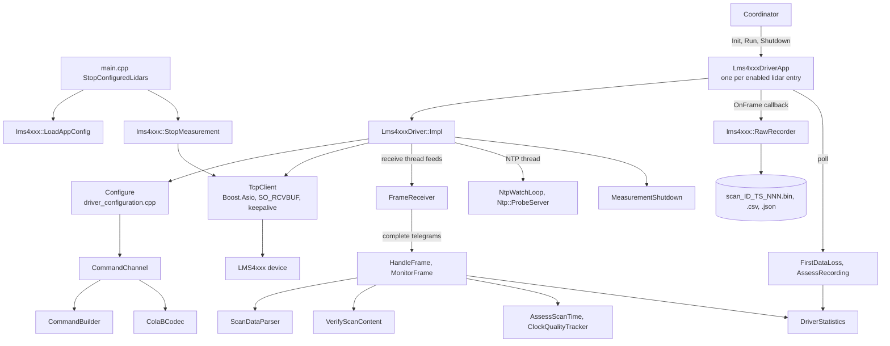

| Element | Responsibility | Source |
|---|---|---|
| `StopConfiguredLidars`, `StopMeasurement` | Before any driver exists, `LMCstopmeas` to every `lidar[]` entry, enabled or not; result ignored; terminate flag checked between entries | `main.cpp:60-68`, `:131-148`, `lms4xxx_driver/src/driver.cpp:20-36` |
| `lms4xxx::LoadAppConfig` | Strict schema; parsed once by `main.cpp` without requiring an enabled entry | `lms4xxx_driver/include/app_config.h:127-131`, `main.cpp:134` |
| `Lms4xxxDriverApp` | `Init`: connect, configure, build recorder with metadata from the session YAML copy. `Run`: start recorder, start scanning, 200 ms poll for faults and first data loss, `[Statistics]`. `Shutdown`: stop scanning, drain recorder, disconnect, final verdict | `lms4xxx_driver/src/lms4xxx_driver_app.cpp:104-419`, `:22` |
| `Lms4xxxDriver::Impl` | Connection state, workers, callbacks, statistics, telemetry handoff | `lms4xxx_driver/include/driver_internal.h:22-125` |
| `Configure` | `mSCloadappdef` baseline, parameter rows with readback, identity and audit, measurement start | `lms4xxx_driver/src/driver_configuration.cpp:268-458`; [LMS4xxx](../lms4xxx_driver/docs/DEVICE_CONFIG.md#configuration-sequence) |
| `TcpClient` | Blocking reads with bounded waits on a private `io_context`; `SHUT_RD` wakes the receive thread at stop | `lms4xxx_driver/src/tcp_client.cpp:68-262` |
| `CommandChannel`, `CommandBuilder`, `ColaBCodec` | Command round trips, telegram construction, CoLa B decoding | `lms4xxx_driver/include/command_channel.h:19`, `command_builder.h`, `cola_b.h:53` |
| `FrameReceiver` | Splits the byte stream into complete telegrams (max 64 KiB), reports framing errors | `lms4xxx_driver/include/frame_receiver.h:34-77` |
| `HandleFrame`, `MonitorFrame` | Inspect each checksum-valid telegram, annotate the `RawRecord`, pass every telegram to the callback | `lms4xxx_driver/src/driver_stream.cpp:376-484` |
| `ScanDataParser`, `VerifyScanContent` | Full parse and structure check of the first scan; timestamp-only parse afterwards | `lms4xxx_driver/include/scan_data_parser.h:12-67`, `lms4xxx_driver/src/driver_stream.cpp:215-236` |
| `AssessScanTime`, `ClockQualityTracker` | Device-time plausibility, clock steps, quality flags | `lms4xxx_driver/src/driver_stream.cpp:299-372`, `lms4xxx_driver/include/clock_quality.h:60` |
| `NtpWatchLoop` | Host-side NTP server probe every `check_status_s` (default 5 s); three consecutive failures latch a time fault | `lms4xxx_driver/src/driver_stream.cpp:18-19`, `:244-296`, `lms4xxx_driver/include/app_config.h:67` |
| `MeasurementShutdown` | One stop attempt per measurement start, status for the manifest | `lms4xxx_driver/include/measurement_shutdown.h:7-55` |
| `lms4xxx::RawRecorder` | Queue, writer thread, BIN/CSV/JSON splits, periodic `fdatasync` | `lms4xxx_driver/src/raw_recorder.cpp:63-287` |
| `FirstDataLoss`, `AssessRecording` | Online fail-fast predicate and final verdict | `lms4xxx_driver/include/recording_status.h:13-90` |

### 5.6 Device tools

| Tool | Engine use | Behavior relevant to the architecture | Source |
|---|---|---|---|
| `ebus_discover` | `phenomate_ebus` only | Routes spdlog to stderr so `--json` keeps stdout machine-readable | `common/src/ebus/discover_main.cpp:7-12`, `:50` |
| `ebus_set_ip` | `phenomate_ebus` only | The only component that writes camera IP settings; spdlog to stderr | `common/src/ebus/set_ip_main.cpp:6`, `:81` |
| `jai_snapshot` | `MakeGoxCameras`, `RunSnapshot` or `RunStream` | SensorSync forced off; no `Logger::Init`, so engine log lines use spdlog's default logger | `gox_driver/tools/snapshot_main.cpp:72`, `:96-105` |
| `fx10_snapshot` | `MakeFx10Camera`, `RunSnapshot` or `RunStream` | No `Logger::Init`, as above | `fx10_driver/tools/snapshot_main.cpp:88-96` |
| `fx10_reference` | One `EbusCameraDriver` per phase (white, dark) | `Logger::Init` with module `FX10Reference`; SensorSync off | `fx10_driver/tools/reference_main.cpp:116-117`, `:185`, `:210-214` |

Exit codes and the final `SNAPSHOT:` line are specified in
[`ebus_driver/README.md`](../ebus_driver/README.md#tools-support). The rig guards of section 10 do
not apply to the tools.

## 6. Runtime views

### 6.1 Session lifecycle

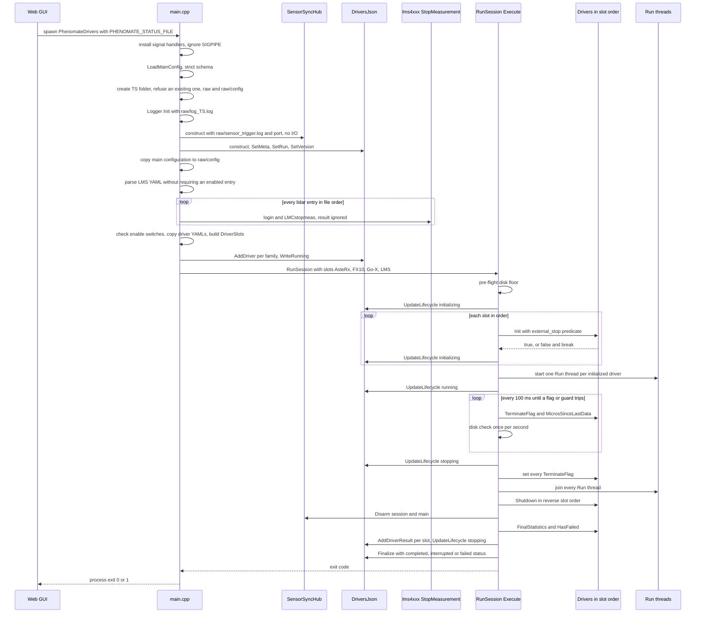

| Element | Responsibility | Source |
|---|---|---|
| Signal setup | `SignalHandler::Install` for SIGINT, SIGTERM, SIGHUP; SIGPIPE ignored | `main.cpp:261-264` |
| Path resolution | Root = `<exe dir>/../..`; default `config/config-main.yaml` | `main.cpp:266-271` |
| `InitializeSystem` | Session folder name from `system_clock` with fmt chrono (UTC in the bundled fmt 12.1), `create_directory` refuses an existing folder, log file opened | `main.cpp:41-57` |
| Hub construction | Stores log path and port; the board is opened by the first `Register` | `main.cpp:75-76`, `common/src/sensor_sync_hub.cpp:49-53`, `:114-123` |
| Manifest setup | Identity, run header, version; first write in `WriteRunning` | `main.cpp:79-82`, `:243-247` |
| Configuration copies | `raw/config/config-<name>_<ts>.yaml`, `copy_options::none` (fails if present) | `main.cpp:113-129`, `:160-226` |
| LMS pre-start stop | Section 5.5 | `main.cpp:131-148` |
| Slot construction | Order AsteRx, FX10, Go-X cameras, LiDARs; cameras load the copied YAML | `main.cpp:160-242` |
| Pre-flight disk check | Stop below `disk_min_free_gib` before bring-up | `common/src/session_runner.cpp:115-124` |
| Sequential `Init` | Exceptions and `false` latch failure; a stop request during `Init` is logged as interrupted | `common/src/session_runner.cpp:152-182` |
| Run threads | Catch-all wrapper; sets the driver's terminate flag on return | `common/src/session_runner.cpp:192-224` |
| Poll loop | 100 ms; first terminated driver, disk (1 s cadence, 60 s log), no-data watchdog | `common/src/session_runner.cpp:241-312` |
| Termination and cleanup | Flags set, joins, reverse `Shutdown`, SensorSync disarm | `common/src/session_runner.cpp:314-338`, `:29-68` |
| Classification | Section 10.3 | `common/src/session_runner.cpp:339-385` |

### 6.2 AsteRx SBF data path

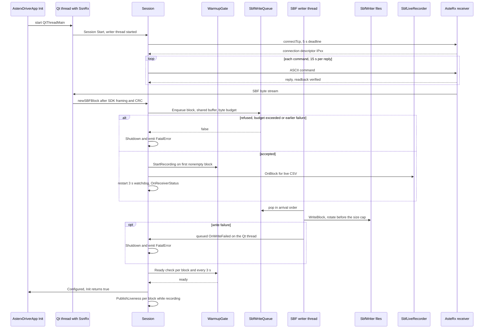

| Element | Responsibility | Source |
|---|---|---|
| Thread start | `Init` starts `QtThreadMain` and waits on a condition variable (100 ms slices) | `asterx_driver/src/asterx_driver_app.cpp:120-128` |
| Connect and configure | Timeouts 5 s connect, 15 s per command; replies bound to the outstanding command name | `asterx_driver/src/session.cpp:18-23`, `:184-299` |
| Block reception | `OnSbfBlock` drops blocks only in `kBackoff` or `kStopping`; all other blocks, including configuration and warm-up, are enqueued | `asterx_driver/src/session.cpp:426-458` |
| Byte budget | `pending_bytes_ + size > max_pending_bytes_` refuses and latches failure | `asterx_driver/src/sbf_write_queue.cpp:37-70` |
| Writer | One thread; on a write failure later blocks are discarded and the callback marshals to the Qt thread | `asterx_driver/src/sbf_write_queue.cpp:126-163`, `asterx_driver/src/session.cpp:44-50` |
| Damage | CRC and length errors increment `recording_errors_`; fatal after readiness | `asterx_driver/src/session.cpp:154-157`, `:461-493` |
| Readiness | `EnterRecording` emits `Configured`, arms the rig watchdog | `asterx_driver/src/session.cpp:363-386` |

### 6.3 eBUS camera data path

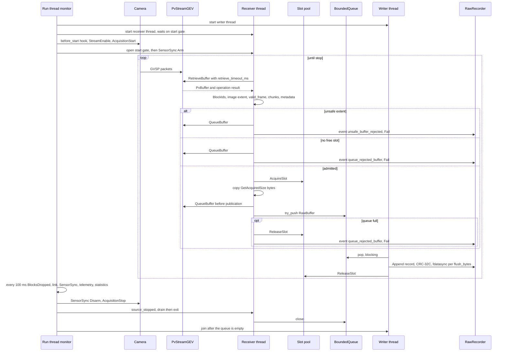

| Element | Responsibility | Source |
|---|---|---|
| Worker start | Writer before receiver, so acquisition never runs without a writer | `ebus_driver/src/camera_driver.cpp:917-919` |
| Start gate | Receiver waits until `start_gate` or `source_stopped` | `ebus_driver/src/camera_driver.cpp:686-689`, `:940-944` |
| Classification | Unsafe extent, limit exclusion, pool or queue rejection, admission, in this order | `ebus_driver/src/camera_driver.cpp:592-681` |
| Ownership hand-off | RAII `ReturnBuffer` requeues on every path; normal path requeues before `try_push` | `ebus_driver/src/camera_driver.cpp:524-539`, `:661-667` |
| Drain | After stop: 200 ms retrieve timeout, end after 1 s without a buffer or on `ABORTED`, failure after 5 s | `ebus_driver/src/camera_driver.cpp:694-723` |
| Monitor | `BlocksDropped`, control link, duration limit, SensorSync stall 15 s and arm wait 30 s, telemetry, `[Statistics]` | `ebus_driver/src/camera_driver.cpp:958-1001` |
| Stop | `StopWorkers`: Disarm, `AcquisitionStop`, join receiver, close queue, join writer | `ebus_driver/src/camera_driver.cpp:872-905` |

### 6.4 LMS4xxx telegram path

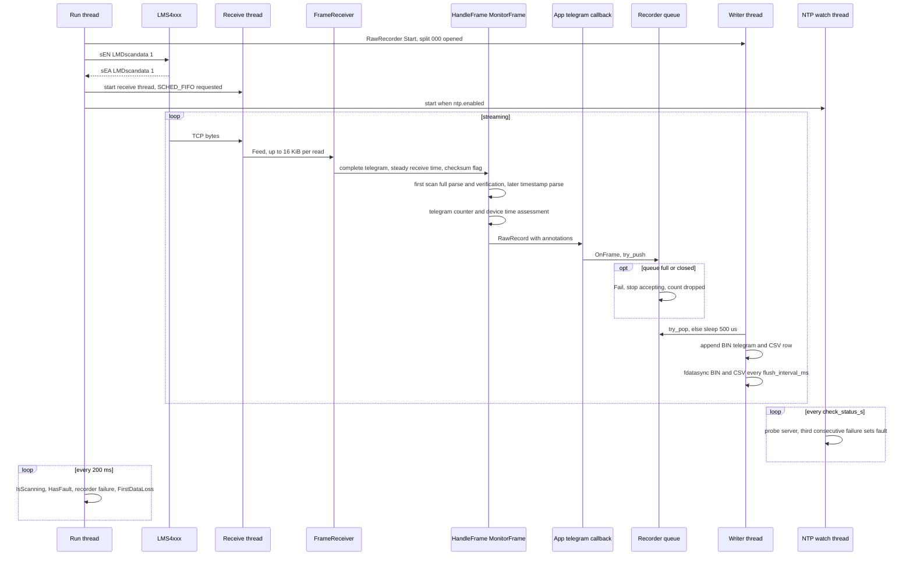

| Element | Responsibility | Source |
|---|---|---|
| Recorder start | Before scanning so no telegram is missed | `lms4xxx_driver/src/lms4xxx_driver_app.cpp:174-179` |
| Stream start | `sEN LMDscandata` and its answer; workers started afterwards; time gate deadline `lock_timeout_s` | `lms4xxx_driver/src/driver.cpp:126-218` |
| Receive loop | 16 KiB reads into `FrameReceiver::Feed`; read error sets fault | `lms4xxx_driver/src/driver_stream.cpp:17`, `:180-212` |
| Monitor | Corrupted telegrams are archived but do not drive state; counter discontinuity counted | `lms4xxx_driver/src/driver_stream.cpp:376-447` |
| Callback | Every complete telegram reaches the recorder, even after a monitor failure | `lms4xxx_driver/src/driver_stream.cpp:450-484`, `lms4xxx_driver/src/lms4xxx_driver_app.cpp:158-160` |
| Queue | `BoundedQueue<RawRecord>`, capacity `output.queue_max_frames` (default 512) | `lms4xxx_driver/include/app_config.h:100`, `lms4xxx_driver/src/raw_recorder.cpp:228`, `:245-266` |
| Writer | Polling loop with 500 µs sleep, periodic `fdatasync`, drain and finalize on close | `lms4xxx_driver/src/raw_recorder.cpp:169-209` |
| NTP watch | 2000 ms probe timeout, three failures | `lms4xxx_driver/src/driver_stream.cpp:18-19`, `:244-296` |
| Run poll | 200 ms, fail-fast checks, `[Statistics]` | `lms4xxx_driver/src/lms4xxx_driver_app.cpp:22`, `:213-316` |

### 6.5 SensorSync Register, Arm and Disarm

The owner string is `<kind>:<id>` (`ebus_driver/src/camera_driver.cpp:130`); the shipped channels
are 0 for the FX10 and 2 for `cam0` (`fx10_driver/config/config-fx10.yaml:43`,
`gox_driver/config/config-gox.yaml:32`).

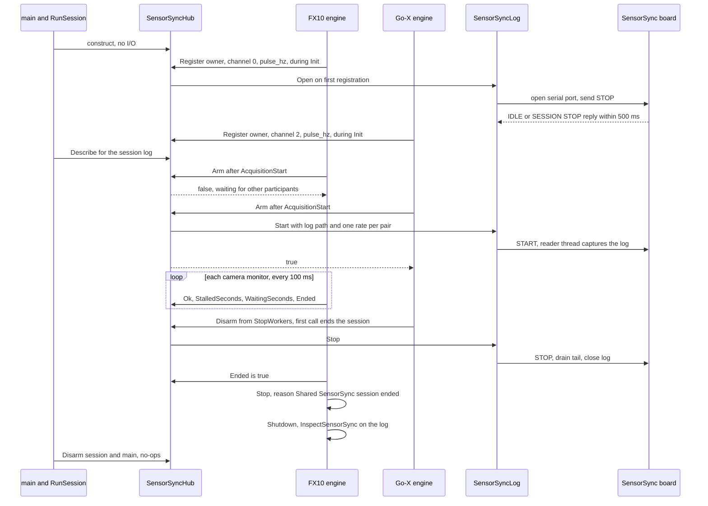

| Element | Responsibility | Source |
|---|---|---|
| `Register` | Validates owner, port, channel 0 to 3, pair rate rule, one rate per pair, no registration after start; opens the board once | `common/src/sensor_sync_hub.cpp:69-127` |
| Board open | Serial session open, STOP, expect `#IDLE,` or `#SESSION,STOP,` | `common/src/sensor_sync_log.cpp:58-79` |
| `Arm` | Marks the participant; starts the board when all are armed; fails after end or failure | `common/src/sensor_sync_hub.cpp:130-173` |
| `Start` | Upstream `start` opens the log with mode `wx` and starts its reader thread | `common/src/sensor_sync_log.cpp:82-106`, `3rd_party/External/sensor_trigger/session_client.cpp:61-79` (fetched) |
| Camera guards | Failure, stall over 15 s, arm wait over 30 s, end of shared session | `ebus_driver/src/camera_driver.cpp:968-980` |
| `Disarm` | First call ends the session for all participants; backend `Stop` runs under the hub mutex | `common/src/sensor_sync_hub.cpp:176-193` |
| Final accounting | `InspectSensorSync`; bounded for triggered cameras, observation window only for freerun | `ebus_driver/src/camera_driver.cpp:1047-1091` |
| Coordinator disarm | `Cleanup::Stop` and `Execute` call `Disarm`, then log `Summary` | `common/src/session_runner.cpp:62-67`, `:333-338` |

## 7. Concurrency view

### 7.1 Threads and queues

Notation: rectangle = thread; stadium = queue or buffer pool. Per-camera and per-LiDAR groups
repeat for each instance.

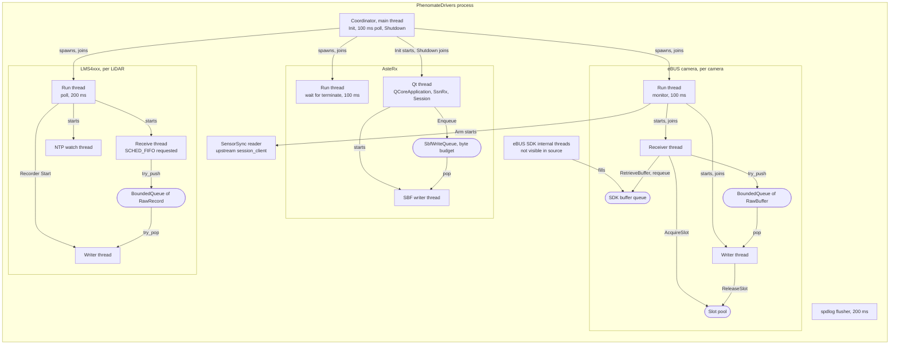

| Element | Responsibility | Source |
|---|---|---|
| Coordinator | Runs `main`, sequential `Init`, poll loop, reverse `Shutdown`, manifest | `main.cpp:260-277`, `common/src/session_runner.cpp:108-386` |
| spdlog flusher | Periodic flush of all sinks every 200 ms | `common/src/logger.cpp:57` |
| SensorSync reader | Upstream reader loop between `start` and `stop` | `3rd_party/External/sensor_trigger/session_client.cpp:79`, `:100` (fetched) |
| AsteRx threads | Run thread waits; Qt thread owns all Qt objects; writer thread owns `SbfWriter` | `asterx_driver/src/asterx_driver_app.cpp:120`, `:155-158`, `asterx_driver/src/sbf_write_queue.cpp:33` |
| Camera threads | Run thread is the monitor; receiver and writer started in `Run` | `ebus_driver/src/camera_driver.cpp:918-919`, `:958-1001` |
| LMS threads | Run poll; receive and NTP threads from `StartScanning`; writer from `RawRecorder::Start` | `lms4xxx_driver/src/driver.cpp:201-205`, `lms4xxx_driver/src/raw_recorder.cpp:231` |
| eBUS SDK threads | Not visible in this repository; GVSP reception is inside the SDK | – |

### 7.2 Thread inventory

| Thread | Instances | Created by | Ends and joined by | Source |
|---|---|---|---|---|
| Coordinator (main) | 1 | Process | Process exit | `main.cpp:260` |
| spdlog periodic flusher | 1 | `Logger::Init` (`flush_every`) | spdlog | `common/src/logger.cpp:57` |
| Driver Run thread | 1 per initialized slot | `Execute` | Return sets the driver's terminate flag; joined in `Cleanup::Stop` | `common/src/session_runner.cpp:198-216`, `:37-41` |
| AsteRx Qt thread | 1 | `AsterxDriverApp::Init` | `app.quit()` on terminate (100 ms timer) or `FatalError`; joined in `Init` failure paths or `Shutdown` | `asterx_driver/src/asterx_driver_app.cpp:120`, `:137-148`, `:179-181` |
| SBF writer | 1 | `Session::Start` → `SbfWriteQueue::Start` | Drains, then joined by `SbfWriteQueue::Close` in `Session::Shutdown` | `asterx_driver/src/session.cpp:178`, `asterx_driver/src/sbf_write_queue.cpp:22-34`, `:73-106` |
| Camera receiver | 1 per camera | `Impl::Run` | Drain end; joined in `StopWorkers` | `ebus_driver/src/camera_driver.cpp:919`, `:894-896` |
| Camera writer | 1 per camera | `Impl::Run` | Queue closed and empty; joined in `StopWorkers` | `ebus_driver/src/camera_driver.cpp:918`, `:897-902` |
| LMS receive | 1 per LiDAR | `Lms4xxxDriver::StartScanning` | `SHUT_RD` and flag; joined in `StopScanning` | `lms4xxx_driver/src/driver.cpp:201`, `:247-260` |
| LMS NTP watch | 1 per LiDAR with `ntp.enabled` | `StartScanning` | Flag; joined in `StopScanning` | `lms4xxx_driver/src/driver.cpp:202-205`, `:254-257` |
| LMS writer | 1 per LiDAR | `RawRecorder::Start` from `Run` | Queue closed and drained; joined in `RawRecorder::Stop` from `Shutdown` | `lms4xxx_driver/src/raw_recorder.cpp:231`, `:268-273`, `lms4xxx_driver/src/lms4xxx_driver_app.cpp:354-356` |
| SensorSync reader | 0 or 1 per run | Hub `Arm` of the last participant | Hub `Disarm` (first call) | `common/src/sensor_sync_hub.cpp:162-169`, `:176-193` |

The LMS receive and writer threads outlive the LMS Run thread: after `Run` returns, complete
telegrams are still archived until `Shutdown` stops scanning
(`lms4xxx_driver/src/lms4xxx_driver_app.cpp:221`, `:340-356`).

### 7.3 Queues

| Queue | Type | Capacity | Producer → consumer | Full policy | Source |
|---|---|---|---|---|---|
| SBF write queue | `std::deque<QByteArray>` with mutex and condition variable; blocks share the SDK buffer | `write_queue_bytes` bytes; default 256 MiB, YAML 16 to 4096 MiB | Qt thread → SBF writer | Refuse, latch `Failed()`, session `Shutdown` and `FatalError` | `asterx_driver/include/sbf_write_queue.h:82-97`, `asterx_driver/include/app_config.h:21`, `asterx_driver/src/app_config.cpp:33-35`, `asterx_driver/src/session.cpp:435-444` |
| SDK buffer queue | `PvBuffer`s queued in `PvStreamGEV` | `min(max(4, sdk_buffers), GetQueuedBufferMaximum, slots − 4)` | SDK → receiver (requeued by receiver) | SDK side; an increase of `BlocksDropped` fails the camera | `ebus_driver/src/camera_driver.cpp:291-329`, `:838-849` |
| Camera slot pool | `std::vector<unique_ptr<RawBuffer>>` under `pool_mutex` | Queue capacity + 2, each reserving `PayloadSize` | Writer releases → receiver acquires | Empty: event `queue_rejected_buffer`, failure | `ebus_driver/src/camera_driver.cpp:96-97`, `:312-317`, `:652-660` |
| Camera recording queue | `common::BoundedQueue<unique_ptr<RawBuffer>>` | `min(wanted, slots − SDK buffers − 2)`; `wanted` = `queue_frames` or `max(2, ceil(expected_rate_hz × stall_budget_s))` | Receiver → writer | `try_push` false: slot released, event, failure; accepted buffers drain | `ebus_driver/src/camera_driver.cpp:300-311`, `:667-675` |
| LMS recorder queue | `common::BoundedQueue<RawRecord>` | `output.queue_max_frames`, default 512 | Receive thread (callback) → writer | Failure latched, admission stopped, queue closed, telegram counted as dropped; the Run poll then stops the run | `lms4xxx_driver/include/app_config.h:100`, `lms4xxx_driver/src/raw_recorder.cpp:245-266`, `lms4xxx_driver/include/recording_status.h:16` |
| Console pipe | Non-blocking `stderr` | Kernel pipe buffer | Any logging thread → GUI reader | Drop the line, count it, report at the end | `common/include/nonblocking_stderr_sink.h:38-57`, `common/src/session_runner.cpp:373-379` |

`BoundedQueue` offers `push_wait_for` and `push_blocking`, but no production caller uses a
blocking push; all producers use `try_push` (`common/include/bounded_queue.h:19-65`).

### 7.4 Synchronization

| Primitive | Purpose | Source |
|---|---|---|
| `terminate`, `signal_received` (process statics) | Signal handler → coordinator; acquire/release on the flag, relaxed on the number | `main.cpp:261-263`, `common/src/signal_handler.cpp:10-17` |
| `IDriverApp::failed_`, `terminate_` | Sticky failure and per-driver stop, acquire/release | `common/include/driver_app.h:49-73` |
| `external_stop` predicate | Global flag or any `HasFailed()`; passed to `Init`, retained by cameras during `Run` | `common/src/session_runner.cpp:127-130`, `ebus_driver/src/camera_driver.cpp:133-137` |
| `SensorSyncHub::mu_` | Participants and session flags; backend `Start`/`Stop` run while it is held | `common/include/sensor_sync_hub.h:115`, `common/src/sensor_sync_hub.cpp:131-188` |
| `bring_up_mutex_`, `bring_up_cv_` | AsteRx `Init` waits for the first bring-up outcome | `asterx_driver/src/asterx_driver_app.cpp:35-47`, `:122-128` |
| `data_reference_us_`, `scan_start_us_`, `data_reference_ns` | Liveness stamps read by the coordinator's watchdog | `asterx_driver/include/asterx_driver_app.h:54`, `lms4xxx_driver/include/lms4xxx_driver_app.h:52`, `ebus_driver/src/camera_driver.cpp:103` |
| Qt queued invocation | SBF writer failure delivered on the Qt thread | `asterx_driver/src/session.cpp:44-50` |
| `SbfWriteQueue` mutex, condition variable, atomics | Queue, budget, stop and close flags; relaxed statistics | `asterx_driver/include/sbf_write_queue.h:82-97` |
| Camera `start_mutex`, `start_changed` | Start gate for the receiver | `ebus_driver/src/camera_driver.cpp:99-101`, `:686-689`, `:889-893` |
| Camera `pool_mutex`, `error_mutex` | Slot pool; first error and stop reason | `ebus_driver/src/camera_driver.cpp:96-105`, `:147-175`, `:480-499` |
| `BoundedQueue` mutex, `not_empty_`, `not_full_` | Queue state | `common/include/bounded_queue.h:117-122` |
| `RawRecorder::events_mutex_` | `events.jsonl` writes from the monitor while the writer appends | `ebus_driver/include/ebus_driver/raw_recorder.h:42-43`, `:70` |
| LMS `callback_mutex`, `telemetry_mutex`, state atomics | Callback registration; telemetry and streaming method replies; scanning, fault and stop flags | `lms4xxx_driver/include/driver_internal.h:31-72` |
| spdlog sink mutexes | `_mt` sinks and `base_sink<std::mutex>` serialize sink writes | `common/src/logger.cpp:29-45`, `common/include/nonblocking_stderr_sink.h:25` |

### 7.5 Ordering rules

- No driver thread outlives `Shutdown`: Run threads are joined before any `Shutdown`, and each
  `Shutdown` joins its own workers (`common/src/session_runner.cpp:29-61`).
- Producers stop before consumers: cameras stop the receiver, then close the queue and join the
  writer (`ebus_driver/src/camera_driver.cpp:889-902`); LMS stops scanning before stopping the
  recorder (`lms4xxx_driver/src/lms4xxx_driver_app.cpp:348-356`); AsteRx closes the socket before
  draining the write queue (`asterx_driver/src/session.cpp:637-642`).
- SDK resources are released after the workers that use them: stream teardown, buffer release and
  `Disconnect` follow `StopWorkers` (`ebus_driver/src/camera_driver.cpp:1092-1159`).
- `~Session` runs before `~QCoreApplication` by stack order
  (`asterx_driver/src/asterx_driver_app.cpp:103`).
- The SensorSync session ends with the first camera's `StopWorkers`, before any camera stops its
  stream (`ebus_driver/src/camera_driver.cpp:876-878`).

## 8. State machines

### 8.1 Run phase and status in `drivers.json`

`lifecycle.phase`:

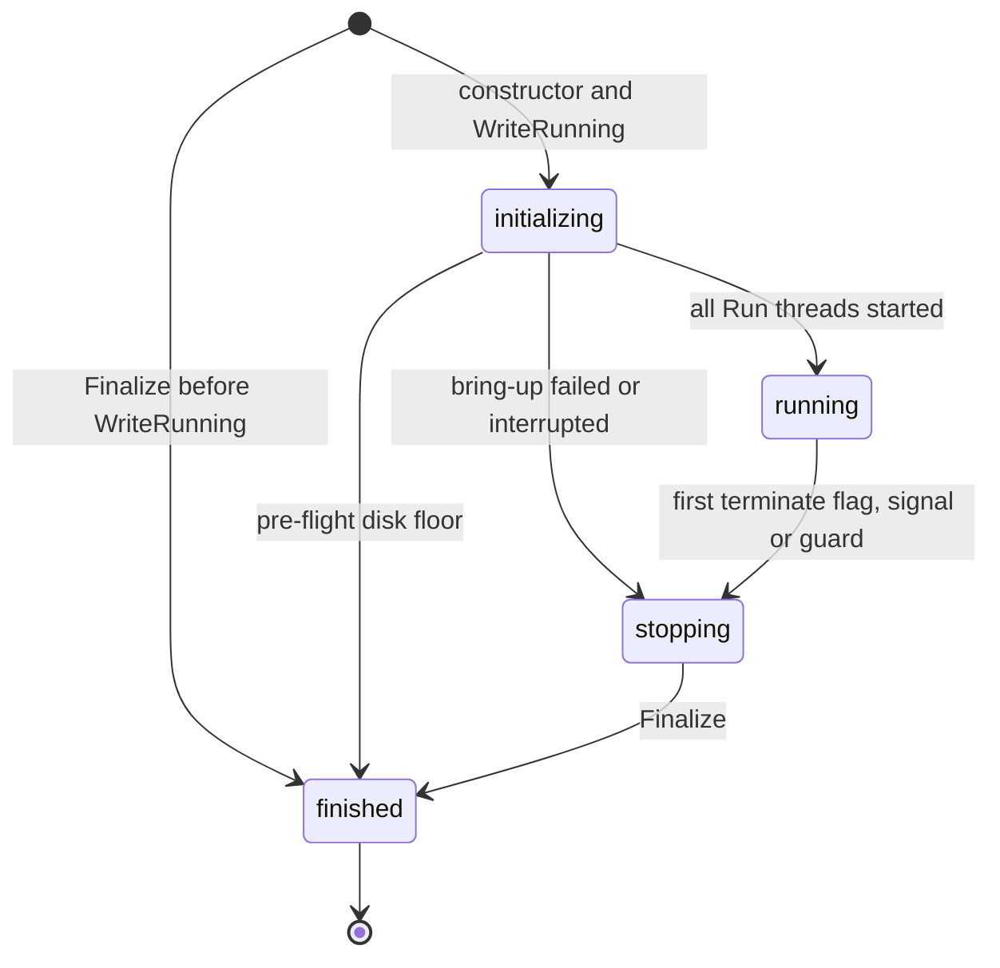

`run.status`:

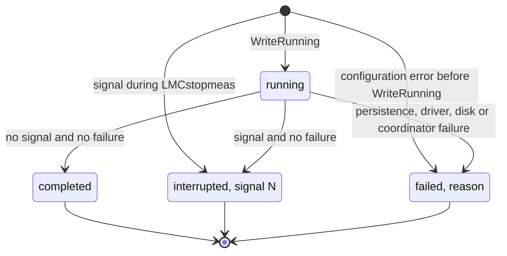

| Element | Responsibility | Source |
|---|---|---|
| `initializing` | Set by the constructor and published per initialized driver | `common/src/drivers_json.cpp:90-91`, `common/src/session_runner.cpp:151`, `:181` |
| `running` | Published once if no termination occurred during bring-up | `common/src/session_runner.cpp:236-238` |
| `stopping` | Published at termination, after cleanup and after result collection | `common/src/session_runner.cpp:315`, `:329`, `:340` |
| `finished` | Set by every `Finalize` | `common/src/drivers_json.cpp:152-160` |
| `lifecycle.revision` | Incremented on every lifecycle write | `common/src/drivers_json.cpp:147`, `:154` |
| Status strings | `running`, `completed`, `interrupted (signal N)`, `failed (configuration)`, `failed (disk)`, `failed (status persistence)`, `failed (<slot keys>)`, `failed (session coordinator)`; `recording_failed` = status starts with `failed` | `main.cpp:92-158`, `common/src/session_runner.cpp:345-366`, `:405`, `common/src/drivers_json.cpp:155-156` |
| Sensor slot states | `lifecycle.sensors.<key>.state`: `waiting` → `running` after `Init` → `stopped` or `failed`; `error` holds the watchdog message or a generic failure text | `common/src/session_runner.cpp:133-150`, `:180`, `:297`, `:326-328` |

The slot state `running` is published when `Init` returns true, before the Run threads start.

### 8.2 Driver lifecycle

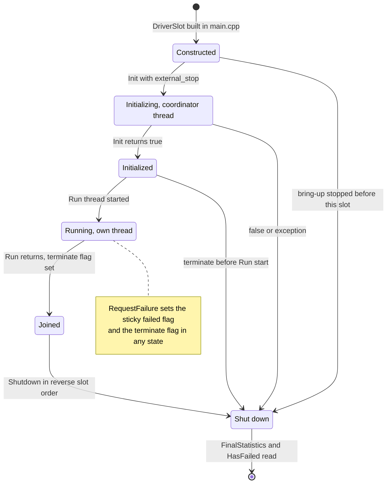

| Element | Responsibility | Source |
|---|---|---|
| Contract | Single use; `Shutdown` mandatory after any `Init` attempt and idempotent | `common/include/driver_app.h:26-41` |
| Sticky failure | `failed_` is never cleared; an operator stop cannot hide a drain or close failure | `common/include/driver_app.h:47-54` |
| Coordinator side | `Init` loop, Run threads, `Cleanup::Stop`, `CollectResults` | `common/src/session_runner.cpp:152-224`, `:29-105` |
| Implementations | AsteRx, cameras and LiDARs guard repeated calls with their own flags | `asterx_driver/src/asterx_driver_app.cpp:171-175`, `ebus_driver/src/camera_driver.cpp:396-400`, `:909-914`, `:1030-1032`, `lms4xxx_driver/src/lms4xxx_driver_app.cpp:342-344`, `:411` |

### 8.3 AsteRx session

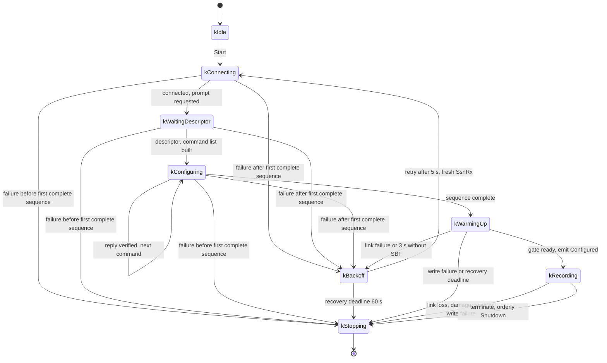

| Element | Responsibility | Source |
|---|---|---|
| States | `kIdle` to `kStopping` | `asterx_driver/include/session.h:66-75` |
| Connect and descriptor | 5 s connect timer; 15 s command timer also covers the descriptor wait | `asterx_driver/src/session.cpp:18-22`, `:95-123` |
| Failure routing | `HandleFailure`: before the first complete sequence → `FailStartup`; while recording → fatal; otherwise backoff with a 60 s total recovery deadline that retries never restart | `asterx_driver/src/session.cpp:508-549`, `:55-57` |
| Watchdog | 3 s without SBF in `kWarmingUp` or `kRecording` | `asterx_driver/src/session.cpp:21`, `:562-568` |
| Damage and reset | CRC and length errors, up-time decrease: counted before readiness, fatal after | `asterx_driver/src/session.cpp:389-423`, `:477-493` |
| Shutdown | Stops timers, closes the socket, drains and closes the writer; failed close emits `FatalError` | `asterx_driver/src/session.cpp:624-656` |
| Result | Any `recording_errors_` marks the driver failed after the Qt loop ends, including a recovered warm-up failure | `asterx_driver/src/asterx_driver_app.cpp:88-92`, `asterx_driver/src/session.cpp:514` |

### 8.4 AsteRx warm-up gate

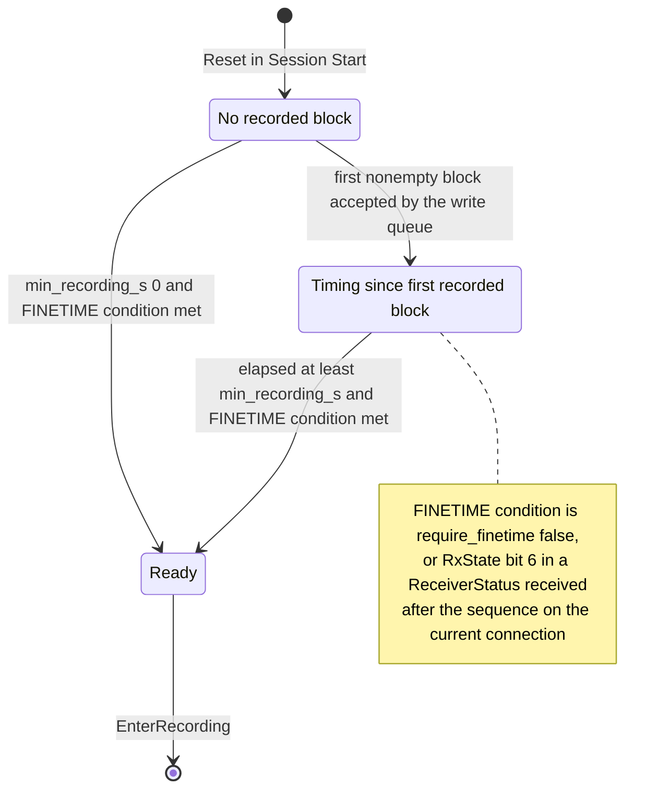

| Element | Responsibility | Source |
|---|---|---|
| `WarmupGate` | `StartRecording` once; `Ready` = duration condition and FINETIME condition | `asterx_driver/include/warmup_gate.h:24-96` |
| Defaults | Code default 1200 s with FINETIME required (`ReceiverSettings`); shipped YAML 90 s without FINETIME; the `WarmupGate` member default (90) is overwritten in `Session::Start` | `asterx_driver/include/commands.h:114-115`, `asterx_driver/config/config-asterx.yaml:21-22`, `asterx_driver/include/warmup_gate.h:28`, `asterx_driver/src/session.cpp:175-177` |
| Evaluation | On each SBF block and every 3 s while warming up | `asterx_driver/src/session.cpp:76-81`, `:454` |
| Reconnect | Receiver status reset; elapsed time preserved | `asterx_driver/include/warmup_gate.h:81-92`, `asterx_driver/src/session.cpp:186`, `:347` |
| Effect on the rig | `Init` returns only when ready, so later drivers start after the warm-up | `asterx_driver/src/asterx_driver_app.cpp:122-135` |

### 8.5 eBUS camera engine phases

The engine has no explicit state enum; the phases follow from flags in `Impl`
(`ebus_driver/src/camera_driver.cpp:106-109`).

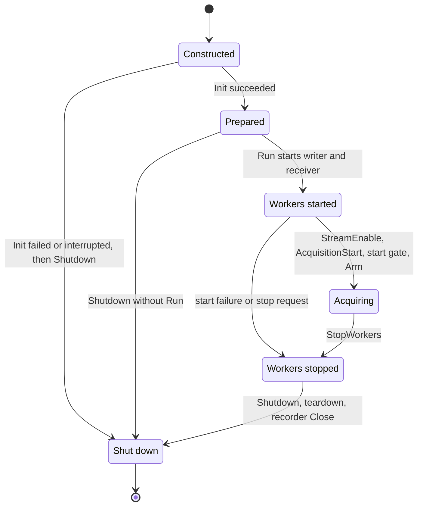

| Element | Responsibility | Source |
|---|---|---|
| Prepared | `initialized` set at the end of `Init`; event `prepared` | `ebus_driver/src/camera_driver.cpp:462-465` |
| Workers started | `run_called`; threads created | `ebus_driver/src/camera_driver.cpp:914-919` |
| Acquiring | `acquisition_started`, `acquiring`, start gate | `ebus_driver/src/camera_driver.cpp:933-948` |
| Workers stopped | `workers_stopped`; Disarm, `AcquisitionStop`, joins | `ebus_driver/src/camera_driver.cpp:872-905` |
| Shut down | `shutdown_done`; final accounting, stream teardown, `Disconnect`, recorder close | `ebus_driver/src/camera_driver.cpp:1029-1189` |

### 8.6 Go-X PTP admission

Active only with `ptp.enabled` (shipped `false`, `gox_driver/config/config-gox.yaml:64-67`).

```mermaid
stateDiagram-v2
    state "Enable, write false then true with readback" as enable
    state "WaitForSync, poll status every 500 ms" as wait
    state "Slave, synchronized" as slave
    state "Prepare fails, on_timeout abort" as fail
    state "Unsynchronized, on_timeout warn_continue" as degraded
    state "Camera session fails" as lost
    [*] --> enable : prepare hook
    enable --> wait : both readbacks verified
    enable --> fail : feature missing or readback mismatch
    enable --> degraded : same, warn_continue
    wait --> slave : status Slave
    wait --> fail : Master, Faulty or sync_timeout_s
    wait --> degraded : same, warn_continue
    slave --> lost : CheckHealth fails after three re-checks
```

| Element | Responsibility | Source |
|---|---|---|
| `PtpManager::Enable` | Write and verify `GevIEEE1588` false, then true | `gox_driver/src/ebus/ptp_manager.cpp:49-99` |
| `WaitForSync` | Poll `GevIEEE1588Status` every 500 ms up to `sync_timeout_s`; Master and Faulty end the wait | `gox_driver/src/ebus/ptp_manager.cpp:17`, `:102-170` |
| `ClassifyPtpStatus` | Maps the status to `kSlave`, `kMaster`, `kFaulty`, `kOther` | `gox_driver/include/ptp_status.h:9-19` |
| `CheckHealth` | Health sample; three re-checks 1000 ms apart before failure | `gox_driver/src/ebus/ptp_manager.cpp:29-30`, `:172-215`, `ebus_driver/src/gox_config.cpp:289-290` |
| Prepare hook | Throws when `Enable` or `WaitForSync` returns false | `ebus_driver/src/gox_config.cpp:131-137` |

### 8.7 LMS4xxx connection state

`Impl::state` is written at each transition but never read in `lms4xxx_driver/src`; it is
diagnostic only (`lms4xxx_driver/include/driver_internal.h:31`).

```mermaid
stateDiagram-v2
    state "kDisconnected" as disc
    state "kConnecting" as conn
    state "kConnected" as connected
    state "kConfiguring" as configuring
    state "kScanning" as scanning
    state "kError" as err
    [*] --> disc
    disc --> conn : Connect
    conn --> connected : TCP connected
    conn --> err : connect failed
    connected --> configuring : Configure
    configuring --> connected : configuration complete
    configuring --> err : configuration failed
    connected --> scanning : StartScanning, workers started
    scanning --> err : read error or worker exception
    scanning --> connected : StopScanning
    err --> connected : StopScanning
    connected --> disc : Disconnect
    err --> disc : Disconnect
```

| Element | Responsibility | Source |
|---|---|---|
| `ConnectionState` | Enum values 0 to 5 | `lms4xxx_driver/include/callbacks.h:12-19` |
| Transitions | `Connect`, `Configure`, `StartScanning`, receive loop, `StopScanning`, `Disconnect` | `lms4xxx_driver/src/driver.cpp:107-119`, `:216`, `:266`, `:281`, `lms4xxx_driver/src/driver_configuration.cpp:273-281`, `:453`, `lms4xxx_driver/src/driver_stream.cpp:196-208` |

## 9. Data view

### 9.1 Session directory

```text
<Output Directory>/<YYYYMMDD_HHMMSS>/              main.cpp:44-49 (refused if it exists)
└── raw/                                           main.cpp:50-52
    ├── log_<YYYYMMDD_HHMMSS>.log                  Logger::Init, main.cpp:55-56
    ├── drivers.json (drivers.json.tmp transient)   DriversJson, drivers_json.cpp:29-72
    ├── config/config-<name>_<ts>.yaml             copy_config, main.cpp:113-125
    ├── sensor_trigger.log                         SensorSync session, created at session start
    ├── asterx/
    │   ├── <prefix>-<UTC>-<n>.sbf                 SbfWriter, sbf_writer.cpp:16-30
    │   ├── live_insnavgeod.csv                    SbfLiveRecorder
    │   └── live_receiverstatus.csv
    ├── gox/<camera id>/                           ebus_driver::RawRecorder
    │   ├── device.json (device.json.part)
    │   ├── events.jsonl
    │   └── seg_NNNNN.raw
    ├── fx10/fx10_<UTC>/                           ebus_driver::RawRecorder, same files
    └── lms4xxx/scan_<id>_<ts>_NNN.bin .csv .json  lms4xxx::RawRecorder
```

| Element | Producer | Content and guarantees | Source |
|---|---|---|---|
| Session folder | `InitializeSystem` | UTC timestamp name; never reused | `main.cpp:43-49` |
| `log_<ts>.log` | spdlog file sink | Complete trace-level log; flushed on error and every 200 ms | `common/src/logger.cpp:42-57` |
| `drivers.json` | `DriversJson` | Run manifest; temp file, `fdatasync`, `rename`, directory `fsync` | `common/src/drivers_json.cpp:29-72` |
| `config/` | `copy_config` | Byte copies of the main and enabled driver YAMLs (`<name>` = `main`, `asterx`, `fx10`, `gox`, `lms4xxx`); fails if a copy exists | `main.cpp:113-129` |
| `sensor_trigger.log` | Upstream `SensorSyncSession` | Board events (log format 3); opened with mode `wx`; only when all participants armed | `common/src/sensor_sync_hub.cpp:162-169`, `3rd_party/External/sensor_trigger/session_client.cpp:72` (fetched) |
| `asterx/*.sbf` | `SbfWriter` | SDK-delivered SBF blocks in arrival order; name `<prefix>-<YYYYMMDDTHHMMSSZ>-<n>.sbf`; no `fsync` | `asterx_driver/src/sbf_writer.cpp:16-30`, `common/include/time_util.h:49-62` |
| `asterx/live_*.csv` | `SbfLiveRecorder` | Display telemetry incl. `host_unix_ns`; not authoritative | `asterx_driver/include/sbf_live_recorder.h:58-70` |
| Camera directory | `ebus_driver::RawRecorder` | `device.json` once in `Init`; `events.jsonl` with `fdatasync` per line; `seg_NNNNN.raw` records with CRC-32C | `ebus_driver/src/raw_recorder.cpp:67-287`; [format](../ebus_driver/README.md#raw-binary-layout) |
| LMS splits | `lms4xxx::RawRecorder` | BIN with complete telegrams, CSV index, JSON metadata with `closed_cleanly`; `O_EXCL` | `lms4xxx_driver/src/raw_recorder.cpp:89-167`; [format](../lms4xxx_driver/docs/DEVICE_CONFIG.md#recording-format) |
| Status mirror | `DriversJson` | Same document at `PHENOMATE_STATUS_FILE` (outside the session) | `common/src/drivers_json.cpp:77-79`, `:170` |

### 9.2 `drivers.json` fields

| Field | Written by | Content | Source |
|---|---|---|---|
| `status_schema` | Constructor | `phenomate-run-v1` | `common/src/drivers_json.cpp:88` |
| `process.pid`, `start_ticks`, `boot_id` | Constructor | `getpid()`, field 22 of `/proc/self/stat`, kernel boot id | `common/src/drivers_json.cpp:80-89` |
| `lifecycle.phase`, `configuration_read`, `sensors`, `revision` | `UpdateLifecycle`, `Finalize` | Section 8.1; `configuration_read` is true when every slot initialized | `common/src/drivers_json.cpp:142-156`, `common/src/session_runner.cpp:181`, `:237` |
| `run.started` | Constructor | ISO-8601 UTC seconds from `system_clock` | `common/src/drivers_json.cpp:92-95` |
| `run.timestamp`, `output_directory`, `session_directory` | `SetRun` | Session name and paths | `common/src/drivers_json.cpp:114-118` |
| `run.version`, `git_sha` | `SetVersion` | `PROJECT_VERSION`, `PHENOMATE_BUILD_REVISION` | `common/src/drivers_json.cpp:121-124`, `CMakeLists.txt:79-82` |
| `run.status`, `recording_failed`, `ended`, `duration_s` | `WriteRunning`, `Finalize` | Status string; prefix test; host wall clock; steady-clock duration | `common/src/drivers_json.cpp:136-159` |
| `drivers.<family>` | `AddDriver` | `enabled: true`, `config`: path of the copy in `raw/config/`; one entry per family, not per instance | `common/src/drivers_json.cpp:127-129`, `main.cpp:174-241` |
| `time_policy` | Constructor | Fixed statements; `association_verified: false` | `common/src/drivers_json.cpp:97-104` |
| `meta.operator`, `meta.field` | `SetMeta` | From `General` | `common/src/drivers_json.cpp:108-111` |
| `driver_results[]` | `CollectResults` | `name` (display name, repeated for each camera or LiDAR), `failed`, `statistics` (`FinalStatistics()` or `statistics_error`) | `common/src/session_runner.cpp:77-105`, `common/src/drivers_json.cpp:132-134` |
| AsteRx `statistics` | `Session::FinalStatistics` | Blocks, bytes, files, queue high-water mark, CRC and length errors, recovery and recording errors, `known_acquisition_incomplete` | `asterx_driver/src/session.cpp:614-622` |
| Camera `statistics` | `EbusCameraDriver::FinalStatistics` | `schema_version` 1, `driver` `unified-ebus`, `camera_id`, counters, trigger accounting, SensorSync quality, recorder summary | `ebus_driver/src/camera_driver.cpp:1241-1254` |
| LMS `statistics` | `Lms4xxxDriverApp::Shutdown` | `instance`, format, receive and writer counters, time-quality counters, stop-measurement status, `failure_reasons` | `lms4xxx_driver/src/lms4xxx_driver_app.cpp:368-392` |

### 9.3 Recorded levels

| Family | Recorded level | Not recoverable from the recording | Specification |
|---|---|---|---|
| AsteRx | SBF blocks as delivered by SsnRx after framing and CRC | Bytes SsnRx discarded while resynchronizing (counted only), ASCII command traffic | [AsteRx](../asterx_driver/docs/DEVICE_CONFIG.md#recording) |
| Go-X, FX10 | SDK buffer bytes after GVSP reassembly plus per-record metadata | Packet headers, SDK processing before delivery | [eBUS](../ebus_driver/README.md#raw-binary-layout) |
| LMS4xxx | Complete CoLa B telegrams received while streaming | Host commands, command-phase replies, bytes rejected by framing | [LMS4xxx](../lms4xxx_driver/docs/DEVICE_CONFIG.md#recording-format) |

## 10. Failure handling

### 10.1 Rig guards

| Guard | Evaluated | Thresholds (code default; shipped) | Effect | Source |
|---|---|---|---|---|
| Disk floor | Once before bring-up; then once per second in the poll loop; not during the sequential `Init` | Stop below 5 GiB (5); warn below 20 GiB (20), latched per crossing; 0 disables | Pre-flight: `failed (disk)` without `Init`. Runtime: all drivers stop, `failed (disk)` | `common/include/run_guards.h:20-28`, `common/src/run_guards.cpp:7-44`, `common/src/session_runner.cpp:115-124`, `:254-280`, `config/config-main.yaml:46-47` |
| No-data watchdog | Every poll for initialized drivers; skipped while `MicrosSinceLastData()` is nullopt | Warn after 5 s (15); stop after 60 s (60) | Driver `RequestFailure`, slot error text, run stops, `failed (<key>)` | `common/include/run_guards.h:23-27`, `common/src/run_guards.cpp:47-83`, `common/src/session_runner.cpp:284-309`, `config/config-main.yaml:51-55` |

Validation of the guard values: each in 0 to 86400; the warning floor must exceed the hard floor
and the warning delay must be shorter than the abort delay (`common/src/main_config.cpp:41-54`).

Liveness sources: AsteRx publishes only after the warm-up gate opens; cameras report from the
last valid buffer, before it from `AcquisitionStart` or the SensorSync start, and nothing when
`expect_data` is false or while waiting for other SensorSync participants; LiDARs report from the
last scan telegram, before it from the stream start
(`asterx_driver/src/session.cpp:351`, `:378`, `ebus_driver/src/camera_driver.cpp:1223-1238`,
`lms4xxx_driver/src/lms4xxx_driver_app.cpp:326-337`).

### 10.2 Per-driver policies

| Driver | Online failure (stops the rig) | Counted, failure at shutdown | Details |
|---|---|---|---|
| AsteRx | Startup failure before the first complete sequence; after readiness any link loss, 3 s SBF silence, CRC or length error, receiver reset; write-queue refusal or write failure in every phase; 60 s recovery deadline | Any `recording_errors_`, including recovered warm-up failures | [AsteRx](../asterx_driver/docs/DEVICE_CONFIG.md#failure-policy-and-reconnects), `asterx_driver/src/session.cpp:461-559` |
| Go-X, FX10 | SDK operation error, block-ID gap or anomaly, incomplete image, unsafe extent, pool or queue exhaustion, `BlocksDropped` increase, control link loss, health sample failure, SensorSync failure, stall or arm timeout, append or event write error | No valid frame although expected, trigger accounting mismatch, SensorSync edge accounting, records ≠ admitted buffers, teardown errors | [eBUS](../ebus_driver/README.md#failure-policy), `ebus_driver/src/camera_driver.cpp:592-681`, `:958-1001`, `:1029-1189` |
| LMS4xxx | Read error or EOF, 1000 consecutive framing errors, first-scan mismatch, time fault, three NTP probe failures, first checksum, framing or parse error, queue full, writer I/O error, scanning stopped | Counter gaps, count mismatch received/queued/written, time-quality events, unconfirmed `LMCstopmeas` | [LMS4xxx](../lms4xxx_driver/docs/DEVICE_CONFIG.md#runtime-guards-and-failure-policy), `lms4xxx_driver/src/driver.cpp:15`, `lms4xxx_driver/include/recording_status.h:13-90` |
| SensorSync | Error report, failed write, STOP not acknowledged: `Ok()` false, which every participant treats as fatal | Edge accounting in each camera's `Shutdown` | `common/include/sensor_sync_log.h:48-52`, `ebus_driver/src/camera_driver.cpp:970-972`, `:1047-1091` |

### 10.3 Failure, `run.status` and exit code

Precedence at the end of `Execute`: status persistence, then driver failures, then the disk guard,
then a signal, otherwise `completed` (`common/src/session_runner.cpp:345-366`). A driver that ends
its own `Run` without failure (for example a frame or duration limit) leads to `completed`.

| Cause | Where | `run.status` | Exit code |
|---|---|---|---|
| Main configuration missing or invalid | `main.cpp:272-276` | No manifest | 1 |
| Session folder exists or cannot be created; log file cannot be opened | `main.cpp:41-57`, `:73` (outside the `try`) | No manifest | 1 |
| Main configuration copy fails; LMS YAML invalid; no driver enabled; LMS enabled without enabled entry; driver YAML copy or camera configuration load fails | `main.cpp:127-158`, `:160-242`, `:249-255` | `failed (configuration)` | 1 |
| Signal during the LMS pre-start stop | `main.cpp:140-148` | `interrupted (signal N)` | 0 |
| First manifest write fails | `main.cpp:243-247` | Manifest may be absent | 1 |
| Disk below the floor before bring-up | `common/src/session_runner.cpp:115-124` | `failed (disk)` | 1 |
| A lifecycle write fails | `common/src/session_runner.cpp:146-149`, `:347-349` | `failed (status persistence)` | 1 |
| Any driver `HasFailed()` at the end (Init failure, Run exception, watchdog, driver policy, shutdown failure, statistics exception) | `common/src/session_runner.cpp:350-356` | `failed (<slot keys>)`, e.g. `failed (asterx, gox:cam0)` | 1 |
| Disk below the floor during the run, no driver failure | `common/src/session_runner.cpp:270-275`, `:357-361` | `failed (disk)` | 1 |
| Signal, no failure | `common/src/session_runner.cpp:362-363` | `interrupted (signal N)` | 0 |
| No signal, no failure | `common/src/session_runner.cpp:364-365` | `completed` | 0 |
| Final manifest write fails | `common/src/session_runner.cpp:367-371` | Last persisted document | 1 |
| Exception in the coordinator | `common/src/session_runner.cpp:396-408` | `failed (session coordinator)` | 1 |

### 10.4 Exception boundaries

| Boundary | Handling | Source |
|---|---|---|
| `Init` | Exception → `RequestFailure` and log | `common/src/session_runner.cpp:158-166` |
| Run thread | Catch-all → `RequestFailure`; logging guarded | `common/src/session_runner.cpp:198-216` |
| `Shutdown` | Per driver catch-all; later drivers still shut down | `common/src/session_runner.cpp:42-61` |
| `FinalStatistics` | Exception → `statistics_error` and failure | `common/src/session_runner.cpp:84-93` |
| Coordinator | Catch-all → cleanup, collect, finalize | `common/src/session_runner.cpp:394-409` |
| Camera workers | `noexcept`, catch-all → `Fail` | `ebus_driver/src/camera_driver.cpp:684-736`, `:739-781` |
| AsteRx Qt thread | Catch → `MarkFailed`, bring-up `Failed`, terminate | `asterx_driver/src/asterx_driver_app.cpp:93-102` |
| LMS workers | Receive loop and monitor catch → fault; writer catch → `Fail` | `lms4xxx_driver/src/driver_stream.cpp:200-209`, `:456-483`, `lms4xxx_driver/src/raw_recorder.cpp:192-196` |

## 11. Deployment view

`start.bash` serves the edge computer only; development machines use the Compose commands in the
[README](../README.md#docker-deployment). Device addresses below come from
`resource/devices_ip.yaml`, which is documentation; the drivers read their own YAML.

```mermaid
flowchart TB
    subgraph edge ["Edge computer, Linux host with Docker"]
        subgraph hostsetup ["Host setup by start.bash"]
            udev["udev rule 99-pleora-keylok.rules"]
            sysctl["net.core.rmem_max 33554432"]
        end
        repo[("Repository checkout")]
        shared[("/mnt/SharedData/Post_Processing_Data")]
        devfs["/dev, KEYLOK hiddev, Teensy ttyACM"]
        subgraph ctr ["Container phenomate-drivers-dev, Ubuntu 22.04, user dev"]
            guiproc["python3 -B -m app.main"]
            pdproc[["build/bin/PhenomateDrivers"]]
            toolproc[["build/bin device tools"]]
            sdk["eBUS SDK 6.5.1, /opt/pleora/ebus_sdk"]
            ws["/workspace, bind mount"]
            ds["/workspace/dataset"]
        end
        nica["NIC enp1s0f2"]
        nicf["NIC enp1s0f0"]
        nicg["NIC enp1s0f1"]
        nicl["NIC eno1"]
        usb["USB"]
    end
    browser["Operator browser, port 8619"]
    asterx["AsteRx 10.95.76.110"]
    fx10["FX10e 10.95.0.100"]
    gox["Go-X 10.95.1.101"]
    lms["LMS4xxx 10.95.76.101 to 103"]
    ss["SensorSync Teensy"]
    keylok["Pleora KEYLOK dongle"]
    browser -->|"HTTP, host network"| guiproc
    guiproc -->|"spawn, SIGTERM"| pdproc
    guiproc -->|"spawn"| toolproc
    pdproc --> sdk
    toolproc --> sdk
    repo -->|"mounted"| ws
    shared -->|"mounted"| ds
    devfs -->|"mounted, cgroup rules"| ctr
    pdproc -->|"host network"| nica
    pdproc -->|"host network"| nicf
    pdproc -->|"host network"| nicg
    pdproc -->|"host network"| nicl
    nica --> asterx
    nicf --> fx10
    nicg --> gox
    nicl --> lms
    ss --> usb
    keylok --> usb
    usb --> devfs
```

| Element | Responsibility | Source |
|---|---|---|
| Host setup | Refuses to run inside a container; installs the KEYLOK udev rule; sets `rmem_max` until reboot; recreates the container; builds in the container | `start.bash:5-38` |
| Container | `phenomate-drivers-dev`, image `phenomate-drivers-dev:local`, target `drivers`; `init: true`; `restart: unless-stopped`; SIGTERM with 180 s grace | `.devcontainer/docker-compose.yml:2-18` |
| Networking | `network_mode: host`, `ipc: host`; capabilities `NET_ADMIN`, `NET_RAW`, `SYS_NICE` | `.devcontainer/docker-compose.yml:23-28` |
| Devices | `/dev` bind mount; cgroup rules `c 180:*` (KEYLOK hiddev) and `c 166:*` (ttyACM); groups 20 (dialout) and 1000 | `.devcontainer/docker-compose.yml:57-69`, `:78` |
| Mounts | Repository at `/workspace`; shared disk at `/workspace/dataset`; user runtime directory | `.devcontainer/docker-compose.yml:71-84` |
| Environment | `PHENOMATE_*` paths for the GUI; `PHENOMATE_CONFIG_ROOT` and `PHENOMATE_DATA_ROOT` = `/workspace` | `.devcontainer/docker-compose.yml:30-55` |
| Image | Ubuntu 22.04, toolchain, Qt5, Boost, OpenSSL, eBUS SDK with SHA-256 check, Python packages, user `dev` | `.devcontainer/Dockerfile:1-116` |
| GUI process | Container command; owns acquisition and tool processes | `.devcontainer/docker-compose.yml:16` |
| Health check | GUI `/healthz` only, not sensors | `.devcontainer/docker-compose.yml:87-92`, `.devcontainer/gui_healthcheck.py` |
| NICs and devices | Interface-to-device mapping as documented | `resource/devices_ip.yaml:3-36` |
| Not provided | `PHENOMATE_BUILD_REVISION` is not passed by `start.bash`, so `run.git_sha` is `unknown` there; the `CAP_SYS_NICE` file capability is not applied by `start.bash` or the GUI | `start.bash:37-38`, [README](../README.md#running) |

## 12. Crosscutting concepts

### 12.1 Logging

- One process-wide spdlog logger named `PhenomateDrivers` with a console sink and a file sink at
  `raw/log_<ts>.log`; both at trace level, errors flushed immediately, everything else every
  200 ms (`common/src/logger.cpp:24-58`).
- On a TTY the console sink is colored and may block; otherwise `NonBlockingStderrSink` switches
  stderr to `O_NONBLOCK`, drops lines it cannot write and counts them; the coordinator reports the
  count at the end (`common/src/logger.cpp:29-37`, `common/src/session_runner.cpp:373-379`).
- Line format `[HH:MM:SS] [level] [Module]: message`; modules come from `DriverLog` instances and
  `Markers` (`common/src/logger.cpp:31-45`, `:78-88`, `common/include/driver_markers.h:6-13`).
- `Log::LogMessage` is documented as non-throwing; `LogAndThrow` and the `DriverLog::Error(true,
  ...)` overload are the only throwing calls and are meant for configuration and `Init`
  (`common/include/logger.h:28-37`, `:86-99`).
- Periodic `[Statistics]` lines are a GUI contract (`fps=`), checked by `tools/check_contracts.py`
  through the `contract_check` test (`CMakeLists.txt:57-60`; [README](../README.md#logging)).
- Lifecycle is published in `drivers.json`; log markers are diagnostics only
  (`common/include/driver_markers.h:7-8`, `common/src/session_runner.cpp:295-296`).

### 12.2 Configuration

- One schema policy for all YAML files: unknown keys, malformed or non-finite values and
  out-of-range values are errors naming the dotted key; omitted keys take code defaults
  (`common/include/config_util.h:21-24`, `:54-348`).
- The main configuration is parsed into a fresh value; relative paths resolve against the
  repository root; `General` is required, `Guards` and `Sensor Trigger` optional, enable switches
  default to false, the SensorSync port must be absolute or empty
  (`common/src/main_config.cpp:7-75`).
- Driver loaders: `asterx::LoadAppConfig`, `gox::LoadAppConfig`, `fx10::LoadAppConfig`,
  `lms4xxx::LoadAppConfig` (`asterx_driver/include/app_config.h:29-33`,
  `gox_driver/include/app_config.h:179-181`, `fx10_driver/include/app_config.h:160-162`,
  `lms4xxx_driver/include/app_config.h:127-131`).
- Cameras load the session copy in `raw/config/`; the AsteRx app parses the original path given in
  the main configuration, and `main.cpp` parses the original LMS YAML before copying it
  (`main.cpp:134`, `:183-188`, `:207-210`, `asterx_driver/src/asterx_driver_app.cpp:24-26`,
  `:110`). LMS metadata embeds the text of the copy
  (`lms4xxx_driver/src/lms4xxx_driver_app.cpp:46-56`).
- Configuration is read once per run; there is no reload.

### 12.3 Time handling

| Clock | Used for | Source |
|---|---|---|
| Device clocks | SBF block times (inside the recorded blocks); camera `device_timestamp_raw` (unscaled, unit and epoch unverified); LMS time block as `device_time_unix_us` plus the raw telegram | `ebus_driver/src/camera_driver.cpp:611-614`, `lms4xxx_driver/src/driver_stream.cpp:441-446` |
| SensorSync board | Trigger, exposure, PPS and ZDA events in `sensor_trigger.log`; association to frames not verified (`association_verified` false) | `ebus_driver/src/camera_driver.cpp:384-390` |
| Host `CLOCK_REALTIME` | Camera `host_realtime_ns`, segment `created_realtime_ns`, event times, AsteRx CSV `host_unix_ns`, manifest `started`/`ended`, file and folder names | `common/include/time_util.h:12-16`, `common/src/drivers_json.cpp:93`, `:157` |
| Host `CLOCK_MONOTONIC` / `steady_clock` | Deadlines, watchdogs, rate statistics, camera `host_monotonic_ns`, LMS `host_receive_monotonic_us`, manifest `duration_s` | `common/include/time_util.h:19-29`, `lms4xxx_driver/include/frame_receiver.h:16`, `common/src/drivers_json.cpp:158-159` |

The rig's time services are configured on the AsteRx (NTP and PTP server, PPS on GPS time; see
`asterx_driver/config/config-asterx.yaml:74-83`); LiDARs are NTP clients; Go-X PTP is optional and
its grandmaster identity is not verified (`gox_driver/include/ebus/ptp_manager.h:3-5`). The manifest
states that it establishes no association (`common/src/drivers_json.cpp:97-104`).

### 12.4 Error policy

- Lower layers return native error types: `std::error_code` in LMS4xxx, `PvResult` wrapped in
  `common::Ebus::SdkError` in the camera layer, Qt signals in the AsteRx session
  (`lms4xxx_driver/include/error.h`, `common/include/ebus/sdk_error.h:20`,
  `asterx_driver/include/session.h:56-63`).
- Adapters latch the first failure (`Fail`, `MarkFailed`, `RequestFailure`) and keep the first
  message; failures are sticky; severity does not decide lifecycle
  (`ebus_driver/src/camera_driver.cpp:156-169`, `common/include/driver_app.h:47-54`).
- There is no retry after the recording has started; the only reconnect path is the AsteRx warm-up
  recovery (`asterx_driver/src/session.cpp:508-549`).
- Exceptions never cross thread boundaries (section 10.4).

### 12.5 Testing

Test sources are listed below; they were not built or run for this document. All use doctest and
synthetic input; none requires a device.

| Suite (CTest entries) | Target under test | Test files | Source |
|---|---|---|---|
| `common_tests` (one entry) | `phenomate_common` | `test_config_util`, `test_driver_app`, `test_drivers_json`, `test_file_writer`, `test_ipv4`, `test_logger`, `test_main_config`, `test_ring_buffer`, `test_run_guards`, `test_sensor_sync_hub`, `test_sensor_sync_quality`, `test_session_runner`, `test_util` | `common/tests/CMakeLists.txt:4-30` |
| `asterx.*` (per file) | `asterx_lib` | `test_app_config`, `test_commands`, `test_sbf_live_recorder`, `test_sbf_parsers`, `test_sbf_write_queue`, `test_sbf_writer`, `test_session` (fake receiver on localhost), `test_warmup_gate` | `asterx_driver/tests/CMakeLists.txt:4-35` |
| `gox.*` (per file) | `gox_config_core` | `test_apply_plan`, `test_buffering`, `test_config`, `test_device_json`, `test_ptp_status`, `test_templates`, `test_user_set` | `gox_driver/CMakeLists.txt:24-37` |
| `fx10.*` (per file) | `fx10_config_core` | `test_apply_plan`, `test_config`, `test_wavelengths`, `test_ebus_config_file` | `fx10_driver/tests/CMakeLists.txt:1-11` |
| `lms4xxx.*` (per file) | `lms4xxx_lib` | `test_command_builder`, `test_command_channel`, `test_clock_quality`, `test_config_schema`, `test_frame_receiver`, `test_measurement_shutdown`, `test_ntp_probe`, `test_recording_status`, `test_statistics`, `test_scan_data_parser`, `test_raw_recorder`, `test_scan_verify` | `lms4xxx_driver/tests/CMakeLists.txt:4-45` |
| `ebus.raw` | `ebus_raw` | `test_raw`, `test_block_ids` | `ebus_driver/CMakeLists.txt:14-18` |
| `contract_check` | GUI parser contract | `tools/check_contracts.py` | `CMakeLists.txt:57-60` |

No test references `EbusCameraDriver`, the Go-X or FX10 hooks, `CameraController`, `PtpManager`,
`AsterxDriverApp`, `Lms4xxxDriverApp`, `Lms4xxxDriver` or `main.cpp`; these paths depend on the SDK,
Qt event loop or devices and are exercised only on hardware.

## 13. Decisions, risks and glossary

### 13.1 Architecture decisions evidenced in code and documents

| ID | Decision | Stated rationale | Evidence |
|---|---|---|---|
| AD-1 | One process, one coordinator: sequential `Init`, concurrent `Run`, joins, reverse `Shutdown` | Single ownership and rollback of partial bring-up | `common/include/session_runner.h:22-26`, `common/src/session_runner.cpp:19-20` |
| AD-2 | Fail fast on the first data loss; no reconnect after readiness | A gap makes the recording incomplete either way | `asterx_driver/include/session.h:25-27`, `lms4xxx_driver/include/recording_status.h:11-12` |
| AD-3 | Record at the SDK or telegram level, unchanged; decode offline | Raw fidelity; offline tools own interpretation | [eBUS](../ebus_driver/README.md#scope), `lms4xxx_driver/include/raw_recorder.h:13-14` |
| AD-4 | Device time recorded raw; host time diagnostic | No host substitution for measurement time | `common/src/drivers_json.cpp:97-104`, `lms4xxx_driver/src/lms4xxx_driver_app.cpp:122-127` |
| AD-5 | Lifecycle through a versioned manifest, not log parsing | Recovery must not depend on log wording | `common/src/drivers_json.cpp:166-169`, `common/include/driver_markers.h:7-8` |
| AD-6 | Strict YAML schema everywhere | Typos must not silently select defaults | `common/include/config_util.h:21-24` |
| AD-7 | Defined device baseline on every start; only recording-relevant writes with readback | Reproducible device state | [README](../README.md#sensors), device documents |
| AD-8 | One camera engine with profile hooks | Shared lifecycle, buffering and failure policy for Go-X and FX10 | `ebus_driver/include/ebus_driver/camera_driver.h:46-56` |
| AD-9 | One SensorSync session per rig, started when all participants armed | One board and one timing log per run | `common/include/sensor_sync_hub.h:61-68` |
| AD-10 | Qt confined to one dedicated thread | At most one `QCoreApplication` per process | `asterx_driver/src/asterx_driver_app.cpp:51-56` |
| AD-11 | Bounded queues that refuse when full; acquisition threads never block on disk or logging | Back-pressure must not reach the device or SDK | `asterx_driver/include/sbf_write_queue.h:18-30`, `common/include/nonblocking_stderr_sink.h:1-10` |
| AD-12 | No driver writes network settings; only `ebus_set_ip` | Rig addressing stays under operator control | [README](../README.md#sensors) |
| AD-13 | Build identity supplied by the caller; configure does not query Git | Reproducible configure step | `CMakeLists.txt:35-39` |

### 13.2 Risks and technical debt

| ID | Observation | Impact | Evidence |
|---|---|---|---|
| R-1 | SBF files are written through `std::ofstream` and closed without `fsync`, while camera and LMS recorders use `fdatasync`; the device document states this | Data accepted before a power loss may be missing from `.sbf` files | `common/include/file_writer.h:140-164`, `:181-189`, [AsteRx](../asterx_driver/docs/DEVICE_CONFIG.md#recording) |
| R-2 | SBF files open with `std::ios::out` (truncate), not `O_EXCL`; uniqueness relies on the fresh session folder and the UTC-plus-sequence name | A name collision would overwrite silently | `common/include/file_writer.h:118`, `asterx_driver/src/sbf_writer.cpp:20-25` |
| R-3 | No manifest is written when the session folder, log file or hub setup fails, because `InitializeSystem` and hub construction precede the `try` block | The GUI sees an unknown result for these early failures | `main.cpp:73-76`, `:272-276` |
| R-4 | The disk guard is not evaluated during sequential `Init`, which includes the AsteRx warm-up (90 s shipped, 1200 s code default) while SBF is already written | A filling disk during bring-up is detected only by write failures | `common/src/session_runner.cpp:115-182`, `asterx_driver/config/config-asterx.yaml:21` |
| R-5 | `driver_results[].name` uses the display name, so multiple cameras or LiDARs share `GoX` or `LMS4xxx`; the status string uses slot keys | Consumers must identify instances from `statistics.camera_id` or `statistics.instance` | `common/src/session_runner.cpp:94`, `:101` |
| R-6 | A recovered AsteRx warm-up reconnect still increments `recording_errors_`, so the run ends as `failed (asterx)` after recording normally | Intentional per the device document; operators may read it as an unexplained failure | `asterx_driver/src/session.cpp:514`, `asterx_driver/src/asterx_driver_app.cpp:90-92` |
| R-7 | `SensorSyncHub::Disarm` holds the hub mutex while the backend stops (reader join, flush, close); other cameras' monitor polls block meanwhile | Bounded stall of camera monitor loops at stop | `common/src/sensor_sync_hub.cpp:176-193` |
| R-8 | LMS writer polls with a 500 µs sleep instead of a blocking pop | About 2000 wake-ups per second per LiDAR | `lms4xxx_driver/src/raw_recorder.cpp:176-184` |
| R-9 | Repository root resolved as `<exe dir>/../..` in two places | Binaries only work from `build/bin` or a same-depth directory | `main.cpp:266`, `ebus_driver/src/fx10_config.cpp:91` |
| R-10 | SensorSync sources follow upstream `main` without a pin; the host copies of firmware rules can drift | Non-reproducible builds; rule mismatch with the board | `cmake/Dependencies.cmake:8-21` |
| R-11 | `BootstrapEnv` may call `setenv` while other driver threads run (AsteRx Qt thread is already active during camera `Init`) | Only if the GenICam variable is unset; the image sets it | `common/src/ebus/env_bootstrap.cpp:30-45`, `.devcontainer/Dockerfile:71` |
| R-12 | Configuration copies are verbatim, including the AsteRx account and NTRIP passwords; log redaction does not apply to them | Credentials are distributed with every session | `main.cpp:113-125`, `asterx_driver/config/config-asterx.yaml:11-15`, `:24-29` |
| R-13 | AsteRx and LMS parse the original YAML, cameras the copy | A file change between copy and load would make `raw/config/` differ from the applied values (the GUI blocks writes during start) | Section 12.2 |
| D-1 | `common::RingBuffer` (lock-free SPSC) is used only by its test; `common/CMakeLists.txt` still advertises it | Dead code | `common/include/ring_buffer.h:26`, `common/CMakeLists.txt:3` |
| D-2 | LMS `DriverStatistics::frames_dropped` is a legacy field without a receive queue, yet appears as `drop_ring`, `dropped_ring` and "receive ring overflow" | Misleading diagnostics | `lms4xxx_driver/include/statistics.h:13`, `lms4xxx_driver/include/recording_status.h:15`, `lms4xxx_driver/src/lms4xxx_driver_app.cpp:371` |
| D-3 | LMS `Impl::state` is never read | Unused state machine | `lms4xxx_driver/include/driver_internal.h:31` |
| D-4 | Camera markers (`kModuleGox`, `kModuleFx10`, `kGoxInitialized`, `kFx10Shutdown`, `*SessionIssues`, `kGox*InstTpl`) are unused outside tests; cameras log as `GoX` and `FX10` | Dead constants with misleading names | `common/include/driver_markers.h:11-30`, `ebus_driver/src/gox_config.cpp:81`, `ebus_driver/src/fx10_config.cpp:49` |
| D-5 | `BoundedQueue::push_wait_for` and `push_blocking` have no production caller | Unused API surface | `common/include/bounded_queue.h:35-62` |
| D-6 | The image installs `libeigen3-dev`, `zlib1g-dev` and `libcli11-dev`, which no CMake target uses | Image size, maintenance | `.devcontainer/Dockerfile:40-46` |
| D-7 | Profile sources live in `ebus_driver/src` but are compiled by `gox_device_config` and `fx10_device_config`; several headers share basenames (`app_config.h`, `raw_recorder.h`) across include roots | Include resolution relies on quoted-include directory lookup and private include paths | `gox_driver/CMakeLists.txt:10-16`, `fx10_driver/CMakeLists.txt:10-13`, `main.cpp:20-21` |
| D-8 | `jai_snapshot` and `fx10_snapshot` do not configure logging, so engine messages go to spdlog's default logger, while the discovery tools redirect to stderr | Inconsistent tool output streams | `gox_driver/tools/snapshot_main.cpp`, `fx10_driver/tools/snapshot_main.cpp`, `common/src/ebus/discover_main.cpp:50` |

### 13.3 Code and documentation inconsistencies

The code is taken as authoritative; none of these was changed.

| ID | Location | Statement | Code |
|---|---|---|---|
| I-1 | `common/include/run_guards.h:24-26`, `config/config-main.yaml:52-54` | The AsteRx has a 30 s SBF watchdog that triggers a reconnect | The watchdog is 3 s (`asterx_driver/src/session.cpp:21`); after readiness a silence is fatal, a reconnect happens only during warm-up (`:519-548`) |
| I-2 | `asterx_driver/src/session.cpp:68` | "a mid-run link loss keeps reconnecting" | Fatal while recording (`asterx_driver/src/session.cpp:519-527`) |
| I-3 | [README](../README.md#architecture) steps 1 and 2 | Configurations are copied and the SensorSync hub opened before `LMCstopmeas` | Only the main configuration is copied before the LMS stop; driver YAMLs after it (`main.cpp:127`, `:139`, `:162-224`); the board opens on the first `Register` in camera `Init` (`common/src/sensor_sync_hub.cpp:114-123`) |
| I-4 | `common/include/drivers_json.h:23` | `config` is the path "as configured" | The path of the copy in `raw/config/` is stored (`main.cpp:174-176`) |
| I-5 | `common/src/logger.cpp:50` | Console at info, file at trace | Console at trace unless `quiet` (`common/src/logger.cpp:38`) |
| I-6 | `asterx_driver/config/config-asterx.yaml:15` | Password 1..16 characters | Limit 32 (`asterx_driver/src/commands.cpp:17`); the device document says 1–32 |
| I-7 | `asterx_driver/config/config-asterx.yaml:122` | Files `<prefix>_<seq>.sbf` | `<prefix>-<UTC>-<n>.sbf` (`asterx_driver/src/sbf_writer.cpp:20-25`) |
| I-8 | `gox_driver/config/config-gox.yaml:70` | Output section titled `jai-raw-seg` | Recordings are `ebus-raw`; `jai-raw-seg` is rejected by the reader ([eBUS](../ebus_driver/README.md#compatibility)) |
| I-9 | `lms4xxx_driver/config/config-lms4xxx.yaml:48` | NTP server `10.95.76.57` is the AsteRx | `resource/devices_ip.yaml:4`, `:26` lists the AsteRx at `10.95.76.110` as the LiDARs' NTP server; which address is correct was not verified |
| I-10 | `start.bash:32-34` | The second stop/remove targets the pre-rename container | Line 34 repeats line 31 (`phenomate-drivers-dev`) |
| I-11 | `common/CMakeLists.txt:3` | `phenomate_common` provides an SPSC ring buffer | Not used by any production target (D-1) |

### 13.4 Glossary

| Term | Meaning |
|---|---|
| Slot, slot key | `common::DriverSlot`; key `asterx`, `fx10`, `gox:<id>` or `lms:<id>`, used in `lifecycle.sensors` and failure statuses |
| Display name | Slot `name`: `AsteRx`, `FX10`, `GoX`, `LMS4xxx`; used in logs and `driver_results[].name` |
| Run manifest | `raw/drivers.json`, schema `phenomate-run-v1` |
| Warm-up gate | AsteRx readiness condition that releases `Init` and the rig |
| SBF | Septentrio Binary Format, block-structured receiver output |
| SsnRx | Vendored Septentrio GNSS receiver communication SDK (Qt) |
| FINETIME | `ReceiverStatus.RxState` bit 6 |
| eBUS | Pleora GigE Vision SDK (`PvDeviceGEV`, `PvStreamGEV`, `PvBuffer`) |
| GVSP, block ID | GigE Vision Streaming Protocol; per-buffer identifier used for gap detection |
| `ebus-raw` | Segment format of the camera recorder (`seg_NNNNN.raw`) |
| Profile, hooks | Device-specific `CameraDefinition` and `DeviceHooks` for Go-X or FX10 |
| CoLa B | SICK binary telegram protocol over TCP |
| Split | One BIN, CSV and JSON triple of an LMS recording |
| SensorSync | Teensy trigger and timing-log board and its host client |
| Participant, owner | Camera registered with `SensorSyncHub`, named `<kind>:<id>` |
| PFNC | GenICam Pixel Format Naming Convention |
| PTP, NTP, PPS, ZDA | Precision Time Protocol; Network Time Protocol; pulse per second; NMEA time and date sentence |
