# Phenomate web control panel: architecture

**Scope.** The NiceGUI web control panel in `app/` (shown as "Phenomate" in the browser), its
Compose deployment and its contracts with the C++ binaries. The C++ side appears only as external
actors; its internals are described in [architecture-drivers.md](architecture-drivers.md).
Workflows, camera procedures and GUI copy rules are specified in
[`app/README.md`](../app/README.md) and are linked, not repeated.

**Date.** 2026-11-26.

**Status.** Derived from the source tree by static reading; not verified in a browser or by
running tests.

**Notation.** C4 model levels 1–3 (system context, containers, components) and UML views
(sequence, state machine), drawn with Mermaid `flowchart`, `sequenceDiagram` and
`stateDiagram-v2`. Source references are `path:line` or `path:first-last` relative to the
repository root. Every diagram is followed by an element catalogue with the columns Element,
Responsibility and Source. `<runtime>` denotes `PHENOMATE_RUNTIME_DIR` (default
`app/_runtime`), `<session>` a recording folder `<Output Directory>/<YYYYMMDD_HHMMSS>`.

## Contents

1. [Introduction and quality goals](#1-introduction-and-quality-goals)
2. [Constraints](#2-constraints)
3. [System context (C4 level 1)](#3-system-context-c4-level-1)
4. [Containers (C4 level 2)](#4-containers-c4-level-2)
5. [Components (C4 level 3)](#5-components-c4-level-3)
6. [Runtime views](#6-runtime-views)
7. [State machines](#7-state-machines)
8. [Concurrency view](#8-concurrency-view)
9. [Data view](#9-data-view)
10. [Interfaces and contracts with the C++ side](#10-interfaces-and-contracts-with-the-c-side)
11. [Deployment view](#11-deployment-view)
12. [Crosscutting concepts](#12-crosscutting-concepts)
13. [Decisions, risks and glossary](#13-decisions-risks-and-glossary)

## 1. Introduction and quality goals

### 1.1 Purpose

The control panel is the operator interface of the rig and the component that launches
`PhenomateDrivers` in the deployed container. It starts and stops recordings, edits the YAML
configurations, runs the camera tools (discovery, Set IP, snapshots, exposure series, focus
assist, references) and shows previews decoded from recorded RAW data. Offline export, format
conversion and calibration of recordings belong to the separate PhenomateDecoders project
(`app/README.md:3-7`). Browsers hold no state that matters for a recording: all control state
lives in one server process and is shared by every connected browser.

### 1.2 Quality goals

| Priority | Goal | Realization in code | Source |
|---|---|---|---|
| 1 | Data protection: the GUI never interrupts, overwrites or mis-associates recorded data or configurations | Five invariants (§1.3) | `app/README.md:50-73` |
| 2 | Independence: a recording survives closed browsers and a GUI restart | Acquisition runs in its own process session; a restarted GUI adopts it by process identity | `app/services/runtime.py:46-55`, `app/services/process.py:331-349` |
| 3 | Fail closed: unverified state locks conflicting controls instead of guessing | `control_uncertain` and `tool_uncertain` start `True` and are cleared only after verification | `app/state.py:71`, `app/state.py:90`, `app/services/camera_operations.py:26-38` |
| 4 | Responsiveness: file scans and decoding stay off the event loop | `asyncio.to_thread`, single-flight tasks, bounded caches (§8) | `app/services/storage.py:110-122`, `app/services/preview_images.py:22-46` |
| 5 | Traceability: operations leave verifiable records | Tool journal, run manifest, `reference.json`, `series.json` (§9) | `app/services/tool_jobs.py:33-40`, `app/services/gox_reference.py:96-122` |

### 1.3 Data-protection invariants as evidenced in code

| Invariant | Mechanism | Source |
|---|---|---|
| Camera exclusion | `guard_reason(driver)` refuses while a tool exit or acquisition ownership is unverified, while a recording starts or stops, and, during a recording, for any camera whose driver was enabled at start (`enables_at_start`, missing entry counts as enabled). `run()` checks the guard and `STATE.snapshot_busy` and sets the reservation before its first `await`; the work runs in a shielded task. Discovery (`"discovery"`) is exempt only from the recording-ownership rule; FX10 reference collection passes `None` (whole rig idle) and also refuses when `pgrep` finds `PhenomateDrivers`. Recording start refuses while a tool holds or may hold a camera. | `app/services/camera_operations.py:26-73`, `app/services/ebus_tools.py:85`, `app/services/fx10_reference.py:167`, `app/services/fx10_reference.py:265-266`, `app/services/process.py:134-135`, `app/services/process.py:143-147` |
| Device-tool journal and launch gate | `check_idle` runs `pgrep -x` for each registered tool name; `begin` journals the operation; the tool starts behind a `/bin/sh` gate that prints its PID and `exec`s only after reading `GO`, which is sent after the PID, start ticks and boot id are journaled (fsync, rename, directory fsync). Stop targets the journaled identity: SIGTERM, SIGKILL after 15 s, exit confirmed within 5 s. After a restart, `reconcile` marks an unfinished entry `interrupted` only if no registered tool and no journaled process is alive. | `app/services/tool_jobs.py:20-104`, `app/services/tool_jobs.py:169-193`, `app/services/runtime.py:58-65`, `app/services/atomic_json.py:10-23` |
| TERM-only acquisition stop | `stop()` latches the request; `_stop_when_ready` waits for an in-flight launch, then sends SIGTERM once per verified identity and never escalates; after 60 s it only reports. GUI shutdown latches Stop, stops tools and waits while acquisition or a tool is active. | `app/services/process.py:289-329`, `app/services/runtime.py:128-138`, `app/services/control_service.py:51-70` |
| Ownership by identity and manifest | Adoption requires exactly one `pgrep` match, the triple (PID, `/proc` start ticks, boot id) and a `<runtime>/acquisition.json` plus `<session>/raw/drivers.json` carrying the same triple and `phenomate-run-v1`; a run is clean only if its final manifest says so. One controller per container through `flock` on `controller.lock`. | `app/services/runtime.py:86-125`, `app/services/run_status.py:26-57`, `app/services/session_info.py:25-69`, `app/services/control_owner.py:14-26` |
| Verified configuration writes | `_require_writable` refuses saves while a tool runs or its exit is unknown, while ownership is unverified and while `config_locked` is set (§7.3). Saves check path and `mtime_ns`, copy a `.bak` and replace through a temporary file. Apply edits text, re-parses and compares every written value (`_verified_text`), writes recording and snapshot configs as a staged pair, rechecks before each replace, rolls back on failure and refuses a `.bak` that overlaps an active config. | `app/services/config_store.py:124-159`, `app/services/config_store.py:299-421` |
| Retention | References and exposure series are created under `<Output Directory>/tmp/`; `reference_storage.save` refuses an existing target and moves by `os.rename`. Failed GOX references keep their RAW and a `failed` record; FX10 pairs are accepted only if the phase counters equal `session_end`; ColorChecker calibration reads its frame with payload CRC-32C verification. | `app/services/reference_storage.py:23-43`, `app/services/gox_reference.py:134-147`, `app/services/fx10_reference.py:101-134`, `app/decoder/gox/color_checker.py:469`, `app/decoder/gox/color_checker.py:590` |

## 2. Constraints

| Constraint | Value | Source |
|---|---|---|
| Python runtime | System `python3` of Ubuntu 22.04 (the release ships the 3.10 series; the patch version is not pinned), no virtual environment, started as `python3 -B -m app.main` from `/workspace`. No 3.11-only constructs (`except*`, `tomllib`, `TaskGroup`, `asyncio.timeout`) were found in non-test code; `session_info.read` rewrites a trailing `Z` before `fromisoformat`, as 3.10 requires. | `.devcontainer/Dockerfile:1-3`, `.devcontainer/Dockerfile:36`, `.devcontainer/docker-compose.yml:16`, `app/services/session_info.py:57` |
| Python packages | `nicegui==3.14.0`, `numpy==2.2.6`, `opencv-python==5.0.0.93`, `pyyaml==6.0.3`; FastAPI is used through NiceGUI and is not pinned separately. | `requirements.txt:1-4`, `app/main.py:7-8` |
| Single controller | Exclusive non-blocking `flock` on `PHENOMATE_CONTROL_LOCK` (default `<runtime>/controller.lock`), held for the server lifetime, never unlinked; every control entry point calls `control_owner.require()`. | `app/services/control_owner.py:14-31`, `app/services/process.py:142`, `app/services/camera_operations.py:44`, `app/services/config_store.py:153`, `app/services/tool_jobs.py:197-198` |
| No login | No authentication, session secret or per-user storage exists in `app/`; access is limited only by the listening address `PHENOMATE_GUI_HOST`. | `app/constants.py:28-29`, `README.md` "Docker deployment" |
| Container-only execution | GUI, acquisition and tools share one Linux container; process identity relies on `/proc` and `pgrep -x`, which matches at most 15 characters of the process name. | `app/services/runtime.py:13`, `app/services/runtime.py:68-105` |
| Prebuilt binaries | The GUI launches binaries from `build/bin/` and never builds them; preflight refuses a missing executable. | `app/constants.py:12-18`, `app/services/process.py:122-123` |
| Text-level configuration | YAML is edited as text to keep comments; the GUI checks syntax only, the C++ loaders remain the final validators. | `app/services/config_store.py:1-2`, `app/services/config_store.py:110-121` |
| Settings namespace | `PHENOMATE_*` only; `AMIGA_*` names are not read. | `app/constants.py:20-29`, `app/constants.py:63`, `app/README.md:87-88` |
| Edge startup | `start.bash` is for the edge computer only; development machines use the Compose commands. | `README.md` "Docker deployment" |

## 3. System context (C4 level 1)

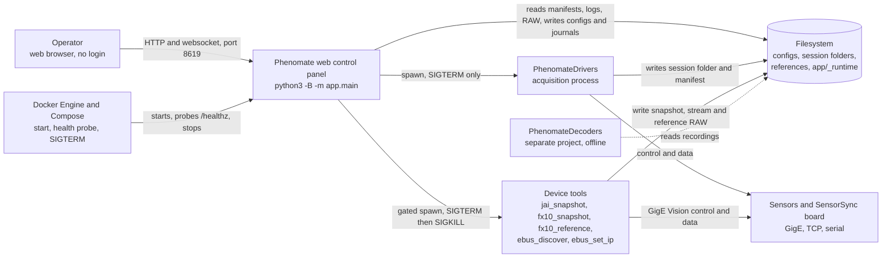

Notation: solid arrows are runtime interactions, the dashed arrow is offline use, the cylinder is
persistent storage. The GUI never talks to a sensor directly.

| Element | Responsibility | Source |
|---|---|---|
| Operator | Starts and stops recordings, tunes cameras, captures references; any browser that reaches the port has full control | `app/ui/layout.py:25-34`, `README.md` "Web GUI" |
| Docker Engine and Compose | Runs the container, probes readiness, sends SIGTERM and allows 180 s before forced termination | `.devcontainer/docker-compose.yml:14-18`, `.devcontainer/docker-compose.yml:87-92` |
| Phenomate web control panel | Owns acquisition, device tools and configuration writes; serves pages and previews | `app/main.py:54-65`, `app/services/control_service.py:1-70` |
| PhenomateDrivers | Records all enabled sensors; publishes the run manifest | `app/constants.py:13`, [architecture-drivers.md](architecture-drivers.md) |
| Device tools | One-shot or streaming camera utilities started one at a time by the GUI | `app/services/tool_jobs.py:20`, `app/constants.py:14-18` |
| Filesystem | Configuration files, session folders, `tmp` references, GUI runtime directory | §9 |
| Sensors and SensorSync board | Reached only through the C++ processes | `README.md` "Sensors" |
| PhenomateDecoders | Offline consumer of recordings; no runtime link to the GUI | `app/README.md:5-7` |

## 4. Containers (C4 level 2)

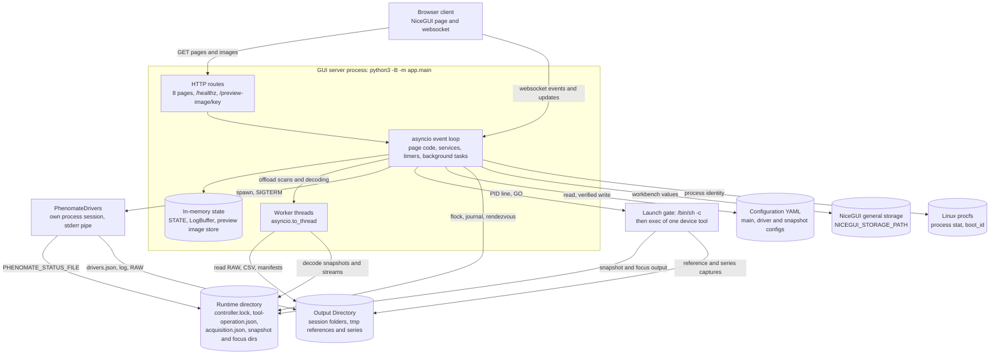

Notation: cylinders are stores; boxes inside the subgraph run in one OS process.

| Element | Responsibility | Source |
|---|---|---|
| Browser client | Renders pages; receives element updates over the NiceGUI websocket; fetches preview images over HTTP | `app/services/preview_images.py:1-10` |
| HTTP routes | Page routes registered by `@ui.page` on import; `/healthz` and `/preview-image/{key}` registered on the NiceGUI app | `app/main.py:13-38` |
| asyncio event loop | Runs page handlers, `ui.timer` callbacks, the service assembly and all state transitions | `app/services/process.py:31-34`, `app/services/control_service.py:20-32` |
| Worker threads | Run blocking file I/O and decoding with immutable arguments | `app/services/gox_focus.py:12-13`, `app/services/live_view.py:101-104` |
| In-memory state | `STATE` (`AppState`), recording snapshot, log ring, preview store, per-workflow results; lost on restart | `app/state.py:83-109`, `app/services/log_buffer.py:40-46`, `app/services/preview_images.py:36-37` |
| PhenomateDrivers | Acquisition child; stdout discarded, stderr piped until the session log is tailed | `app/services/runtime.py:46-55`, `app/services/process.py:227-234` |
| Launch gate | Prints its PID, waits for `GO`, then `exec`s the tool so the PID is unchanged | `app/services/runtime.py:58-65` |
| Configuration YAML | Main config, the four driver configs it names, two snapshot configs | `app/constants.py:20-27`, `app/constants.py:81-91`, `app/services/config_store.py:70-80` |
| Runtime directory | GUI journals and lock; acquisition rendezvous; tool work directories | `app/constants.py:63-68`, `app/services/tool_jobs.py:21` |
| Output Directory | Recordings written by C++; `tmp/` references and exposure series | `app/services/reference_storage.py:12-25` |
| NiceGUI general storage | Server-wide `app.storage.general` (workbench values, target camera, ROI size) | `app/ui/camera.py:153-163`, `.devcontainer/docker-compose.yml:49` |
| Linux procfs | `/proc/<pid>/stat` start ticks and `/proc/sys/kernel/random/boot_id` | `app/services/runtime.py:13`, `app/services/runtime.py:93-105` |

HTTP endpoints:

| Route | Handler | Function | Source |
|---|---|---|---|
| `/` | `dashboard_page` | Overview: start/stop, recording details, Enable switches, sensor cards, storage, run result | `app/ui/dashboard.py:68-272` |
| `/live` | `live_page` | Data preview: on-demand GoX frame and FX10 spectrum from the running session | `app/ui/live.py:17-164` |
| `/asterx` | `asterx_page` | Navigation & IMU: live AsteRx CSV telemetry and route | `app/ui/asterx.py:133-295` |
| `/camera` | `camera_page` | Camera workbench: discovery, Set IP, GoX/FX10 snapshots, Apply, focus assist | `app/ui/camera.py:121-640` |
| `/reference` | `reference_page` | FX10 white/dark pair, FX10 and GOX exposure series, GOX ColorChecker | `app/ui/reference.py:59-275`, `app/ui/gox_reference.py:116-520` |
| `/config` | `config_page` | Text editor for main and driver configs | `app/ui/config_editor.py:17-143` |
| `/logs` | `logs_page` | Filtered view of the in-memory log ring | `app/ui/logs.py:13-57` |
| `/sessions` | `sessions_page` | Recording history from manifests, 20 rows per page, track map | `app/ui/sessions.py:28-199` |
| `/healthz` | `health` | JSON `{"ready", "controller_connected"}`; `ready` is true only after `control_service.startup()` completed | `app/main.py:19-21`, `app/main.py:41-45` |
| `/preview-image/{key}` | `preview_image` | Bytes from the preview store; `?download=1` sets `attachment`; 404 when evicted, 500 when a producer fails; `Cache-Control: private, max-age=86400, immutable` | `app/main.py:24-38` |
| Framework routes | NiceGUI | Static assets and the websocket transport; not defined in `app/` | — |

## 5. Components (C4 level 3)

### 5.1 Layers and dependency rule

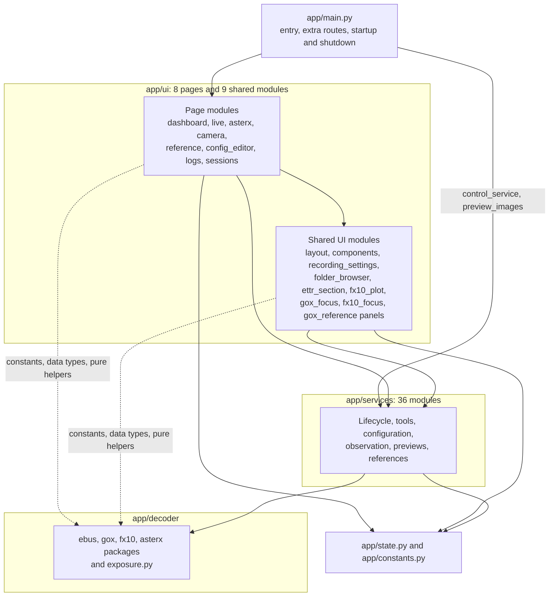

Notation: solid arrows are imports of behaviour; dashed arrows are imports of constants, types and
pure functions, which `app/README.md:42-43` permits.

| Element | Responsibility | Source |
|---|---|---|
| `app/main.py` | Imports all pages (registration by decorator), adds two routes, runs `control_service` on startup and shutdown | `app/main.py:10-65` |
| Page modules | One `@ui.page` each; build elements once and update them from timers | `app/ui/components.py:6-7` |
| Shared UI modules | Shell and header, widgets and copy, Overview recording details, server folder browser, ETTR panel, echart options, focus panels, GOX reference panel | `app/ui/layout.py:1`, `app/ui/components.py:1-8`, `app/ui/recording_settings.py:30`, `app/ui/folder_browser.py:142` |
| `app/services` | Owns every side effect: processes, journals, configuration writes, session observation, previews, reference records | `app/README.md:29`, `app/README.md:33-38` |
| `app/decoder` | Pure readers and algorithms; no device control, no process start, no writes to recordings | `app/README.md:24-28`, `app/README.md:45-48` |
| `app/state.py`, `app/constants.py` | Shared state object and recording snapshot; paths, settings, config registry, tick intervals | `app/state.py:1-109`, `app/constants.py:1-98` |

Import verification (by `grep` over every `import` line in `app/`, tests excluded):

- No module in `app/services/` or `app/decoder/` imports `nicegui` or `fastapi`; no service
  imports `app/ui/`; no decoder module imports `app/services/`, `app/ui/` or `app/state.py`. No
  violation of the documented direction was found.
- `app/main.py:11` imports `control_service` and `preview_images` directly, skipping `app/ui/`;
  the direction is still downward.
- Decoder-internal imports follow `app/README.md:43-45`: `gox` and `fx10` build on `ebus` and
  `exposure.py` (`app/decoder/gox/recording.py:8`, `app/decoder/gox/exposure.py:12`,
  `app/decoder/fx10/exposure.py:15`), and `app/decoder/fx10/focus.py:36` reuses `png_bytes`.
- `app/decoder/fx10/recording.py:16` is the only absolute project import
  (`from app.decoder.ebus import ...`); all other modules import relatively.
- `tool_jobs` imports `control_owner` and `pathlib.Path` inside functions
  (`app/services/tool_jobs.py:51`, `app/services/tool_jobs.py:197`).

### 5.2 Page to service mapping

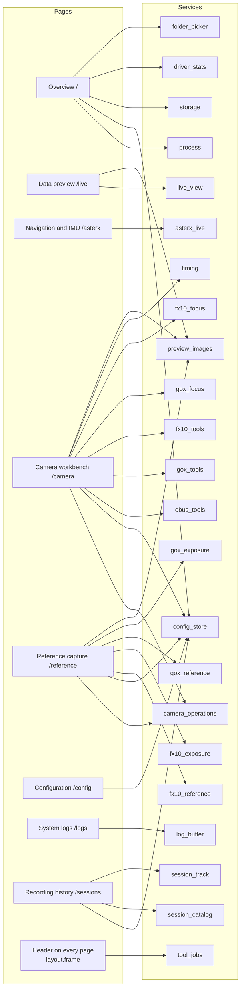

| Element | Responsibility | Source |
|---|---|---|
| Overview `/` (with `recording_settings`, `folder_browser`, `components`) | Start via `process.preflight`/`start`, Stop via `process.stop`; Enable switches via `config_store.set_enable`; recording details via `config_store.set_main_fields`; folder browsing via `folder_picker`; sensor cards read `driver_stats.STATS`; byte formatting from `storage` | `app/ui/dashboard.py:10-14`, `app/ui/dashboard.py:275-336`, `app/ui/recording_settings.py:10-11`, `app/ui/recording_settings.py:199`, `app/ui/folder_browser.py:8`, `app/ui/components.py:17-18` |
| Data preview `/live` | `live_view.fetch_gox`/`fetch_fx10`; releases its preview URLs on client deletion | `app/ui/live.py:13`, `app/ui/live.py:24-33`, `app/ui/live.py:133-164` |
| Navigation and IMU `/asterx` | Renders `asterx_live.LIVE`; uses decoder `STALE_S`, `sample_age_s` | `app/ui/asterx.py:11-12`, `app/ui/asterx.py:275-294` |
| Camera workbench `/camera` (with `gox_focus`, `fx10_focus`, `fx10_plot` panels) | Discovery and Set IP (`ebus_tools`), snapshots (`gox_tools`, `fx10_tools`), Apply and `device.ip` update (`config_store`), focus streams, guard display (`camera_operations.guard_reason`), timing limits | `app/ui/camera.py:16-21`, `app/ui/gox_focus.py:15-19`, `app/ui/fx10_focus.py:15-20` |
| Reference capture `/reference` (with `gox_reference`, `ettr_section`) | FX10 pair, FX10 and GOX series, ColorChecker capture, choose/reject, Save, Apply of the suggestion | `app/ui/reference.py:7-13`, `app/ui/gox_reference.py:9-16` |
| Configuration `/config` | `config_store.read`, `validate`, `save`, `get` | `app/ui/config_editor.py:7-12` |
| System logs `/logs` | Subscribes to `log_buffer.BUFFER`; unsubscribes on client deletion | `app/ui/logs.py:7-8`, `app/ui/logs.py:49-52` |
| Recording history `/sessions` | `session_catalog.Catalog` and `session_track.TrackView`; default root from `config_store.main_settings` | `app/ui/sessions.py:13-15`, `app/ui/sessions.py:30-42` |
| Header (`layout.frame`) | Acquisition badge, controller status, config notice, tool banner and "Stop tool" via `tool_jobs.stop` | `app/ui/layout.py:37-122` |
| Services | See §5.3–5.5 | `app/services/` |

Pages also import `app/state.py` and `app/constants.py` for `STATE` and tick intervals; these
edges are omitted.

### 5.3 Service to decoder mapping

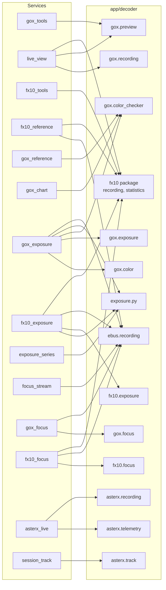

| Element | Responsibility | Source |
|---|---|---|
| `ebus.recording` | `ebus-raw` reader: header, metadata, sequence and CRC-32C checks, `session_end`, newest committed record | `app/decoder/ebus/recording.py:19-45`, `app/decoder/ebus/recording.py:213-300` |
| `gox.preview`, `gox.recording` | Native 12-bit frames, 8-bit screen PNG, lazy 16-bit PNG | `app/decoder/gox/recording.py:12-67`, `app/decoder/gox/preview.py:17-18` |
| `gox.color_checker`, `gox.color` | Chart detection, measurement, CCM fit, previews; color calibration record and device exposure | `app/decoder/gox/color_checker.py:27-39`, `app/decoder/gox/color.py:17-22` |
| `gox.exposure`, `fx10.exposure`, `exposure.py` | ETTR points, fit, suggestion and verification | `app/decoder/exposure.py:16-19`, `app/decoder/gox/exposure.py:12`, `app/decoder/fx10/exposure.py:15` |
| `gox.focus`, `fx10.focus` | GoX Gr-plane focus score; FX10 edge LSF FWHM | `app/decoder/gox/focus.py:35-37`, `app/decoder/fx10/focus.py:36` |
| `fx10` package | Capture metadata, cubes, band statistics, finalization check | `app/decoder/fx10/__init__.py:3-4`, `app/decoder/fx10/recording.py:55-118` |
| `asterx.*` | Incremental CSV tail, telemetry model, bounded route for history | `app/decoder/asterx/recording.py:11-17`, `app/decoder/asterx/track.py:13-16` |
| Services | Callers listed by import; each passes paths and receives values | imports at the top of each service module |

### 5.4 Lifecycle and observation services

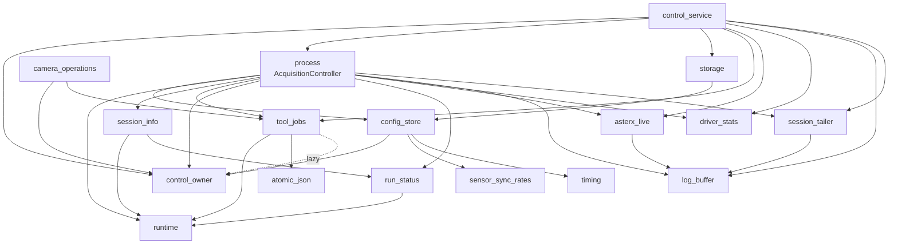

Notation: arrows are module imports; the dashed arrow is a function-local import.

| Element | Responsibility | Source |
|---|---|---|
| `control_service` | Service assembly: lock, subscriptions, reconcile, reattach, 2 s maintenance and storage loops, ordered shutdown | `app/services/control_service.py:20-70` |
| `process` (`AcquisitionController`) | Sole owner of the recording snapshot, launch, watch, stop latch, reattach and final verdict | `app/services/process.py:28-402` |
| `tool_jobs` | Tool registry, journal, gated spawn, bounded output, verified termination, restart reconciliation | `app/services/tool_jobs.py:1-222` |
| `camera_operations` | Camera guard and the single event-loop reservation shared by all tools | `app/services/camera_operations.py:1-73` |
| `runtime` | `exec_`, acquisition `spawn`, `gated_tool`, `pgrep`, process identity, signalling | `app/services/runtime.py:1-138` |
| `run_status`, `session_info` | Validate `phenomate-run-v1` documents, map sensor states, recover the session of an identity, judge clean completion | `app/services/run_status.py:13-107`, `app/services/session_info.py:13-69` |
| `config_store` | Config registry resolution, reads, saves, Apply, Set IP update, Overview fields | `app/services/config_store.py:1-911` |
| `control_owner` | `flock` ownership; `require()` for control entry points | `app/services/control_owner.py:14-38` |
| `atomic_json` | fsync, rename and directory fsync for small JSON records | `app/services/atomic_json.py:10-23` |
| `session_tailer`, `log_buffer`, `driver_stats` | Tail the session log; ring buffer with stderr hand-off; `fps=` statistics | `app/services/session_tailer.py:19-104`, `app/services/log_buffer.py:40-110`, `app/services/driver_stats.py:46-126` |
| `asterx_live` | Incremental AsteRx CSV reader for the active session | `app/services/asterx_live.py:15-66` |
| `storage` | Disk usage and per-sensor session size every 2 s | `app/services/storage.py:66-146` |
| `timing`, `sensor_sync_rates` | Python mirrors of C++ timing and SensorSync limits | `app/services/timing.py:13-21`, `app/services/sensor_sync_rates.py:13-20`, `app/README.md:138-143` |

`control_service`, `process`, `tool_jobs`, `camera_operations`, `run_status`, `config_store`,
`driver_stats` and `storage` also import `app/state.py`; several import `app/constants.py`. These
edges are omitted. `timing`, `sensor_sync_rates` and `log_buffer` import no project module.

### 5.5 Camera tool, preview and reference services

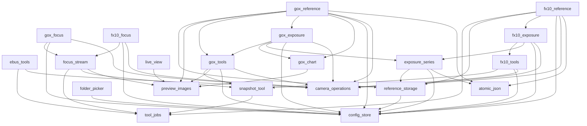

| Element | Responsibility | Source |
|---|---|---|
| `ebus_tools` | Discovery (`ebus_discover --json`) and Set IP (`ebus_set_ip --json`) inside the reservation | `app/services/ebus_tools.py:84-172` |
| `gox_tools`, `fx10_tools` | Workbench snapshots, RAW capture for series and references, decode for display | `app/services/gox_tools.py:53-128`, `app/services/fx10_tools.py:20-147` |
| `snapshot_tool` | Run a registered tool, interpret the `SNAPSHOT:` marker, name and prune snapshot directories | `app/services/snapshot_tool.py:20-81` |
| `focus_stream` | Shared stream supervisor: spawn, poll, heartbeat stop, SIGTERM, segment pruning | `app/services/focus_stream.py:33-174` |
| `gox_focus`, `fx10_focus` | Focus-stream state, analysis scheduling and views | `app/services/gox_focus.py:32-300`, `app/services/fx10_focus.py:35-299` |
| `gox_reference`, `fx10_reference` | Reference capture, validation, records and Save | `app/services/gox_reference.py:96-320`, `app/services/fx10_reference.py:24-300` |
| `gox_exposure`, `fx10_exposure`, `exposure_series` | ETTR brackets, fit, verification and `series.json` | `app/services/gox_exposure.py:158-452`, `app/services/fx10_exposure.py:132-273`, `app/services/exposure_series.py:55-115` |
| `gox_chart` | Candidate thumbnails and operator selection shared by GOX reference and series | `app/services/gox_chart.py:15-38` |
| `reference_storage` | `<Output Directory>/tmp` location and move-on-Save | `app/services/reference_storage.py:12-43` |
| `live_view` | Single-flight preview of the running session | `app/services/live_view.py:77-166` |
| `preview_images` | LRU store of preview bytes and lazy producers behind `/preview-image/{key}` | `app/services/preview_images.py:21-101` |
| `folder_picker` | Read-only directory listing inside `PHENOMATE_DATA_ROOT` (fallback repository root) | `app/services/folder_picker.py:54-161` |

## 6. Runtime views

### 6.1 GUI start, controller lock and reattachment

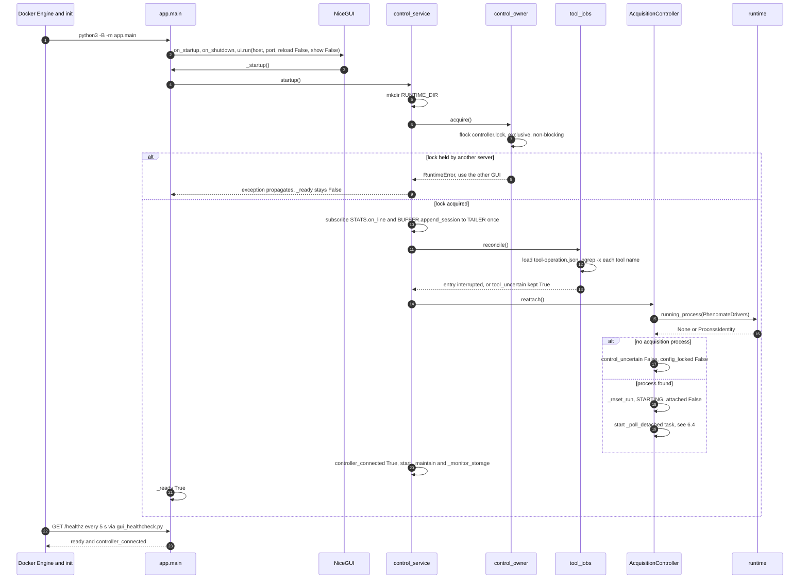

| Element | Responsibility | Source |
|---|---|---|
| Docker Engine and init | `init: true` starts the command `python3 -B -m app.main`; the engine runs the health check every 5 s | `.devcontainer/docker-compose.yml:14-16`, `.devcontainer/docker-compose.yml:87-92` |
| `app.main` | Registers handlers, runs NiceGUI, gates `/healthz` on `_ready` | `app/main.py:16-65` |
| `control_service.startup` | Lock, subscriptions (once per process), tool reconcile, reattach, background loops | `app/services/control_service.py:20-32` |
| `control_owner.acquire` | `flock(LOCK_EX or LOCK_NB)`; raises if another server owns the lock | `app/services/control_owner.py:14-26` |
| `tool_jobs.reconcile` | Recovers or certifies the journaled tool operation | `app/services/tool_jobs.py:169-193` |
| `AcquisitionController.reattach` | Adopts exactly one running `PhenomateDrivers` or certifies absence | `app/services/process.py:331-349` |
| `runtime.running_process` | `pgrep -x` with the 15-character name; exactly one PID or an error | `app/services/runtime.py:108-118` |
| `gui_healthcheck.py` | Loopback probe of `/healthz`; fails unless `ready` is `true` | `.devcontainer/gui_healthcheck.py:8-20` |

### 6.2 Start recording

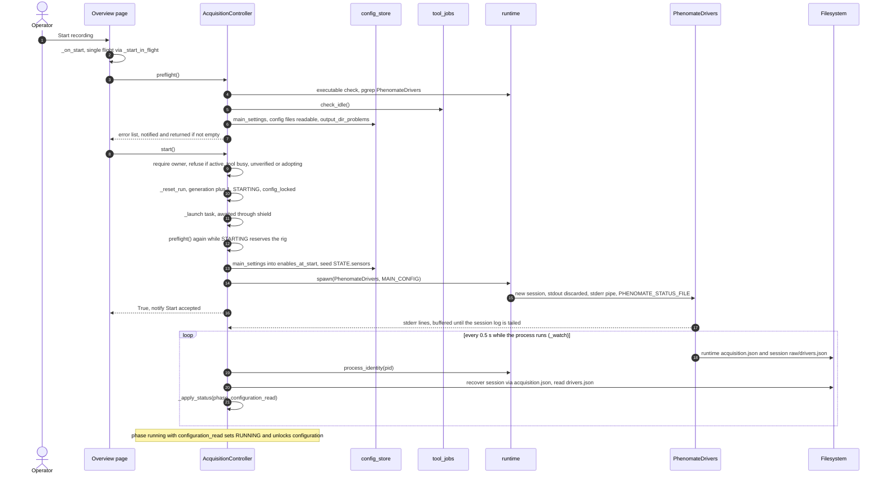

| Element | Responsibility | Source |
|---|---|---|
| Overview page | Single-flight start, notifications, detail-draft check after the preflight await | `app/ui/dashboard.py:293-322` |
| `preflight` | Binary, other acquisition, tools idle, enabled configs readable, `PHENOMATE_DATA_ROOT`, at least one sensor, no camera tool | `app/services/process.py:119-138` |
| `start` | Synchronous reservation, then shielded `_launch` | `app/services/process.py:140-152` |
| `_reset_run` | New `session_generation`, STARTING, locks, stops tailers, clears log and statistics | `app/services/process.py:78-94` |
| `_launch` | Repeated preflight, stop-before-spawn check, enable snapshot, spawn, watcher | `app/services/process.py:154-188` |
| `runtime.spawn` | `start_new_session=True`, `PHENOMATE_STATUS_FILE=<runtime>/acquisition.json` | `app/services/runtime.py:46-55` |
| `_watch` | stderr drain, 0.5 s identity and manifest loop, final verdict | `app/services/process.py:226-265` |
| `_apply_status` | Sensor states from the manifest; phase to process state and lock | `app/services/process.py:190-205` |

### 6.3 Stop recording (SIGTERM only)

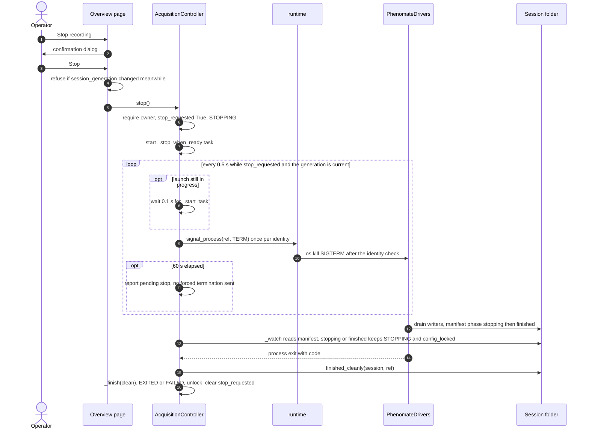

| Element | Responsibility | Source |
|---|---|---|
| Overview page | Confirmation and generation check before `stop()` | `app/ui/dashboard.py:325-336`, `app/ui/components.py:104-112` |
| `stop` | Latches the request; one stop task per generation | `app/services/process.py:289-296` |
| `_stop_when_ready` | Waits for launch, signals once per identity, warns after `term_timeout` (60 s), never KILL | `app/services/process.py:303-329` |
| `runtime.signal_process` | Re-checks identity, sends SIGTERM (KILL is accepted as a value but only `tool_jobs` passes it) | `app/services/runtime.py:128-138` |
| `finished_cleanly` | `phase == finished`, `recording_failed is False`, `ended` set, status `completed` or `interrupted (signal N)` | `app/services/session_info.py:63-69` |
| `_finish` | Final manifest applied, EXITED or FAILED, unlocks, last error from the log ring | `app/services/process.py:96-117` |

### 6.4 Reattachment after a GUI restart

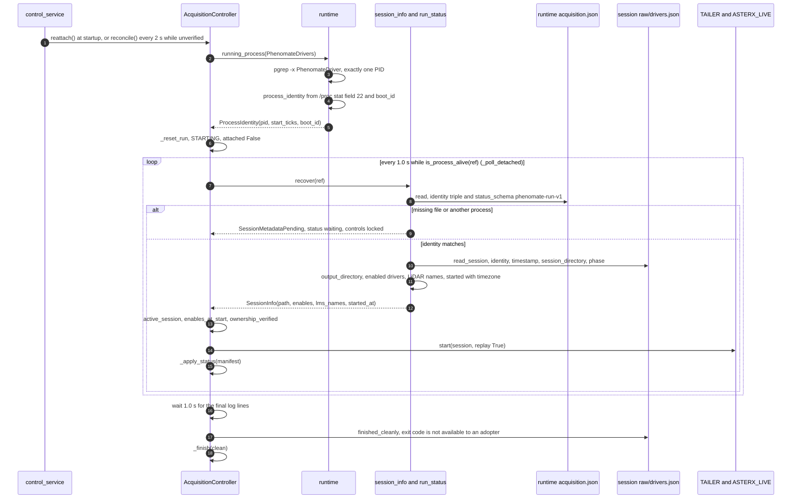

| Element | Responsibility | Source |
|---|---|---|
| `reattach` / `reconcile` | Adopt or certify absence; retried by the 2 s maintenance loop while `control_uncertain` and no monitor task runs | `app/services/process.py:331-356`, `app/services/control_service.py:35-42` |
| `runtime.process_identity` | Start ticks from field 22 after the last `)` of `/proc/<pid>/stat`; zombies count as exited | `app/services/runtime.py:93-105` |
| `run_status.control_session` | Rendezvous through `<runtime>/acquisition.json`; ignores a document of another process | `app/services/run_status.py:33-42` |
| `run_status.read_session` | Identity, timestamp, `session_directory`, phase and lifecycle checks | `app/services/run_status.py:45-57` |
| `session_info.read` | Output directory, driver enables, LiDAR names from the lifecycle, sensor update dry run, start time | `app/services/session_info.py:35-60` |
| `_observe_session` | First match recovers and starts the tailers with replay; later polls read `drivers.json` only | `app/services/process.py:207-224` |
| `_poll_detached` | 1.0 s liveness and manifest loop; manifest-only verdict | `app/services/process.py:358-389` |
| `_recover_after_disconnect` | After a monitoring error, re-identifies the process every 2.0 s; a different identity resets the run | `app/services/process.py:267-287` |

### 6.5 Session tailing and `[Statistics]` parsing

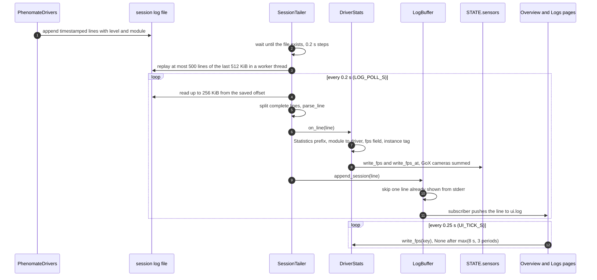

| Element | Responsibility | Source |
|---|---|---|
| `SessionTailer` | Bounded replay, offset-based follow, partial-line handling, `ready` flag that ends the stderr feed | `app/services/session_tailer.py:16-104` |
| `parse_line` | `[HH:MM:SS] [level] [Module]: msg` with ANSI stripping | `app/services/log_buffer.py:10-37` |
| `DriverStats.on_line` | `[Statistics] ` prefix, module map (GoX, FX10, LMS4xxx and their App tags), `fps=` regex, GoX per-camera sum, period tracking | `app/services/driver_stats.py:32-104` |
| `DriverStats.write_fps` | Staleness after `max(8.0 s, 3 × period)` | `app/services/driver_stats.py:43`, `app/services/driver_stats.py:107-118` |
| `LogBuffer` | Ring of 5000 lines, 500-line stderr hand-off, fan-out to page subscribers | `app/services/log_buffer.py:20`, `app/services/log_buffer.py:40-92` |
| Pages | Sensor cards read `STATS`; the Logs page pushes lines on arrival | `app/ui/components.py:123-188`, `app/ui/logs.py:42-52` |

### 6.6 On-demand live preview

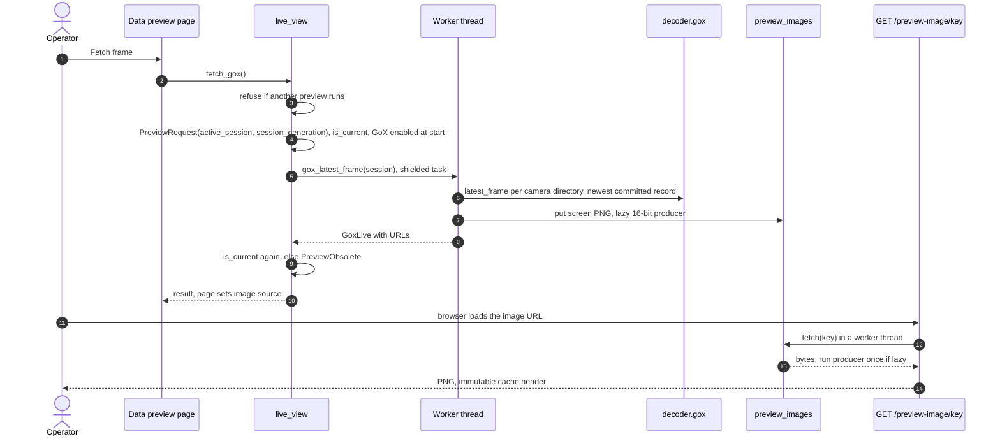

| Element | Responsibility | Source |
|---|---|---|
| Data preview page | Per-kind pending flag and version counter; releases its URLs when the client is deleted | `app/ui/live.py:20-33`, `app/ui/live.py:136-164` |
| `live_view._fetch` | Single flight, session and generation pinning, shielded worker, obsolescence check | `app/services/live_view.py:77-115` |
| `gox_latest_frame`, `fx10_spectrum` | Newest committed GoX frame; FX10 raw-DN statistics over about 1 s of frames, refused if older than 3 s | `app/services/live_view.py:25-26`, `app/services/live_view.py:126-166` |
| `preview_images` | 64 entries or 512 MiB materialized, LRU eviction, per-entry producer lock | `app/services/preview_images.py:21-101` |
| `/preview-image/{key}` | Worker-thread fetch, HTTP status mapping, cache header | `app/main.py:24-38` |

### 6.7 Device tool job: GoX snapshot with journal and launch gate

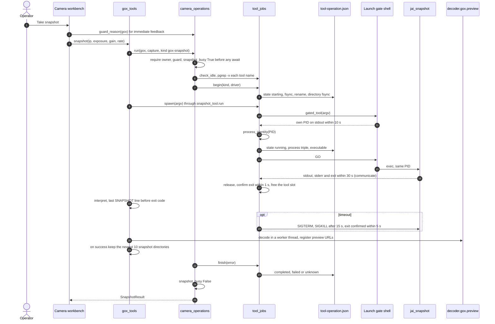

| Element | Responsibility | Source |
|---|---|---|
| Camera workbench | Validates values, stores them in NiceGUI general storage, calls the service | `app/ui/camera.py:483-533` |
| `gox_tools.snapshot` | Reservation with kind `gox-snapshot`; capture, decode, prune | `app/services/gox_tools.py:53-75` |
| `gox_tools.capture_raw` | Argv with workbench overrides, 30 s timeout, output-directory check | `app/services/gox_tools.py:15`, `app/services/gox_tools.py:78-111` |
| `camera_operations.run` | Guard, reservation, journal begin and finish, shielded task | `app/services/camera_operations.py:41-73` |
| `tool_jobs.spawn` | Registry and overlap check, PID read, journal, `GO`; on error closes stdin (gate exits) or terminates | `app/services/tool_jobs.py:49-82` |
| Launch gate | `printf "%s\n" "$$"; IFS= read -r permit && [ "$permit" = GO ] && exec "$@"` | `app/services/runtime.py:58-65` |
| `tool_jobs.communicate`, `terminate`, `finish` | Read to EOF with timeout; TERM then KILL; journal final state | `app/services/tool_jobs.py:94-166` |
| `snapshot_tool.interpret`, `prune` | Marker semantics; keep `SNAPSHOT_KEEP` = 10 directories | `app/services/snapshot_tool.py:36-53`, `app/services/snapshot_tool.py:77-81`, `app/constants.py:66` |

Other jobs follow the same pattern with different `kind` values: `discover`, `set-ip`,
`fx10-snapshot`, `fx10-reference`, `gox-color-reference`, `gox-exposure-series`,
`fx10-exposure-series`, `gox-focus`, `fx10-focus` (`app/services/ebus_tools.py:85`,
`app/services/ebus_tools.py:134-135`, `app/services/fx10_tools.py:90`,
`app/services/fx10_reference.py:167`, `app/services/gox_reference.py:130-131`,
`app/services/gox_exposure.py:174-175`, `app/services/fx10_exposure.py:143-144`,
`app/services/gox_focus.py:200`, `app/services/fx10_focus.py:193`). Exposure series run several
tools in one operation; `release` frees the slot between them.

### 6.8 Configuration save and Apply

Editor save:

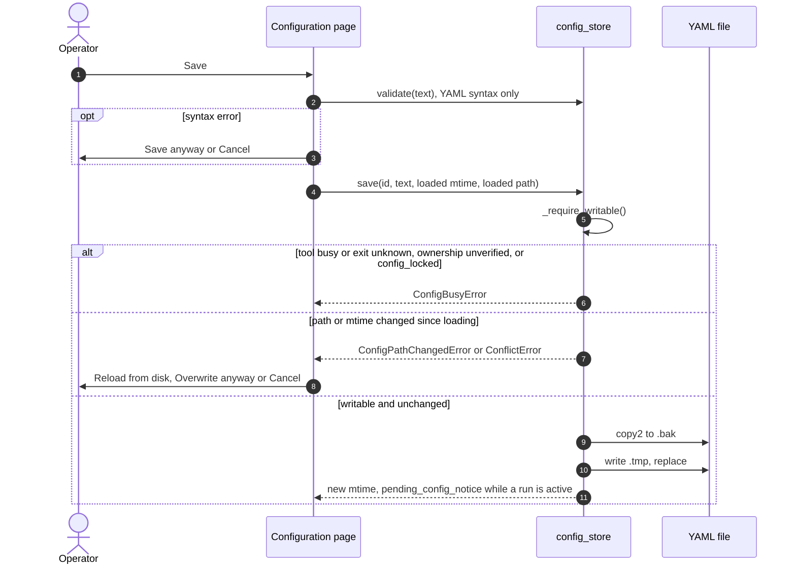

| Element | Responsibility | Source |
|---|---|---|
| Configuration page | One editor per config; syntax dialog; conflict dialog; 2 s path watch | `app/ui/config_editor.py:33-143` |
| `config_store.validate` | `yaml.safe_load` only | `app/services/config_store.py:110-121` |
| `config_store.save` | Writable check, path and mtime check (skipped for Overwrite anyway), `.bak`, temporary file, replace; no `await` inside | `app/services/config_store.py:124-148` |
| `_require_writable` | Check order: owner, tool, ownership, lifecycle lock | `app/services/config_store.py:151-159` |

Apply to config (GoX shown; FX10 uses `apply_fx10_acquisition` on `config-fx10.yaml` and the FX10
snapshot config):

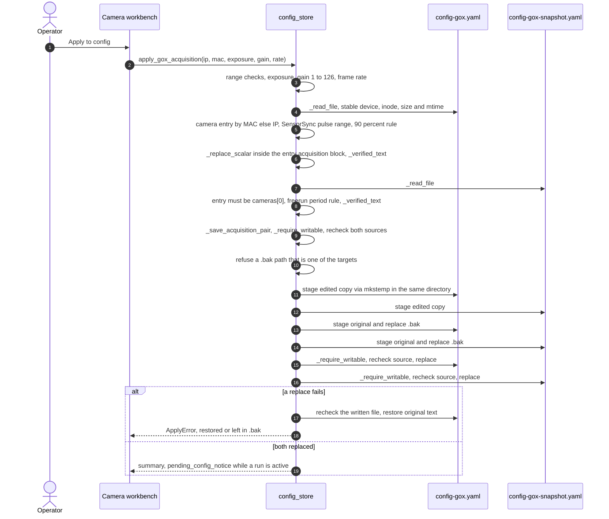

| Element | Responsibility | Source |
|---|---|---|
| Camera workbench | `_gox_apply`, `_fx10_apply`; Set IP calls `apply_device_ip` after a successful `ebus_set_ip` | `app/ui/camera.py:416-459`, `app/ui/camera.py:535-548`, `app/ui/camera.py:626-640` |
| `apply_gox_acquisition` | Value checks and the paired edit | `app/services/config_store.py:495-531` |
| `_gox_camera_entry` | MAC-bound entries match by MAC only; otherwise IP; highest rank wins | `app/services/config_store.py:429-475` |
| `_gox_acquisition_text` | Snapshot entry must be `cameras[0]`; SensorSync and period rules; bounded scalar replacement | `app/services/config_store.py:574-609` |
| `_verified_text` | Re-parse and compare every edited key path (floats within 1e-9) | `app/services/config_store.py:299-320` |
| `_save_acquisition_pair` | Staging, `.bak` replacement, rechecked replaces, reverse rollback | `app/services/config_store.py:363-421` |
| `apply_fx10_acquisition` | FX10 exposure, binnings (together or not at all), rate; timing and SensorSync checks | `app/services/config_store.py:680-775` |

### 6.9 FX10 white and dark reference

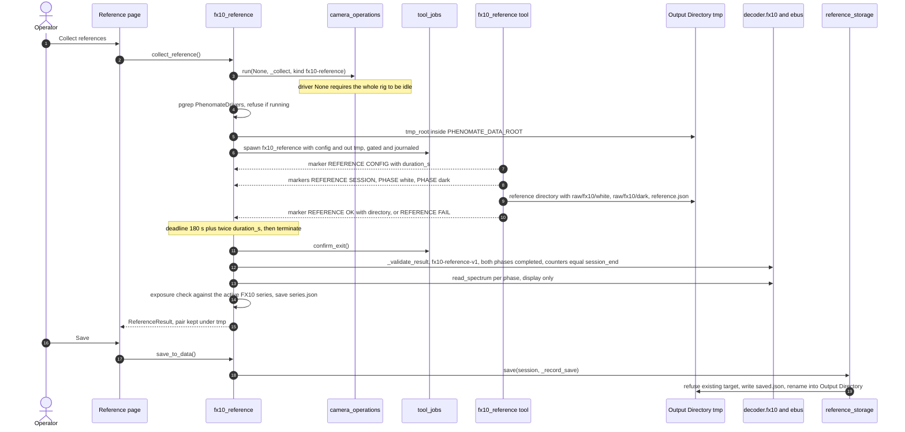

| Element | Responsibility | Source |
|---|---|---|
| Reference page | Collect, series, Apply of the suggestion (exposure only), Save | `app/ui/reference.py:184-271` |
| `_collect` | Acquisition check, spawn, marker wait, validation, spectra, exposure check | `app/services/fx10_reference.py:257-300` |
| `_Progress.feed` | Parses `REFERENCE: CONFIG`, `SESSION`, `PHASE white`, `PHASE dark`, `OK`, `FAIL` | `app/services/fx10_reference.py:170-201` |
| `_wait`, `_stop` | 180 s setup and finalization plus both capture intervals; bounded drain after terminate | `app/services/fx10_reference.py:24`, `app/services/fx10_reference.py:204-240` |
| `_validate_result` | Path, size ≤ 4 MiB, format, status, durations, frames, phase paths, finalization, `session_end` | `app/services/fx10_reference.py:101-134` |
| `read_spectrum` | Statistics for display; errors never fail the pair | `app/services/fx10_reference.py:44-52` |
| `reference_storage.save` | Move from `tmp`; target must not exist; note written first | `app/services/reference_storage.py:28-43`, `app/services/fx10_reference.py:147-149` |

### 6.10 GOX ColorChecker reference

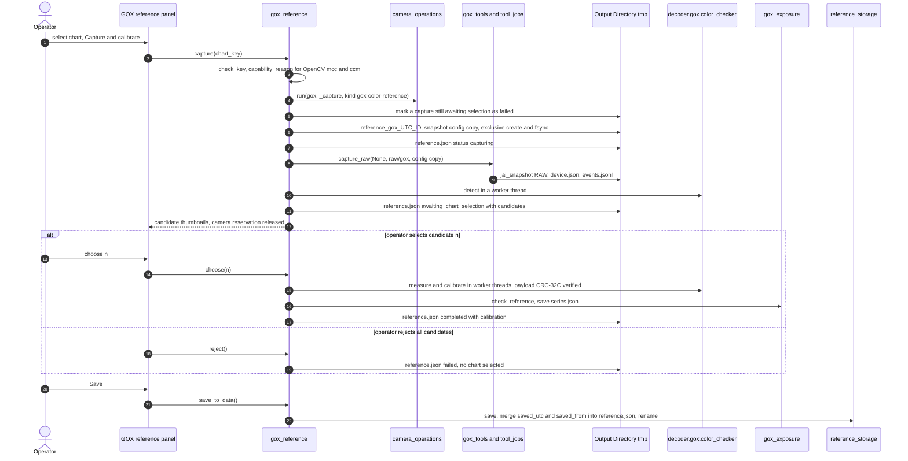

| Element | Responsibility | Source |
|---|---|---|
| GOX reference panel | Chart selection, capture, candidate dialog, series, Apply, Save | `app/ui/gox_reference.py:116-520` |
| `capture` / `_capture` | Preconditions, reservation, session preparation, RAW capture, detection, pending selection | `app/services/gox_reference.py:125-206` |
| `_prepare`, `_initialize` | Directory `reference_gox_<UTC>_<8 hex>`, config copy (`xb` + fsync), initial record | `app/services/gox_reference.py:96-122` |
| `choose`, `reject` | One decision per capture (`_take_pending`); calibration, exposure check, final record | `app/services/gox_reference.py:209-292` |
| `_write_failed`, `_abandon_pending` | Failure record keeps RAW; a newer capture fails a pending one | `app/services/gox_reference.py:134-155` |
| `gox_chart` | Thumbnails in the preview store; `NO_CHART_SELECTED` reason | `app/services/gox_chart.py:15-38` |
| `save_to_data` | Move and re-register previews for the moved paths | `app/services/gox_reference.py:295-320` |

### 6.11 Focus-assist stream (GoX; FX10 is analogous)

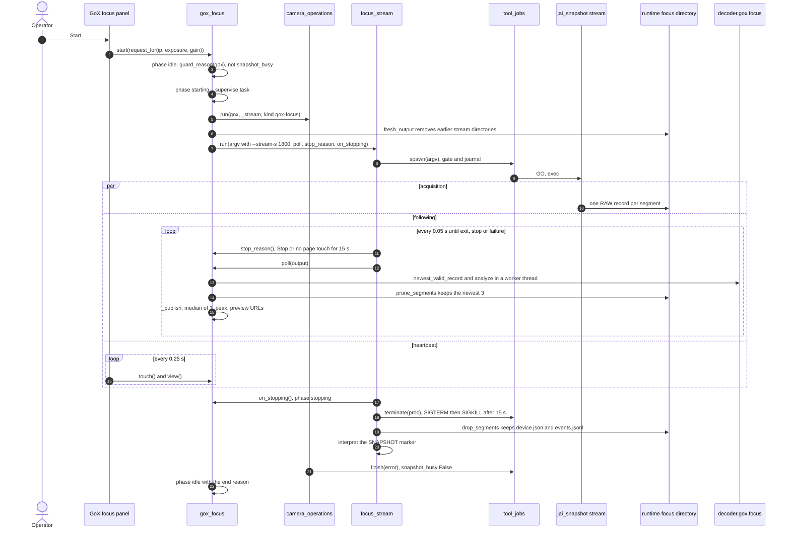

| Element | Responsibility | Source |
|---|---|---|
| GoX focus panel | Start/Stop/Reset, ROI, heartbeat `touch()` in its 0.25 s timer | `app/ui/gox_focus.py:79-219` |
| `gox_focus.start`, `_supervise`, `_stream` | Guard, phase, reservation, argv with workbench overrides and `--stream-s 1800` | `app/services/gox_focus.py:172-221` |
| `gox_focus._poll`, `_publish`, `_read_newest` | Newest committed record, ROI score, median and peak, overview at most every 1.0 s | `app/services/gox_focus.py:32-35`, `app/services/gox_focus.py:233-300` |
| `focus_stream.run` | Spawn, 0.05 s poll, stop reasons, terminate, bounded output tails, result interpretation; exit reasons 7 and 130 after a stop count as stopped before the first frame | `app/services/focus_stream.py:33-101` |
| Heartbeat | Stop when no page touched the stream for 15 s | `app/services/focus_stream.py:34`, `app/services/focus_stream.py:50-54` |
| Segment handling | Remove earlier streams, keep 3 segments while streaming, drop all segments at the end | `app/services/focus_stream.py:36`, `app/services/focus_stream.py:145-174` |
| FX10 variant | `fx10_snapshot --stream-s 1800` with binnings and rate; analysis at most every 0.25 s over ≤ 16 frames | `app/services/fx10_focus.py:35-39`, `app/services/fx10_focus.py:204-251` |

## 7. State machines

### 7.1 `AcquisitionController` process state

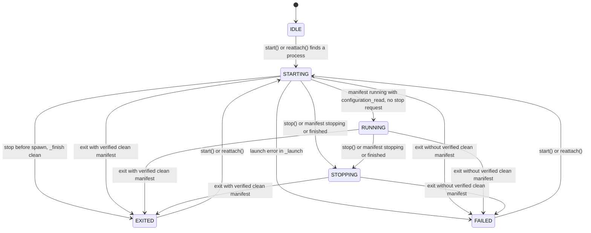

| Element | Responsibility | Source |
|---|---|---|
| `ProcState` | `IDLE`, `STARTING`, `RUNNING`, `STOPPING`, `EXITED`, `FAILED` | `app/state.py:11-17` |
| `RecordingSnapshot` | Frozen snapshot: process state, `attached`, `last_error`, `active_session`, `enables_at_start`, `run_result`, `stop_requested`, `config_locked`, `ownership_verified`, `control_uncertain`, `session_generation` | `app/state.py:57-72` |
| Write protection | `AppState.__setattr__` refuses recording fields; reads go through `CONTROLLER.snapshot_value` | `app/state.py:95-106`, `app/services/process.py:392-393` |
| Start and reattach transitions | `_reset_run` sets STARTING and increments `session_generation` | `app/services/process.py:78-94`, `app/services/process.py:148`, `app/services/process.py:341-343` |
| Manifest-driven transitions | `_apply_status` | `app/services/process.py:190-205` |
| Stop transition | `stop()` | `app/services/process.py:289-296` |
| Launch error | FAILED with `control_uncertain` and `config_locked`, followed by `reattach()` | `app/services/process.py:180-188` |
| Exit transitions | Attached: exit code 0 and `finished_cleanly`; adopted: `finished_cleanly` only | `app/services/process.py:249-256`, `app/services/process.py:378-389` |

Orthogonal flags: `control_uncertain` (ownership not verified; the header shows "State unverified"
regardless of `ProcState`, `app/ui/layout.py:111-112`), `attached` (false for adopted runs) and
`stop_requested` (latched until `_finish`). A stale task of an earlier run is ignored through
`session_generation` (`app/services/process.py:56-57`).

The manifest lifecycle phase (`initializing → running → stopping → finished`, `README.md` "Lifecycle
protocol and recovery") is interpreted as follows (`app/services/process.py:198-205`,
`app/services/run_status.py:53-56`):

| Manifest phase | `configuration_read` | Process state set | `config_locked` |
|---|---|---|---|
| `initializing` | any | unchanged | true |
| `running` | false | unchanged | true |
| `running` | true | `RUNNING` unless a stop was requested | false |
| `stopping`, `finished` | any | `STOPPING` | true |
| other value | — | document rejected | unchanged |

### 7.2 Tool-operation journal

```mermaid
stateDiagram-v2
    state "no entry" as noEntry
    [*] --> noEntry
    noEntry --> starting : begin()
    completed --> starting : begin() of the next operation
    failed --> starting : begin() of the next operation
    interrupted --> starting : begin() of the next operation
    starting --> running : spawn() journals the gate PID
    running --> running : release() then spawn() of the next tool
    running --> stopping : terminate() or stop()
    starting --> failed : finish(error) without a process
    running --> completed : finish() confirms exit
    running --> failed : finish(error)
    stopping --> completed : finish() after a requested stop
    stopping --> failed : finish(error)
    starting --> unknown : finish() cannot confirm exit
    running --> unknown : finish() cannot confirm exit
    stopping --> unknown : finish() cannot confirm exit
    starting --> interrupted : reconcile(), no tool alive
    running --> interrupted : reconcile(), no tool alive
    stopping --> interrupted : reconcile(), no tool alive
    unknown --> interrupted : reconcile(), no tool alive
```

| Element | Responsibility | Source |
|---|---|---|
| Entry fields | `id`, `kind`, `driver`, `state`, `started_ns`, `error`; later `process` (pid, start_ticks, boot_id), `executable`, `stop_requested`, `ended_ns` | `app/services/tool_jobs.py:37-40`, `app/services/tool_jobs.py:64`, `app/services/tool_jobs.py:159-160`, `app/services/tool_jobs.py:202` |
| `starting` | Written by `begin` before any tool exists | `app/services/tool_jobs.py:37-40` |
| `running` | Written after the gate PID is identified and before `GO` | `app/services/tool_jobs.py:62-70` |
| `stopping` | Written before signalling by `terminate` (owned handle) or `stop` (header button) | `app/services/tool_jobs.py:107-117`, `app/services/tool_jobs.py:196-215` |
| `completed`, `failed`, `unknown` | `finish` after exit confirmation and `check_idle`; `unknown` sets `tool_uncertain` | `app/services/tool_jobs.py:152-166` |
| `interrupted` | `reconcile` after a restart when neither a registered tool name nor the journaled identity is alive | `app/services/tool_jobs.py:169-193` |
| Stop before launch | `stop` on `starting` without a process only records `stop_requested`; `spawn` then refuses | `app/services/tool_jobs.py:53-54`, `app/services/tool_jobs.py:202-205` |

### 7.3 Configuration write permission (lifecycle gate)

```mermaid
stateDiagram-v2
    state "Refused, ownership unverified" as U
    state "Writable" as W
    state "Refused, startup lock" as S
    state "Refused, shutdown lock" as D
    [*] --> U : GUI start, control_uncertain True
    U --> W : reattach() finds no process
    U --> S : reattach() adopts a process
    W --> S : start() resets the run
    S --> W : manifest running with configuration_read
    S --> D : manifest stopping or finished
    W --> D : manifest stopping or finished
    D --> W : _finish() after exit
    S --> U : metadata unavailable or launch error
    W --> U : monitoring failed
    U --> W : same process re-identified with config unlocked
```

| Element | Responsibility | Source |
|---|---|---|
| Check order | `control_owner.require()`, then tool (`snapshot_busy` or `tool_uncertain`), then `control_uncertain`, then `config_locked` | `app/services/config_store.py:151-159` |
| Unverified | Initial `control_uncertain=True`; set by `_metadata_unavailable`, launch errors and monitoring failures | `app/state.py:71`, `app/services/process.py:64-71`, `app/services/process.py:183`, `app/services/process.py:260` |
| Startup lock | `_reset_run` sets `config_locked`; cleared by `_apply_status` for `running` with `configuration_read` | `app/services/process.py:86`, `app/services/process.py:198-199` |
| Shutdown lock | `stopping` or `finished` sets `config_locked`; `_finish` clears it | `app/services/process.py:202-203`, `app/services/process.py:107` |
| Writers | Editor saves, Overview fields and Enable switches, Apply, Set IP `device.ip` | `app/services/config_store.py:124-131`, `app/services/config_store.py:370`, `app/services/config_store.py:396` |

The tool gate is orthogonal and checked first; it follows §7.4. Between `stop()` and the manifest
reporting `stopping`, saves remain allowed because the manifest still reports `running`
(`app/services/process.py:198-201`); this matches `app/README.md:64-66`.

### 7.4 Camera reservation

```mermaid
stateDiagram-v2
    state "Unverified, tool_uncertain" as U
    state "Free" as F
    state "Reserved, snapshot_busy" as R
    [*] --> U : AppState default
    U --> F : reconcile(), no registered tool alive
    U --> U : reconcile(), a tool is still alive
    F --> R : run() passes guard_reason, set before any await
    F --> F : guard refuses, CameraBusyError
    R --> F : finish() confirms exit and check_idle
    R --> U : finish() or terminate() cannot confirm exit
```

| Element | Responsibility | Source |
|---|---|---|
| `tool_uncertain` | Starts `True`; set when an exit cannot be confirmed; cleared by `finish` or `reconcile` | `app/state.py:90`, `app/services/tool_jobs.py:81`, `app/services/tool_jobs.py:116`, `app/services/tool_jobs.py:158`, `app/services/tool_jobs.py:190-192` |
| `snapshot_busy` | Reservation flag set and cleared only by `camera_operations.run` | `app/services/camera_operations.py:46-67` |
| `guard_reason` | Reasons in order: tool unverified, ownership unverified, STARTING or STOPPING, camera owned by the recording | `app/services/camera_operations.py:26-38` |
| Consumers | Recording preflight and start, config saves, page buttons, focus `start()` | `app/services/process.py:134-147`, `app/services/config_store.py:154-155`, `app/services/gox_focus.py:176-178` |

### 7.5 Focus-stream phase

```mermaid
stateDiagram-v2
    [*] --> idle
    idle --> starting : start() passes the guard
    starting --> live : first sample published
    starting --> stopping : stop() or on_stopping()
    live --> stopping : stop() or on_stopping()
    starting --> idle : _supervise ends
    live --> idle : _supervise ends, tool exited
    stopping --> idle : _supervise ends
```

| Element | Responsibility | Source |
|---|---|---|
| `phase` | `idle`, `starting`, `live`, `stopping` in `gox_focus._s` and `fx10_focus._s` | `app/services/gox_focus.py:84-86`, `app/services/fx10_focus.py:165-201` |
| Transitions | `start`, `stop`, `_on_stopping`, `_publish`, `_supervise` `finally` | `app/services/gox_focus.py:172-208`, `app/services/gox_focus.py:228-230`, `app/services/gox_focus.py:264-265` |

## 8. Concurrency view

```mermaid
flowchart TB
    subgraph loopG ["Event loop thread: asyncio with NiceGUI and the HTTP server"]
        timers["Per-client ui.timer callbacks<br/>0.25 s, 0.5 s, 2 s"]
        handlers["Page event handlers<br/>buttons and dialogs"]
        maintain["_maintain task, every 2 s<br/>tool and acquisition reconcile"]
        storageT["_monitor_storage task, every 2 s"]
        ctl["Controller tasks<br/>_launch, _watch, drain_stderr,<br/>_poll_detached, _recover_after_disconnect,<br/>_stop_when_ready"]
        tailer["SessionTailer task, every 0.2 s"]
        asterx["AsterxLive task, every 0.5 s"]
        camtask["camera_operations task<br/>one reservation at a time"]
        focus["Focus _supervise task<br/>poll every 0.05 s"]
        prevtask["live_view preview task<br/>single flight"]
        history["Catalog and TrackView tasks<br/>2 slots each"]
    end
    subgraph pool ["Default executor threads: asyncio.to_thread"]
        io["File scans<br/>storage sizes, history, folder listing,<br/>log replay, CSV tail"]
        cpu["Decoding and analysis<br/>previews, focus, ColorChecker, spectra"]
        img["Preview fetch and lazy producers"]
    end
    subgraph kids ["Child processes"]
        acq["PhenomateDrivers"]
        tool["One device tool behind the gate"]
        pg["pgrep"]
    end
    handlers --> camtask
    handlers --> ctl
    handlers --> prevtask
    timers -->|"touch heartbeat"| focus
    maintain --> pg
    maintain --> ctl
    ctl --> acq
    ctl --> pg
    camtask --> tool
    camtask --> cpu
    focus --> cpu
    prevtask --> cpu
    storageT --> io
    history --> io
    tailer --> io
    asterx --> io
    handlers --> img
```

| Element | Responsibility | Source |
|---|---|---|
| Event loop thread | All `STATE` and service-state mutations; config reads and writes run synchronously here | `app/services/process.py:31-34`, `app/services/config_store.py:124-148`, `app/services/storage.py:66-69` |
| `ui.timer` callbacks | Per browser client; update existing elements only | `app/constants.py:52-61`, `app/ui/components.py:6-7` |
| Background tasks | Created by `control_service`, the controller, tailers, reservations and focus services | `app/services/control_service.py:32`, `app/services/process.py:73-76` |
| Worker threads | `asyncio.to_thread` only; NiceGUI `run.io_bound` and `run.cpu_bound` are not used; no process pool | `grep asyncio.to_thread app/` |
| Child processes | Acquisition in its own session; tools in their own session behind the gate; `pgrep` via `exec_` with 5 s timeout | `app/services/runtime.py:27-65`, `app/services/runtime.py:79` |

Periodic activities:

| Activity | Interval | Source |
|---|---|---|
| Header, Overview, GoX and FX10 focus panels | `UI_TICK_S` = 0.25 s | `app/constants.py:60`, `app/ui/layout.py:120`, `app/ui/dashboard.py:272`, `app/ui/gox_focus.py:219`, `app/ui/fx10_focus.py:246` |
| Data preview, Navigation & IMU, Camera workbench guard, Reference page, GOX reference panel | `TOOL_TICK_S` = 0.5 s | `app/constants.py:61`, `app/ui/live.py:109`, `app/ui/asterx.py:294`, `app/ui/camera.py:310`, `app/ui/reference.py:274`, `app/ui/gox_reference.py:519` |
| Config path watch (one per editor tab) | 2.0 s literal | `app/ui/config_editor.py:143` |
| Recording history initial load | once after 0.1 s | `app/ui/sessions.py:199` |
| Maintenance (tool and acquisition reconcile) | 2 s | `app/services/control_service.py:35-42` |
| Storage sample | 2 s | `app/services/control_service.py:45-48` |
| Controller watch / adopted poll / recovery | 0.5 s / 1.0 s / 2.0 s | `app/services/process.py:246`, `app/services/process.py:376`, `app/services/process.py:287` |
| Stop loop / launch wait / final grace | 0.5 s / 0.1 s / 1.0 s | `app/services/process.py:329`, `app/services/process.py:312`, `app/services/process.py:380` |
| Session log tail (retry after `OSError`) | `LOG_POLL_S` = 0.2 s (1.0 s) | `app/constants.py:59`, `app/services/session_tailer.py:66-77` |
| AsteRx CSV tail | `POLL_S` = 0.5 s | `app/services/asterx_live.py:12` |
| Focus stream poll / FX10 analysis / GoX overview image | 0.05 s / ≥ 0.25 s / ≥ 1.0 s | `app/services/focus_stream.py:35`, `app/services/fx10_focus.py:35`, `app/services/gox_focus.py:32` |
| Exit wait poll in `_wait_absent`; shutdown wait | 0.2 s; 0.2 s | `app/services/tool_jobs.py:90`, `app/services/control_service.py:63` |

Timeouts:

| Operation | Timeout | Source |
|---|---|---|
| `pgrep` | 5 s | `app/services/runtime.py:79`, `app/services/runtime.py:109` |
| Gate PID line | 10 s | `app/services/tool_jobs.py:59` |
| Tool termination | SIGTERM, 15 s, SIGKILL, 5 s; then `proc.wait` 5 s | `app/services/tool_jobs.py:100-104`, `app/services/tool_jobs.py:114` |
| Exit confirmation after EOF | 1 s | `app/services/tool_jobs.py:141` |
| GoX snapshot | 30 s | `app/services/gox_tools.py:15` |
| FX10 snapshot | `frames / rate × 3 + 10` s | `app/services/fx10_tools.py:47-49` |
| Discovery | `timeout_ms / 1000 + 15` s (default `timeout_ms` 1500) | `app/services/ebus_tools.py:84-90` |
| Set IP | 45 s | `app/services/ebus_tools.py:21` |
| FX10 reference | 180 s plus twice `duration_s` | `app/services/fx10_reference.py:24`, `app/services/fx10_reference.py:211-221` |
| Focus stream | `--stream-s 1800`; heartbeat 15 s; 20 consecutive read errors; output readers 10 s | `app/services/focus_stream.py:33-37`, `app/services/focus_stream.py:86` |
| Acquisition stop | warning after 60 s, no forced termination | `app/services/process.py:289`, `app/services/process.py:326-328` |
| Container stop | 180 s grace period | `.devcontainer/docker-compose.yml:18` |

Exclusion and consistency mechanisms:

| Mechanism | Scope | Source |
|---|---|---|
| `flock` on `controller.lock` | One control server per lock inode | `app/services/control_owner.py:14-26` |
| `STATE.snapshot_busy` set without an intervening `await` | One camera operation at a time | `app/services/camera_operations.py:46-48` |
| `tool_jobs._handle`, `_stopping` | One tool process; no launch after shutdown | `app/services/tool_jobs.py:22-23`, `app/services/tool_jobs.py:53-56` |
| `_start_task`, `_adopting`, `_closing`, `_start_in_flight` | Single launch and adoption; no start during shutdown | `app/services/process.py:140-152`, `app/ui/dashboard.py:293-302` |
| `session_generation` and request objects | Discard results of earlier runs | `app/services/process.py:56-57`, `app/services/storage.py:55-78`, `app/services/live_view.py:63-88`, `app/services/asterx_live.py:24-37` |
| `asyncio.shield` | Keeps launches, reservations, scans and previews running when a page stops awaiting | `app/services/process.py:152`, `app/services/camera_operations.py:73`, `app/services/storage.py:122`, `app/services/live_view.py:112`, `app/services/session_catalog.py:107` |
| `threading.Lock` in `preview_images` | Store index and once-only producers across worker threads | `app/services/preview_images.py:33-37`, `app/services/preview_images.py:86-101` |
| `asyncio.Semaphore(2)` | Bounded history scans and track reads | `app/services/session_catalog.py:16`, `app/services/session_track.py:11` |

## 9. Data view

| Path | Writer | GUI access | Format | Atomicity and durability | Source |
|---|---|---|---|---|---|
| `PHENOMATE_CONTROL_LOCK` (default `<runtime>/controller.lock`) | GUI | Open `a+`, `flock` for the server lifetime, never unlinked | Empty file | — | `app/services/control_owner.py:19-26` |
| `<runtime>/tool-operation.json` | GUI | Read at start; rewritten at each journal transition | JSON object (§7.2) | `.tmp`, fsync, rename, directory fsync | `app/services/tool_jobs.py:21`, `app/services/atomic_json.py:10-23` |
| `<runtime>/acquisition.json` | C++ (`PHENOMATE_STATUS_FILE`) | Read for the rendezvous | `phenomate-run-v1` | Defined by the C++ side | `app/services/runtime.py:53`, `app/services/run_status.py:33-42`, `common/src/drivers_json.cpp:77` |
| `<runtime>/snapshot/<ts>/`, `snapshot_fx10/<ts>/` | Tools; GUI names and prunes | Decode for display; `rmtree` beyond the newest 10 after a successful decode | `ebus-raw` segments, `device.json`, `events.jsonl` | Pruning by name order | `app/constants.py:64-66`, `app/services/snapshot_tool.py:69-81`, `app/services/gox_tools.py:73-74`, `app/services/fx10_tools.py:116-117` |
| `<runtime>/focus/<ts>/`, `focus_fx10/<ts>/` | Tools; GUI deletes | Newest records; closed segments unlinked; all segments dropped at the end; earlier streams removed | `ebus-raw` | Deletion only | `app/constants.py:67-68`, `app/services/focus_stream.py:145-174` |
| Main config (`PHENOMATE_MAIN_CONFIG`) | GUI and operators | Read by most pages and services; written by editor, Overview fields and Enable switches | YAML text | `.bak` via `copy2`, `.tmp` then `replace`; no fsync | `app/services/config_store.py:124-148`, `app/services/config_store.py:797-911` |
| Driver configs (paths from the main config) | GUI and operators | Editor; Apply; Set IP `device.ip` | YAML text | As above; Apply as staged pair with rollback | `app/services/config_store.py:70-80`, `app/services/config_store.py:363-421`, `app/services/config_store.py:644-677` |
| Snapshot configs (`PHENOMATE_SNAPSHOT_CONFIG`, `PHENOMATE_FX10_SNAPSHOT_CONFIG`) | GUI (Apply only) and operators | Read by tools and reference capture; not shown in the editor | YAML text | Staged pair | `app/constants.py:21-27`, `app/services/config_store.py:327-332` |
| `<session>/raw/drivers.json` | C++ | Active run verification; history | `phenomate-run-v1` (history also `amiga-run-v1`) | Defined by the C++ side | `app/services/run_status.py:13-57`, `app/services/session_catalog.py:29-59` |
| `<session>/raw/log_<session>.log` | C++ | Tail | Text lines | Append | `app/services/process.py:217`, `app/services/session_tailer.py:46-101` |
| `<session>/raw/asterx/live_insnavgeod.csv`, `live_receiverstatus.csv` | C++ | Incremental tail; history route | CSV with header | Append | `app/decoder/asterx/recording.py:11-17`, `app/decoder/asterx/track.py:115` |
| `<session>/raw/gox/<camera>/`, `raw/fx10/<dir>/` | C++ | Newest committed records for previews | `ebus-raw` | — | `app/services/live_view.py:126-166` |
| `<session>/raw/` tree | C++ | Recursive size scan every 2 s | — | — | `app/services/storage.py:24-52` |
| `<Output Directory>/tmp/reference_gox_<UTC>_<id>/` | GUI and `jai_snapshot` | Config copy, `reference.json`, RAW | `gox-color-reference-v1` | Config copy `xb` + fsync; JSON via `atomic_json` | `app/services/gox_reference.py:96-122`, `app/services/gox_reference.py:254` |
| `<Output Directory>/tmp/reference_*` (FX10) | `fx10_reference`; GUI adds `saved.json` | Validate and display | `fx10-reference-v1`; `fx10-reference-saved-v1` | `saved.json` via `atomic_json` | `app/services/fx10_reference.py:101-149` |
| `<Output Directory>/tmp/exposure_gox_*`, `exposure_fx10_*` | GUI and tools | Config copy, `series.json`, bracket captures | `gox-exposure-series-v1`, `fx10-exposure-series-v1` | `series.json` via `atomic_json`; config copy `write_bytes` without fsync; no move path | `app/services/exposure_series.py:55-74`, `app/services/gox_exposure.py:158-162`, `app/services/fx10_exposure.py:132-136` |
| `<Output Directory>/<reference dir>` | GUI | Save moves from `tmp` | — | Existence check, then one `os.rename` | `app/services/reference_storage.py:28-43` |
| NiceGUI general storage under `NICEGUI_STORAGE_PATH` (`/tmp/nicegui` in the container) | GUI through NiceGUI | Workbench exposure, gain, rate, binnings, target camera, ROI size | Managed by NiceGUI | Managed by NiceGUI; not on a bind mount | `app/ui/camera.py:153-630`, `app/ui/gox_focus.py:84`, `.devcontainer/docker-compose.yml:49` |
| `/proc/<pid>/stat`, `/proc/sys/kernel/random/boot_id` | Kernel | Read | Text | — | `app/services/runtime.py:13`, `app/services/runtime.py:93-105` |
| In-memory | GUI | `STATE`, log ring (5000), preview store (64 entries, 512 MiB), focus state, last reference and series results, pending chart selection | Python objects | Lost on restart | `app/state.py:109`, `app/services/log_buffer.py:41`, `app/services/preview_images.py:22-23`, `app/services/gox_reference.py:20-22` |

## 10. Interfaces and contracts with the C++ side

These strings change only together with the C++ side (`app/README.md:75-90`); the C++ producers
are described in [architecture-drivers.md](architecture-drivers.md).

| Interface | GUI side | Contract | C++ reference |
|---|---|---|---|
| Acquisition launch | `app/services/runtime.py:46-55`, `app/services/process.py:169` | `build/bin/PhenomateDrivers <MAIN_CONFIG>`, cwd repository root, inherited environment plus `PHENOMATE_STATUS_FILE=<runtime>/acquisition.json`, new session, stdout to `/dev/null`, stderr piped | `common/src/drivers_json.cpp:77` |
| Acquisition stop | `app/services/process.py:303-329` | SIGTERM only, once per identity | `README.md` "Running" |
| Exit code | `app/services/process.py:249-256` | `0` is necessary but not sufficient for a clean attached run | `README.md` "Architecture" |
| Run manifest | `app/services/run_status.py:13-107`, `app/services/session_info.py:35-69`, `app/services/session_catalog.py:29-59` | `status_schema` `phenomate-run-v1`; fields read: `process.pid`, `process.start_ticks`, `process.boot_id`; `run.timestamp`, `session_directory`, `output_directory`, `started`, `ended`, `status`, `recording_failed`, `duration_s`; `lifecycle.phase`, `configuration_read`, `sensors.<key>.state` and `.error`; `drivers.<name>.enabled`; `driver_results` | `common/src/drivers_json.cpp:88` |
| Sensor identities | `app/services/run_status.py:60-107` | `asterx`, `fx10`, `lms:<id>`, per camera `gox:<id>` (aggregated into `gox`) or legacy `gox`; states `disabled`, `waiting`, `running`, `stopped`, `failed` | `app/state.py:20-25` |
| Session log | `app/services/log_buffer.py:14` | `[HH:MM:SS] [level] [Module]: message` | `README.md` "Logging" |
| Statistics | `app/services/driver_stats.py:32-40` | `[Statistics] [<instance>] ... fps=<float>`; modules `GoX`, `GoXApp`, `FX10`, `FX10App`, `LMS4xxx`, `LMS4xxxApp`; checked by `tools/check_contracts.py` | `common/include/driver_markers.h` |
| Process name | `app/services/runtime.py:68-75` | `pgrep -x` with the first 15 characters | — |
| `jai_snapshot` | `app/services/gox_tools.py:78-87`, `app/services/gox_focus.py:213-220` | `--config C --out D [--ip IP] [--exposure-ms E] [--gain G] [--frame-rate-hz R] [--stream-s 1800]` | `gox_driver/tools/snapshot_main.cpp:22` |
| `fx10_snapshot` | `app/services/fx10_tools.py:102-109`, `app/services/fx10_tools.py:129-131`, `app/services/fx10_focus.py:207-214` | `--config C --out D [--ip IP] --exposure-ms E [--spatial-binning B] [--spectral-binning B] --fps R`, plus `--frames N` (snapshot) or `--stream-s 1800` (focus) | `fx10_driver/tools/snapshot_main.cpp:25` |
| Snapshot result | `app/services/snapshot_tool.py:20-53` | Last line starting `SNAPSHOT: ` wins: `SNAPSHOT: OK <dir>` with exit 0, or `SNAPSHOT: FAIL <code> <reason>`; read before the exit code; in streams, codes 7 and 130 after a stop request mean stopped before the first frame | `ebus_driver/include/ebus_driver/tool_support.h:49`, `ebus_driver/include/ebus_driver/tool_support.h:113`, `app/services/focus_stream.py:98-100` |
| `fx10_reference` | `app/services/fx10_reference.py:170-201`, `app/services/fx10_reference.py:270` | `--config C --out <Output Directory>/tmp`; markers `REFERENCE: CONFIG <json with duration_s>`, `REFERENCE: SESSION <dir>`, `REFERENCE: PHASE white`, `REFERENCE: PHASE dark`, `REFERENCE: OK <dir>`, `REFERENCE: FAIL <reason>` | `fx10_driver/tools/reference_main.cpp:23` |
| Reference manifest | `app/services/fx10_reference.py:101-134` | `format` `fx10-reference-v1`, `status` `completed`, `phase_duration_s`, two `phases` (`phase`, `status`, `requested_duration_s`, `frames_written`, `records_written`, `session_dir` under `raw/fx10/<phase>`) | `fx10_driver/docs/DEVICE_CONFIG.md` |
| `ebus_discover` | `app/services/ebus_tools.py:88-127` | `--timeout <ms> --json`; stdout JSON `interfaces[].name`, `addresses[].ip`/`subnet_mask`, `devices[]` with `vendor`, `model`, `ip`, `subnet_mask`, `gateway`, `mac`, `serial`, `user_name`, `firmware`, `config_valid`, `ip_config.*` | `ebus_driver/README.md` |
| `ebus_set_ip` | `app/services/ebus_tools.py:138-172` | `--mac --ip --subnet-mask --gateway --json [--allow-foreign-subnet]`; JSON `exit_code`, `error`, `device.model`; exit 6 means active but not persisted | `common/include/ebus/` |
| `ebus-raw` reads | `app/decoder/ebus/recording.py:19-300` | `ebus-raw-eBUS_SDK_v<version>`, `device.json` `ebus-device-eBUS_SDK_v<version>`, `events.jsonl` `session_end` counters, CRC-32C | `ebus_driver/README.md` |
| AsteRx CSV | `app/decoder/asterx/recording.py:11-17` | Column sets of `live_insnavgeod.csv` and `live_receiverstatus.csv`; `host_unix_ns` is host time | `README.md` "Session output" |
| Environment read by the GUI | `app/constants.py:20-29`, `app/constants.py:63`, `app/services/control_owner.py:19`, `app/services/config_store.py:52`, `app/services/config_store.py:206`, `app/services/folder_picker.py:55` | `PHENOMATE_MAIN_CONFIG`, `SNAPSHOT_CONFIG`, `FX10_SNAPSHOT_CONFIG`, `GUI_HOST`, `GUI_PORT`, `RUNTIME_DIR`, `CONTROL_LOCK`, `CONFIG_ROOT`, `DATA_ROOT` | — |

## 11. Deployment view

```mermaid
flowchart TB
    browser["Operator browser<br/>LAN or Tailscale address"]
    subgraph host ["Docker host: edge computer or development machine"]
        engine["Docker Engine<br/>Compose service phenomate-drivers-dev"]
        x11["x11-exec.sh<br/>runs on the host"]
        repo[("Repository checkout")]
        shared[("/mnt/SharedData/Post_Processing_Data")]
        devHost[("Host /dev")]
        nics["Host network interfaces<br/>cameras, LiDAR, receiver"]
        subgraph ctr ["Container phenomate-drivers-dev, network_mode host, ipc host"]
            dinit["Docker init process, init: true"]
            gui["python3 -B -m app.main<br/>PHENOMATE_GUI_HOST, port 8619"]
            kids["PhenomateDrivers and device tools<br/>children of the GUI"]
            health["Health check<br/>gui_healthcheck.py, every 5 s"]
            ws[("/workspace")]
            ds[("/workspace/dataset")]
            devC[("/dev")]
            tmpC[("/tmp/nicegui and /tmp/.x11.xauth")]
        end
    end
    browser -->|"HTTP and websocket"| gui
    engine --> dinit
    dinit --> gui
    gui --> kids
    health -->|"GET /healthz"| gui
    repo -->|"bind mount"| ws
    shared -->|"bind mount"| ds
    devHost -->|"bind mount"| devC
    gui --> ws
    gui --> tmpC
    kids --> ws
    kids --> ds
    kids --> devC
    kids -->|"host networking"| nics
    x11 -->|"docker exec, copies the X cookie"| tmpC
```

Notation: cylinders are mounts or container-local storage.

| Element | Responsibility | Source |
|---|---|---|
| Compose service | Image `phenomate-drivers-dev:local`, target `drivers`, build args `PHENOMATE_UID`/`PHENOMATE_GID` (default 1000), `restart: unless-stopped` | `.devcontainer/docker-compose.yml:1-15` |
| Docker init | `init: true`; SIGTERM as stop signal; 180 s grace period | `.devcontainer/docker-compose.yml:14-18` |
| GUI process | Command `/usr/bin/python3 -B -m app.main`, working directory `/workspace`, non-root user `dev` | `.devcontainer/docker-compose.yml:16`, `.devcontainer/docker-compose.yml:86`, `.devcontainer/Dockerfile:96-116` |
| Network | Host networking; capabilities `NET_ADMIN`, `NET_RAW`, `SYS_NICE`; the listening address selects the interface | `.devcontainer/docker-compose.yml:23-28`, `.devcontainer/docker-compose.yml:46-48` |
| Mounts | Repository at `/workspace`, shared disk at `/workspace/dataset`, `/dev`, `XDG_RUNTIME_DIR` | `.devcontainer/docker-compose.yml:71-84` |
| Device access | cgroup rules for KEYLOK (`c 180:*`) and Teensy (`c 166:*`); groups 20 and 1000 | `.devcontainer/docker-compose.yml:61-69` |
| Health check | `python3 -I -B gui_healthcheck.py`, interval 5 s, timeout 3 s, retries 6, start period 30 s; probe timeout 2 s, wildcard address mapped to loopback | `.devcontainer/docker-compose.yml:87-92`, `.devcontainer/gui_healthcheck.py:8-20` |
| Image | Ubuntu 22.04, eBUS SDK 6.5.1 (checksum-verified `.deb`), Python packages installed with system `pip` from `/opt/phenomate-python/requirements.txt` | `.devcontainer/Dockerfile:1`, `.devcontainer/Dockerfile:63-79` |
| `x11-exec.sh` | Host-side helper: refuses to run inside a container, copies the caller's X cookie to `/tmp/.x11.xauth` and runs the program with the caller's `DISPLAY` | `.devcontainer/x11-exec.sh:11-55` |
| `start.bash` | Edge computer only (udev rule, `rmem_max`, recreation, build); not used on development machines | `README.md` "Docker deployment" |

GUI-relevant environment set by Compose (`.devcontainer/docker-compose.yml:30-55`):

| Variable | Compose value | Code default |
|---|---|---|
| `PHENOMATE_GUI_HOST` | `${PHENOMATE_GUI_HOST:-0.0.0.0}` | `0.0.0.0` |
| `PHENOMATE_GUI_PORT` | `8619` | `8619` |
| `PHENOMATE_MAIN_CONFIG` | `/workspace/config/config-main.yaml` | `<repo>/config/config-main.yaml` |
| `PHENOMATE_SNAPSHOT_CONFIG` | `/workspace/gox_driver/config/config-gox-snapshot.yaml` | same path under `<repo>` |
| `PHENOMATE_FX10_SNAPSHOT_CONFIG` | not set | `<repo>/fx10_driver/config/config-fx10-snapshot.yaml` |
| `PHENOMATE_CONFIG_ROOT`, `PHENOMATE_DATA_ROOT` | `/workspace` | unset (no boundary; folder browser falls back to `<repo>`) |
| `PHENOMATE_RUNTIME_DIR` | `/workspace/app/_runtime` | `<repo>/app/_runtime` |
| `PHENOMATE_CONTROL_LOCK` | `/workspace/app/_runtime/controller.lock` | `<runtime>/controller.lock` |
| `NICEGUI_STORAGE_PATH` | `/tmp/nicegui` (also set in the image) | NiceGUI default |
| `PYTHONUNBUFFERED`, `PYTHONDONTWRITEBYTECODE` | `1` | — |

## 12. Crosscutting concepts

### 12.1 Error reporting and notifications

- Operation results reach the operator through `ui.notify` (78 call sites in `app/ui/`), one
  sentence followed by the raw error (`app/README.md:99`).
- Acquisition errors set `last_error` through `AcquisitionController._report`, which also adds a
  `gui` line to the log ring; the Overview shows it as a banner with a link to the logs
  (`app/services/process.py:59-62`, `app/ui/dashboard.py:200-201`). `_finish` prefers the last
  error line of the log (`app/services/log_buffer.py:101-107`).
- The header shows the tool banner for unfinished or failed journal entries, a "Stop tool" button
  when a process is journaled, and "State unverified" while `control_uncertain` is set
  (`app/ui/layout.py:92-117`).
- Long tool output is shown in raw-output panels (`app/ui/components.py:97-101`).
- Persistent error records exist only in the tool journal (`error`), reference and series JSON
  (`status`, `error`) and the C++ session log; GUI diagnostics are otherwise memory-only
  (§13.2, R5).

### 12.2 GUI text rules

Sections carry a title and at most one short hint; details sit behind ⓘ; numbers come from
constants; shared copy is defined once; notifications are one sentence plus the raw error; the UI
shows no internal names. The rules are specified in
[`app/README.md` "GUI text rules"](../app/README.md#gui-text-rules) and implemented by
`components.info`, `hint`, `heading`, `NEXT_RUN` and `PREVIEW_DETAILS`
(`app/ui/components.py:44-75`).

### 12.3 Logging

The GUI does not use Python `logging` and writes nothing of its own to a log file. `LogBuffer`
keeps 5000 parsed lines from three sources: pre-session stderr of the acquisition (until the
session log is tailed), the session log (deduplicated against those stderr lines) and GUI
messages with module `gui` (`app/services/log_buffer.py:40-79`,
`app/services/process.py:227-234`, `app/services/asterx_live.py:50-52`). The ring is cleared
at each run start (`app/services/process.py:91`). The System logs page filters by level and
module and shows the latest 1000 matching lines (`app/ui/logs.py:13-57`). The authoritative
record of a recording remains the session log written by the C++ side.

### 12.4 Testing

`app/tests/` contains 26 `unittest` modules; there is no `__init__.py`, so modules are named
explicitly when run in the container (`app/README.md:280-291`). They were not run for this
document.

| Area | Modules |
|---|---|
| Control, configuration and infrastructure | `test_acquisition_control.py`, `test_acquisition_config_sync.py`, `test_tool_jobs_sequence.py`, `test_log_handoff.py`, `test_main_config_fields.py`, `test_folder_picker.py`, `test_preview_images.py`, `test_timing.py`, `test_sensor_sync_rates.py` |
| Recording formats | `test_ebus_raw_format.py`, `test_gox_format.py`, `test_fx10_format.py`, `test_asterx_track.py` |
| GoX | `test_gox_snapshot.py`, `test_gox_render.py`, `test_gox_color.py`, `test_gox_color_checker.py`, `test_gox_delta_e.py`, `test_gox_exposure.py`, `test_gox_exposure_service.py`, `test_gox_focus.py`, `test_gox_reference.py` |
| FX10 | `test_fx10_exposure.py`, `test_fx10_focus.py`, `test_fx10_reference.py`, `test_fx10_snapshot_planning.py` |

The C++/GUI statistics contract is checked separately by `tools/check_contracts.py`, which
imports `app/services/driver_stats.py` (`tools/check_contracts.py:1-40`).

## 13. Decisions, risks and glossary

### 13.1 Architecture decisions evidenced in code and documentation

| ID | Decision | Rationale stated in code or documentation | Evidence |
|---|---|---|---|
| AD-1 | GUI and C++ binaries share one container; the GUI owns acquisition, tools and configuration writes | Shared paths and process identity; one controller per environment | `app/constants.py:11`, `app/services/control_owner.py:1`, `.devcontainer/docker-compose.yml:13` |
| AD-2 | Lifecycle comes only from the `phenomate-run-v1` manifest; logs supply diagnostics and `fps=` | Human-readable log messages are not a control protocol | `app/services/session_tailer.py:1-4`, `tools/check_contracts.py:1-6` |
| AD-3 | Adoption by identity triple and the process's own manifest, never by the newest folder | PID reuse and stale folders cannot be mistaken for the run | `app/services/process.py:1-7`, `app/services/runtime.py:85-90` |
| AD-4 | Acquisition in its own process session; SIGTERM only | Terminal signals cannot bypass the orderly stop; writers drain | `app/services/runtime.py:46-48`, `app/services/process.py:303-304` |
| AD-5 | Tools behind a launch gate with a journaled PID; forced stop only for tools | A restarted controller can recover the exact process | `app/services/tool_jobs.py:1-6`, `app/services/runtime.py:58-60` |
| AD-6 | Configurations edited as text with readback; C++ loaders are final validators | Comments with manual references survive; a wrong value would corrupt every dataset | `app/services/config_store.py:1-2`, `app/services/config_store.py:229-233`, `app/services/config_store.py:299-302` |
| AD-7 | All state on the event loop; workers get immutable arguments; generation tokens | No locking of shared state; no cross-run contamination | `app/services/process.py:31-34`, `app/services/gox_focus.py:12-13` |
| AD-8 | Preview images served over HTTP with lazy full-resolution producers | Avoid base64 through the websocket; bound memory | `app/services/preview_images.py:1-10` |
| AD-9 | Previews are never measured or saved; RAW stays unchanged; offline work in PhenomateDecoders | Separation of acquisition and processing | `app/README.md:3-7`, `app/README.md:114-117` |
| AD-10 | Workbench values reach tools as command-line overrides; only Apply writes configs | Previews never change recording configuration | `app/ui/camera.py:1-8`, `README.md` "Web GUI" |
| AD-11 | References use the snapshot configs in freerun, kept in `tmp` until saved | Recording configs and workbench values stay untouched | `app/README.md:205-209`, `app/services/gox_reference.py:96-111` |
| AD-12 | The operator selects the chart among detector candidates | The detector also accepts regular textures | `app/services/gox_chart.py:1-6` |
| AD-13 | No login; exposure limited by the listening address | Deployment on a trusted network or Tailscale | `README.md` "Docker deployment" |

### 13.2 Risks and technical debt observed in code

| ID | Observation | Evidence | Possible impact |
|---|---|---|---|
| R1 | GUI shutdown waits without bound for acquisition to exit, but Compose forces termination after 180 s | `app/services/control_service.py:60-63`, `.devcontainer/docker-compose.yml:18` | A drain longer than 180 s ends with SIGKILL and an unfinalized manifest; the TERM-only rule holds only within the grace period |
| R2 | Config saves and Apply replace files without fsync of the data or the directory; `.bak` is a non-atomic `copy2`; JSON records do use fsync | `app/services/config_store.py:142-146`, `app/services/config_store.py:347-360`, `app/services/atomic_json.py:10-23` | After power loss a config may be empty or old although the GUI reported success (not verified for the deployed filesystem) |
| R3 | `set_enable` replaces the rest of the `Enable ...:` line and is not read back | `app/services/config_store.py:797-807` | An inline comment on an Enable line is removed, contrary to its docstring |
| R4 | The Recording history root is free text and not confined to `PHENOMATE_DATA_ROOT`, unlike the folder browser | `app/ui/sessions.py:39-48`, `app/ui/sessions.py:186-191`, `app/services/folder_picker.py:54-61` | Any client can list session-shaped directories and their manifests anywhere the GUI user can read (no login) |
| R5 | GUI diagnostics exist only in the 5000-line ring, which is cleared at every start | `app/services/log_buffer.py:41`, `app/services/process.py:91` | GUI-side failures (stop not delivered, monitoring lost) leave no persistent trace beyond the journal |
| R6 | Payload CRC-32C is a pure-Python byte loop, used on full GoX frames (18,625,536 B) for ColorChecker calibration | `app/decoder/ebus/recording.py:29-45`, `app/decoder/gox/color_checker.py:469`, `app/decoder/gox/color_checker.py:590` | Long CPU time in a worker thread that competes with the event loop for the GIL (not measured) |
| R7 | `reference_storage.save` checks `exists()` and then calls `os.rename` | `app/services/reference_storage.py:38-42` | A target created in between (an empty directory) would be replaced; unlikely with UTC and random names |
| R8 | Pending chart selections and last results are module globals | `app/services/gox_reference.py:20-22`, `app/services/gox_exposure.py:35-37`, `app/services/fx10_reference.py:25`, `app/services/fx10_reference.py:68` | A GUI restart leaves `reference.json` or `series.json` at `awaiting_chart_selection`; RAW is retained |
| R9 | NiceGUI general storage is server-wide and lives in the container's `/tmp` | `.devcontainer/docker-compose.yml:49`, `app/ui/camera.py:351-355` | Workbench values are shared by all browsers and lost on container recreation |
| R10 | Exposure-series directories have no Save or cleanup path | `app/services/exposure_series.py:55-74` | `<Output Directory>/tmp` grows with every series |
| R11 | Failed snapshot directories are pruned only after the next successful snapshot | `app/services/gox_tools.py:73-74`, `app/services/fx10_tools.py:116-117` | `<runtime>/snapshot*` can exceed 10 directories after repeated failures |
| R12 | Config reads and writes run synchronously on the event loop, including two main-config reads per 2 s storage sample | `app/services/storage.py:66-69`, `app/services/storage.py:128`, `app/services/config_store.py:124-148` | Slow storage stalls all clients; the design keeps writes atomic with respect to state changes |
| R13 | Map base layers rely on NiceGUI's `ui.leaflet` default; no tile source is configured in `app/` | `app/ui/asterx.py:153`, `app/ui/sessions.py:80` | Without internet access the route may lack a background map (not verified) |
| R14 | The only absolute project import requires `app` to be importable as a top-level package | `app/decoder/fx10/recording.py:16` | Breaks if the decoder is reused outside this layout |

### 13.3 Inconsistencies between documentation and code

| ID | Documentation | Code |
|---|---|---|
| D1 | `README.md:391-392`: the image contains "the GUI's Python packages (`/opt/phenomate-python`, outside the bind mount)" | Only `requirements.txt` is copied there; `pip install --ignore-installed -r` installs into the system interpreter's site-packages (`.devcontainer/Dockerfile:77-79`) |
| D2 | `app/README.md:56` and `app/services/camera_operations.py:5`: discovery is "always allowed" | `guard_reason("discovery")` still refuses while a tool or ownership is unverified and while a recording starts or stops; `run` refuses while another tool holds the reservation (`app/services/camera_operations.py:26-38`, `app/services/camera_operations.py:46-47`) |
| D3 | `app/README.md:70`: "references and exposure series stay in `<Output Directory>/tmp/` until saved" | Only references have a Save path (`gox_reference.save_to_data`, `fx10_reference.save_to_data`); exposure series are never moved |
| D4 | `app/services/config_store.py:798-799` ("edit as text so comments survive") and `README.md:205` (an inline comment on `Enable ASTERX`) | `set_enable` replaces everything after the colon (`app/services/config_store.py:803-804`) |
| D5 | `README.md:334`: `/logs` shows the "Session log" | The page shows the in-memory ring (pre-session stderr, session log, GUI messages), cleared at each start, latest 1000 matching lines (`app/ui/logs.py:17-37`, `app/services/process.py:91`) |
| D6 | `app/README.md:156`: focus streams stop the tool "with SIGTERM" | `focus_stream.run` uses `tool_jobs.terminate`, which escalates to SIGKILL after 15 s (`app/services/focus_stream.py:84`, `app/services/tool_jobs.py:94-104`); consistent with `app/README.md:57-59` |
| D7 | `app/README.md:17`: the runtime directory holds "the newest 10 snapshots per camera type" | Pruning runs only after a successful decode (R11) |

### 13.4 Glossary

| Term | Meaning |
|---|---|
| Apply | Workbench or ETTR action that writes exposure (and optionally gain, rate, binning) to the recording and snapshot configs as a verified pair |
| C4 | Context, Containers, Components, Code: hierarchical architecture diagrams |
| Camera reservation | `STATE.snapshot_busy`, held by one camera operation at a time |
| `ebus-raw` | Camera RAW container written by the C++ camera runtime; unmodified SDK buffer bytes with per-record metadata and CRC-32C |
| ETTR | Expose to the right: exposure chosen so the brightest relevant value reaches a target fraction of full scale |
| FWHM, LSF | Full width at half maximum of the line spread function; FX10 focus metric |
| Generation | `session_generation`, incremented per run to invalidate work of earlier runs |
| Identity triple | PID, start ticks from `/proc/<pid>/stat` and kernel boot id |
| Journal | `<runtime>/tool-operation.json`, the durable record of the current or last tool operation |
| Launch gate | `/bin/sh` wrapper that reports its PID and `exec`s the tool only after `GO` |
| Manifest | `raw/drivers.json` (`phenomate-run-v1`), mirrored to `<runtime>/acquisition.json` |
| MCC24, SG140, VINYL18 | ColorChecker chart types supported through OpenCV `mcc` |
| Output Directory | `General.Output Directory` of the main config; parent of session folders and `tmp/` |
| PFNC | GenICam Pixel Format Naming Convention |
| SensorSync | Teensy-based trigger board; its pulse-rate limits are mirrored in `sensor_sync_rates.py` |
| ΔE00 | CIEDE2000 colour difference |
